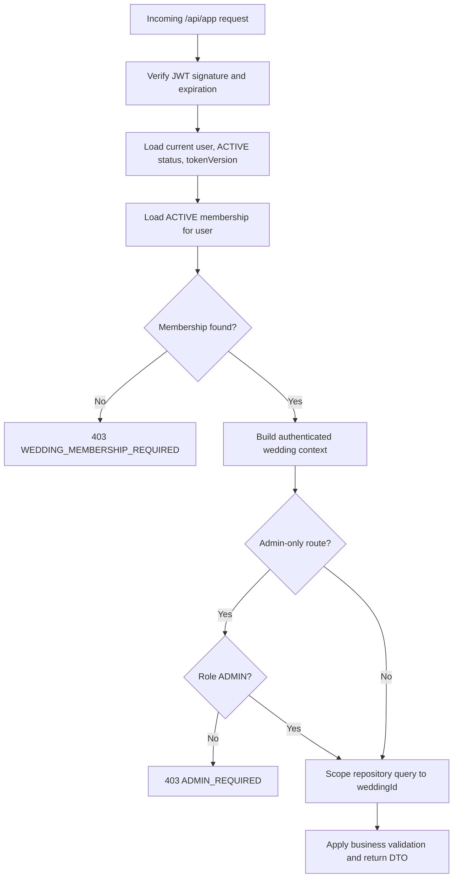
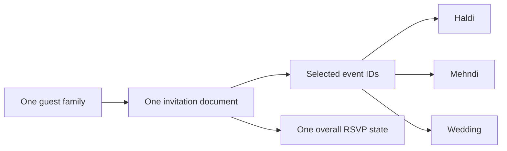
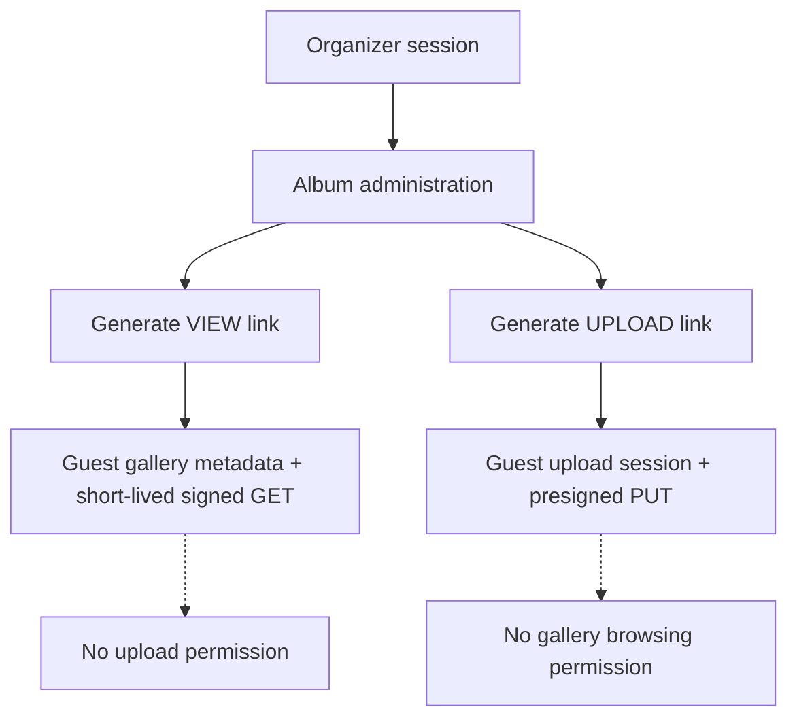
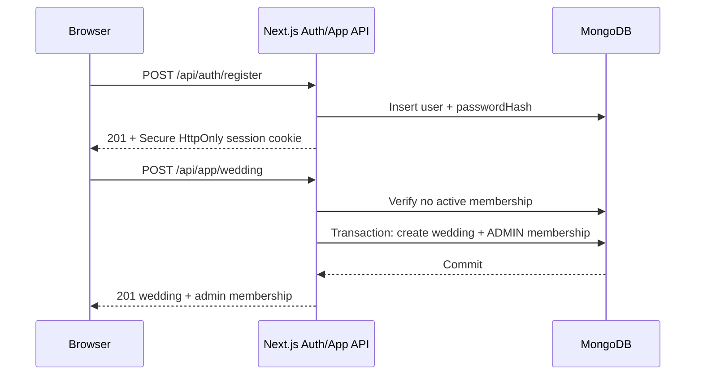
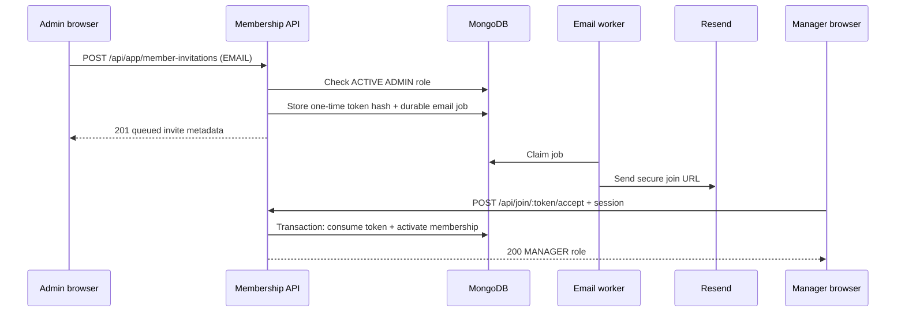
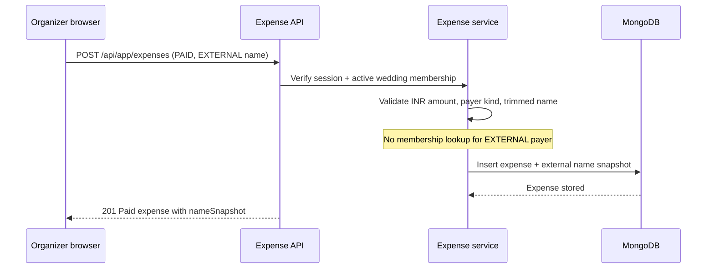
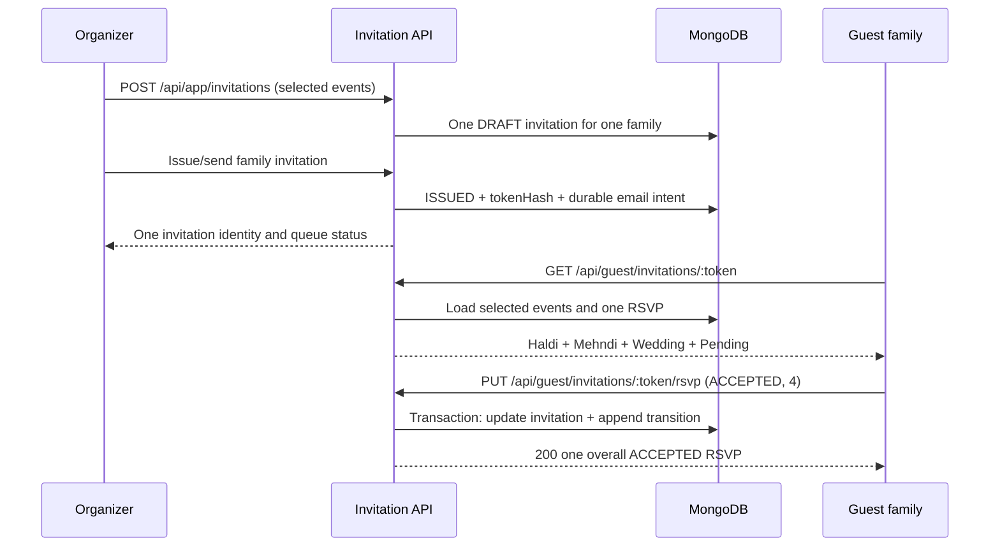
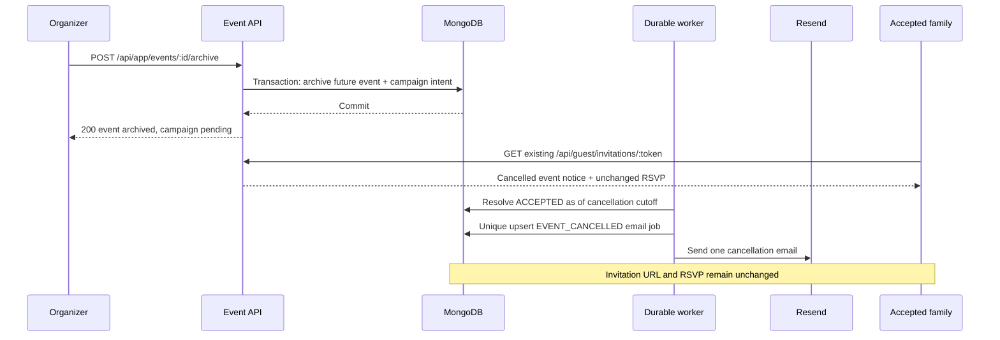

# Make My Marriage (MMM)
## REST API Design & Contract Specification

| Document field | Value |
|---|---|
| Product | **Make My Marriage (MMM)** |
| Version | **1.0 — API Design Baseline** |
| Date | **14 November 2026** |
| Status | **Implementation-ready proposed API contracts; identified decisions remain explicit** |
| API style | REST-like JSON APIs implemented in Next.js App Router Route Handlers |
| Architecture | One Next.js + TypeScript modular monolith, Zod, services/repositories, MongoDB Atlas + Mongoose |
| Security | HttpOnly-cookie JWT for organizers; scoped capability tokens for guests; authenticated internal jobs |
| Primary source documents | **System Design FINAL v1.1**, **Database Design v1.0**, **PRD Aligned v1.1** |
| Readers | Product owner, frontend and backend engineers, QA, reviewers |

> **Contract authority.** This file defines proposed HTTP resource names, DTO shapes, status/error codes, and orchestration. Confirmed product requirements come from PRD v1.1; architecture constraints come from System Design v1.1; persistence invariants from Database Design v1.0. No user-facing product scope is added by this API specification. **Examples use human-readable illustrative IDs; actual MongoDB IDs are 24-character ObjectId strings.**
>
> **Most important non-negotiable invariants:** One active wedding association per registered user; only Admin can manage organizer membership; a family has **one invitation with selected events and one overall RSVP**; event cancellation preserves invitation URL and RSVP; paid expenses accept `ORGANIZER` **or** manual `EXTERNAL` payer; private gallery VIEW and UPLOAD capabilities are separate; no payment gateway, guest login, or per-event RSVP.

---

# Contents

1. Purpose, scope and contract stability
2. API surface and naming conventions
3. Authentication, authorization and capability matrix
4. Shared request, response and error contracts
5. Cross-cutting validation, pagination and concurrency
6. Auth and account APIs
7. Wedding, dashboard and calendar APIs
8. Membership and organizer-invitation APIs
9. Event APIs and cancellation behavior
10. Task APIs
11. Expense ledger APIs
12. Guest-family, invitation and RSVP APIs
13. Vendor-record and discovery APIs
14. Public wedding website APIs
15. Album, photo, guest-gallery and R2-upload APIs
16. Internal email/cancellation-job APIs
17. Sequence diagrams for critical workflows
18. Security, privacy, throttling and caching
19. Contract test matrix and implementation milestones
20. Open decisions and consistency checklist
21. Contract traceability and glossary

---

# 1. Purpose, scope and contract stability

## 1.1 What this document specifies

This design tells frontend and backend developers **how clients interact with MMM services**, independent of the internal React/Mongoose implementation. It defines routes, request payloads, response projections, HTTP status and stable error codes, authorization, idempotency, and rules spanning multiple collections.

The API boundary is **not** a set of independently deployed microservices. Next.js Route Handlers call small domain services, and those services call data repositories. All write rules remain server-authoritative.

## 1.2 Included modules

Authentication and recovery; wedding setup; organizer joining/membership; dashboard; multi-event planner; tasks; expense ledger; family directory; family invitation, RSVP and reminders; vendor records and Google Places proxy; public wedding site; album management; account-free photo uploads and private gallery; calendar; durable email/cancellation background processing.

## 1.3 Exclusions

Multiple simultaneously active weddings per user; organizer sub-roles beyond Admin/Manager; guest/vendor accounts; per-event RSVP; payment or budget APIs; split/partial payment; paid products/subscriptions; calendar synchronization; in-app notification system; realtime collaboration; public audit history; manual photo-approval queue; complex vendor booking or vendor payment systems.

## 1.4 Stability and evolution

- HTTP routes, field names and response DTOs here form the proposed **v1 contract**. Final OpenAPI schemas can be generated from the same Zod definitions, rather than hand-maintained contradictory schemas.
- Prefix is `/api` (not `/api/v1`) to match the approved system architecture. Introduce a coordinated version prefix only when a breaking public contract is required.
- The **module route inventory** is proposed implementation detail; business rules above are already confirmed.
- Avoid `any`-shaped metadata payloads and unrestricted `PATCH` merges; update only documented fields.
- Unless otherwise specified, JSON timestamps are ISO-8601 strings in UTC; internal storage is MongoDB Date.

# 2. API surface and naming conventions

## 2.1 Routing map

| API surface | Root | Caller | Mechanism |
|---|---|---|---|
| Auth | `/api/auth/*` | Browser | Public for signup/login/recovery; cookie for account read/logout |
| Organizer application | `/api/app/*` | Logged-in Admin/Manager | HttpOnly session cookie + fresh active membership lookup |
| Membership joining | `/api/join/:token/*` | Registered, logged-in invitee | Session cookie **and** one-time manager invite token |
| Guest invitations/RSVP | `/api/guest/invitations/:token/*` | Account-free family representative | Valid invitation capability token |
| Guest photo upload | `/api/guest/uploads/:token/*` | Account-free uploader | Valid `UPLOAD` capability token |
| Guest private gallery | `/api/guest/galleries/:token/*` | Account-free viewer | Valid `VIEW` capability token |
| Public wedding website | `/api/public/weddings/:slug` | Anyone | Public, strict projection, no guest/organizer data |
| Internal jobs | `/api/internal/jobs/*` | Trusted worker/scheduler only | Dedicated service credential, never browser-auth |
| Object storage | R2 presigned HTTPS PUT/GET | Browser | Short-lived, tightly scoped URL returned by server |

**Page routes are distinct:** `/w/:slug`, `/invite/:token`, `/gallery/:token`, `/upload/:token`, `/join/:token`, and `/app/*` are user-facing Next.js pages, not API resources. The API deliberately uses explicit `/api/...` prefixes.

## 2.2 HTTP conventions

| Action | Method | Normal response |
|---|---|---|
| Read one | `GET /resource/:id` | `200` |
| Read list | `GET /resources` | `200` + cursor/summary metadata |
| Create | `POST /resources` | `201` + resource + optional `Location` |
| Partially change | `PATCH /resources/:id` | `200` + updated resource |
| Set single RSVP | `PUT /.../rsvp` | `200` + current RSVP; retry-safe if identical |
| Remove/soft delete | `DELETE /resources/:id` | `204`, unless the endpoint documents another outcome |
| Explicit domain action | `POST /.../:id/archive`, `/send`, `/issue`, `/revoke` | `200`, `202` or `204` per specific action |

- Accept header: `application/json`; request JSON `Content-Type: application/json` except direct R2 uploads.
- Singular resource where there is one current wedding per account: `/api/app/wedding`; plural collections elsewhere.
- External clients never send a trusted `weddingId` to establish authorization; server derives it from current active membership or a validated token.
- Use `ObjectId` validation for IDs, URL-safe slug validation, and strict DTO allowlists.
- Use `snake_case` for path labels only where readable; JSON properties and query fields use `camelCase`.
- Error and success metadata include a server-issued `requestId`; frontend can display/copy it for support without revealing secrets.

## 2.3 Internal code separation

```text
app/api/<surface>/.../route.ts     # HTTP parsing, auth context, response mapping
src/modules/<domain>/*.service.ts  # cross-document business rules
src/modules/<domain>/*.repo.ts     # MongoDB queries, scope and projection
src/contracts/<domain>.schema.ts   # Zod input, output DTOs
src/security/*                      # session, capability grants, CSRF, rate limiting
src/jobs/*                          # durable worker claims, retries, provider adapters
```

Handlers must not make unrestricted direct Mongoose calls or trust the UI to apply business rules. A module can call another module's published service contract; it should not mutate another module's collections ad hoc.

# 3. Authentication, authorization and capability matrix

## 3.1 Identity types (do not conflate)

1. **Registered user account:** `users` record; signed JWT cookie; may or may not currently have a wedding membership.
2. **Active organizer:** active `memberships` record for a wedding, role `ADMIN` or `MANAGER`; both have access to ordinary wedding modules.
3. **Admin organizer:** active Admin membership; additionally manages organizers.
4. **Guest invitation capability:** unexpired, unrevoked family invitation token; permits only that family's invitation view and RSVP.
5. **Guest photo `VIEW` or `UPLOAD` capability:** separate token restricted to its album and purpose.
6. **Internal worker principal:** protected machine credential; cannot be impersonated by JWT or guest link.

A manual **external expense payer** is only a name on a ledger entry. It is **not** an identity, an account, or a permission principal.

## 3.2 Role matrix

| Operation | Unauthenticated | Auth user, no membership | Manager | Admin | Guest link |
|---|:---:|:---:|:---:|:---:|:---:|
| Register/login/recover | Yes | Yes | Yes | Yes | N/A |
| Create initial wedding | No | **Yes** | No* | No* | No |
| Read/edit wedding, events, tasks, expenses, guests, vendors, album metadata | No | No | Yes | Yes | No |
| Manage manager invites, role changes, member removal | No | No | No | **Yes** | No |
| View/respond to family invitation | No | No | No | No | **Invitation token** |
| Guest photo upload/view | No | No | No | No | **Matching photo token** |
| Public wedding site | Yes | Yes | Yes | Yes | Yes |
| Call internal jobs | No | No | No | No | No |

*Current active-membership check protects the one-wedding-at-a-time rule. Past removed records do not grant access. Registered users without active membership may join through a valid one-time manager invite or create an initial wedding as permitted by product policy.

## 3.3 Authorization sequence for organizer API



The wedding-creation exception verifies **an authenticated user with no current active membership** and creates a wedding plus initial Admin membership atomically.

## 3.4 Access boundary details

- `401` = absent/invalid/expired authentication; `403` = authenticated but lacking required membership/role.
- `404` can intentionally hide nonexistent **or other-tenant** resource identifiers.
- Read membership from MongoDB on **each protected request**, rather than trusting a stale `role` claim in a JWT. A removed organizer immediately loses access.
- Only Admin may create, revoke, promote, demote or remove organizer invitations/members; guard the last active Admin in a transaction.
- For all related references (event, vendor, organizer, album), validate that they belong to the **same authenticated wedding** and satisfy relevant active/archived restrictions.

# 4. Shared request, response and error contracts

## 4.1 Successful body envelope

For normal JSON requests:

```json
{
  "data": {
    "id": "507f191e810c19729de860ea",
    "title": "Sangeet"
  },
  "meta": { "requestId": "req_01JABCD" }
}
```

List response:

```json
{
  "data": [
    { "id": "507f191e810c19729de860ea", "title": "Sangeet" }
  ],
  "meta": {
    "requestId": "req_01JABCE",
    "pageSize": 20,
    "nextCursor": null,
    "hasMore": false
  }
}
```

Business operation accepted for background work:

```json
{
  "data": {
    "operationId": "507f191e810c19729de860eb",
    "status": "PENDING",
    "message": "Cancellation notices have been queued."
  },
  "meta": { "requestId": "req_01JABCF" }
}
```

Responses with HTTP `204` have **no JSON body**. Do not fake an envelope for them.

## 4.2 Standard error shape

```json
{
  "error": {
    "code": "VALIDATION_ERROR",
    "message": "Please correct the highlighted fields.",
    "details": [
      { "path": "amountMinor", "issue": "Must be a positive integer in paise" }
    ]
  },
  "meta": { "requestId": "req_01JABCG" }
}
```

Errors must not reveal MongoDB stack traces, provider credentials, raw invitation tokens or whether a given email is a registered account.

## 4.3 Recommended status-code mapping

| Status | Usage | Examples |
|---|---|---|
| `200 OK` | Read/update/action completed | RSVP read/write, PATCH, manual token revoke |
| `201 Created` | Persisted new resource | Event, expense, family, album, membership invite |
| `202 Accepted` | Durable work accepted but may run asynchronously | Email send/reminder, R2 photo processing, future cancellation email campaign |
| `204 No Content` | Successful delete/archive acknowledgment where no details needed | Delete task, revoke/remove supported resource |
| `400 Bad Request` | Invalid JSON/schema/parameters | Bad dates, noninteger money, malformed ObjectId |
| `401 Unauthorized` | Organizer session missing/invalid | Expired JWT |
| `403 Forbidden` | Membership/role/capability lacks access | Manager tries to invite managers; wrong-purpose link |
| `404 Not Found` | Resource missing or outside authorized wedding | Expense ID in another wedding |
| `409 Conflict` | State/uniqueness rule violated | Last Admin, already-consumed invite, invalid state transition |
| `410 Gone` | Expired/revoked link when safe to disclose | Guest photo/invitation link expired |
| `413 Payload Too Large` | Oversized upload or declared file | Exceeds chosen 20 MiB file limit |
| `415 Unsupported Media Type` | Unsupported image format | SVG or executable submitted as photo |
| `422 Unprocessable Content` | Parsed input contradicts domain invariant | Accepted headcount exceeds invitedCount; paid without payer |
| `429 Too Many Requests` | Throttled | Login/RSVP/upload/vendor discovery |
| `502 Bad Gateway` / `503 Service Unavailable` | Provider/outage not user error | Google Places failure; no working upload processor |

Use `Retry-After` header for 429 or planned 503 where possible. **Domain error `code` is more stable than the English error string.**

## 4.4 Named domain error codes

```text
INVALID_CREDENTIALS               PASSWORD_RESET_INVALID
PASSWORD_RESET_EXPIRED            EMAIL_ALREADY_REGISTERED
SESSION_EXPIRED                   WEDDING_MEMBERSHIP_REQUIRED
ONE_WEDDING_LIMIT                 ADMIN_REQUIRED
LAST_ADMIN_REQUIRED               MANAGER_INVITE_USED
MANAGER_INVITE_EXPIRED            MANAGER_INVITE_EMAIL_MISMATCH
RESOURCE_NOT_FOUND               CROSS_WEDDING_REFERENCE
EVENT_ALREADY_ARCHIVED            EVENT_NOT_ACTIVE
INVALID_EVENT_TIME_RANGE          PAYER_REQUIRED
PAYER_NOT_ELIGIBLE                INVALID_EXTERNAL_PAYER_NAME
INVALID_PAYMENT_STATE             INVITATION_NOT_ISSUED
INVITATION_EXPIRED                INVITATION_REVOKED
INVITATION_HAS_NO_ACTIVE_EVENTS   RSVP_ATTENDEE_COUNT_INVALID
RSVP_FAMILY_SIZE_CONFLICT         PHOTO_LINK_EXPIRED
PHOTO_LINK_REVOKED                PHOTO_LINK_PURPOSE_MISMATCH
UPLOAD_TOO_LARGE                  UNSUPPORTED_IMAGE_FORMAT
UPLOAD_SESSION_INVALID            PHOTO_NOT_READY
RATE_LIMITED                      IDEMPOTENCY_KEY_CONFLICT
PROVIDER_UNAVAILABLE              VALIDATION_ERROR
```

Avoid exposing whether a random token is valid to untrusted callers beyond the minimum needed for guest-facing UX; apply equivalent rate limits for all token-validation outcomes.

# 5. Cross-cutting validation, pagination and concurrency

## 5.1 DTO validation

- Zod `.strict()` (or equivalent field allowlisting) rejects unknown properties on writes; server controls IDs, `weddingId`, roles, status transitions, audit timestamps, snapshots and secret hashes.
- Validate ID format, object shape, enums, reasonable string lengths, valid phone/email where applicable and permissible event IDs.
- Monetary values are **integer INR paise** (`amountMinor`, `agreedCostMinor`), never floating-point rupees. Example: ₹25,000 = `2500000`.
- Parse user-entered local event time with an explicit IANA timezone; persist UTC. API accepts an ISO timestamp **with a numeric offset or `Z`** and an IANA `timezone`. Reject ambiguous offset-free values instead of silently assuming server timezone.
- `startAt < endAt` for every event. Compute schedule phase dynamically at read time.
- Human text is treated as plain text, normalized/trimmed and escaped in the frontend. URL/video inputs follow an allowlist.

## 5.2 List querying

Recommended uniform params: `?limit=20&cursor=<opaque>&sort=<allowed-field>&order=asc|desc` plus documented domain-specific filters. Initial `limit` default 20, max 100. Cursor is an opaque server-signed/validated representation of `(sortValue, _id, filters, wedding scope)`; clients **must not** construct it. Sort with `_id` tie-breaker and matching indexes; changing filters invalidates the cursor. Totals are returned separately when required and should not force an expensive scan on every page.

Examples:

```text
GET /api/app/events?lifecycle=ACTIVE&sort=startAt&order=asc&limit=20
GET /api/app/expenses?status=PAID&eventId=<id>&limit=20
GET /api/app/guest-families?rsvpStatus=PENDING&eventId=<id>&limit=25
GET /api/app/photos?albumId=<id>&status=READY&limit=25
```

## 5.3 Concurrency, replay and idempotency

- `GET`, `PUT` identical RSVP, archive, revoke, and deletion paths are retry-safe in **domain outcome**, even when network retries occur.
- Use an `Idempotency-Key` header on money record creation, email-producing actions, upload init/complete and other high-risk POSTs. Generate UUIDs per logical user action, not per retry; bound payload size and key length. Same key + same request returns stored outcome; same key + different payload returns `409 IDEMPOTENCY_KEY_CONFLICT`.
- **Implementation caveat:** Persisted response replay for arbitrary POSTs requires an idempotency store or a natural business uniqueness key. The existing database design provides natural uniqueness for invitation, cancellation jobs and upload session, but does **not** yet define a generic idempotency collection. Treat generic replay storage as a recommended implementation addendum, not a silently existing collection. Until chosen, only claim retry guarantees for routes backed by explicit durable uniqueness.
- Organizer `PATCH` defaults to allowed-field atomic `$set` and last-write-wins. Compound invariants—RSVP counts, payer transitions, role counts—must be checked against current DB state and/or a transaction.
- A conflict on changing multiple fields can return `409`; do not secretly apply invalid partial updates.

## 5.4 Global response and operational headers

- Request `X-Request-Id` may be accepted as a trace hint but server generates/normalizes the authoritative request ID.
- Mutating cookie-auth routes require a real CSRF defense (strict `Origin`/`Referer` verification and/or CSRF token, plus SameSite settings). Do not rely on HttpOnly alone.
- Sensitive `GET` responses set `Cache-Control: private, no-store` and `Referrer-Policy: no-referrer`; do not put bearer tokens into analytics or logs.
- Never return `passwordHash`, `tokenHash`, raw R2 object keys to guest/public consumers, lease fields, internal email payloads or unrelated guest contacts.

## 5.5 TypeScript contract sketch (illustrative Zod)

The same Zod schemas can validate incoming requests and infer types for frontend API clients. **Type validation does not replace** wedding membership checks, linked-document lookups, state transitions or MongoDB indexes.

```typescript
import { z } from "zod";

const objectId = z.string().regex(/^[a-f\d]{24}$/i);

const payerWrite = z.discriminatedUnion("kind", [
  z.object({
    kind: z.literal("ORGANIZER"),
    organizerUserId: objectId,
  }).strict(),
  z.object({
    kind: z.literal("EXTERNAL"),
    name: z.string().trim().min(1).max(120),
  }).strict(),
]);

const expenseBasics = z.object({
  title: z.string().trim().min(1).max(160),
  amountMinor: z.number().int().positive().max(Number.MAX_SAFE_INTEGER),
  currency: z.literal("INR"),
  category: z.string().trim().min(1).max(80),
  eventId: objectId.nullable().optional(),
  vendorId: objectId.nullable().optional(),
});

export const createExpenseSchema = z.discriminatedUnion("status", [
  expenseBasics.extend({
    status: z.literal("UNPAID"),
    payer: z.null(),
  }).strict(),
  expenseBasics.extend({
    status: z.literal("PAID"),
    payer: payerWrite,
  }).strict(),
]);

export const updateRsvpSchema = z.discriminatedUnion("status", [
  z.object({ status: z.literal("ACCEPTED"), attendeeCount: z.number().int().positive() }).strict(),
  z.object({ status: z.literal("DECLINED"), attendeeCount: z.literal(0) }).strict(),
]);
```

**Implementation note:** `eventId`/`vendorId` must be scoped to the authenticated wedding after parsing; `organizerUserId` must be active **only when newly assigning/changing** an organizer payer; an external payer only needs a validated name. The RSVP attendee count must be checked against the matching guest family's current `invitedCount`. These cross-document checks belong in domain services.

---

# 6. Auth and account APIs

> **Auth cookie contract:** A successful login or register issues a server-signed JWT in a `Secure`, `HttpOnly`, `SameSite`-configured cookie on HTTPS. Frontend JavaScript does not read the JWT. After token signature/exp validation, the backend loads the active user and verifies the current `tokenVersion` for every protected request.

## 6.1 Endpoint inventory

| Method | Route | Access | Request summary | Response | Special rules |
|---|---|---|---|---|---|
| `POST` | `/api/auth/register` | Public | `displayName,email,password` | `201` user + session cookie | Unique normalized email |
| `POST` | `/api/auth/login` | Public | `email,password` | `200` user + session cookie | Generic invalid credentials; throttle |
| `POST` | `/api/auth/logout` | Authenticated | Empty body | `204` and clear cookie | Domain-idempotent |
| `GET` | `/api/auth/me` | Authenticated | None | `200` identity + association summary | Works before wedding created |
| `PATCH` | `/api/auth/me` | Authenticated | `displayName` | `200` safe identity | Profile only; no role mutation |
| `POST` | `/api/auth/forgot-password` | Public | `email` | `202` generic acknowledgement | No email enumeration; creates durable mail job |
| `POST` | `/api/auth/reset-password` | Reset token | `token,newPassword` | `200` success, session invalidation | One-time 30-minute token |

## 6.2 Register

`POST /api/auth/register`

```json
{
  "displayName": "Rahul Sharma",
  "email": "rahul@example.com",
  "password": "<strong-user-chosen-password>"
}
```

`201 Created`

```json
{
  "data": {
    "user": { "id": "507f191e810c19729de860e1", "displayName": "Rahul Sharma", "email": "rahul@example.com" },
    "currentWedding": null,
    "nextStep": "CREATE_OR_JOIN_WEDDING"
  },
  "meta": { "requestId": "req_register" }
}
```

Reject duplicate email with `409 EMAIL_ALREADY_REGISTERED` (login/recovery must remain enumeration-safe). Hash passwords using a supported resource-hardened algorithm; establish length/strength policy in Zod/domain logic. A newly registered user is not an organizer before wedding creation/joining.

## 6.3 Login and current user

`POST /api/auth/login`

```json
{ "email": "rahul@example.com", "password": "<password>" }
```

Returns `200` with a safe user projection and current active membership summary if available; sets session cookie. `GET /api/auth/me` returns the same safe identity context and can report `currentWedding: null`. A disabled account or invalid credentials use a generic failure. No JWT, password hash, or membership credentials appear in the JSON.

`PATCH /api/auth/me`: `{ "displayName": "Rahul S." }`. Payer snapshots in historical expenses do **not** change when the display name changes.

## 6.4 Forgot-password and reset

`POST /api/auth/forgot-password`

```json
{ "email": "rahul@example.com" }
```

For both registered and unregistered addresses, return the **same** `202` acknowledgement:

```json
{ "data": { "message": "If an account exists, password reset instructions will be sent." }, "meta": { "requestId": "req_forgot" } }
```

Registered account path: generate a cryptographically random 256-bit token; persist only its hash with a 30-minute expiry; invalidate earlier active reset tokens; transactionally enqueue the Resend password-recovery email. The raw token is used only inside the secure reset link and protected mail payload. Rate limit by IP and normalized-email hash; avoid exposing account existence via timing and provider errors.

`POST /api/auth/reset-password`

```json
{ "token": "<opaque-password-reset-token>", "newPassword": "<new-strong-password>" }
```

- Atomically verify token hash, not expired/consumed/superseded; set a new password hash; consume the token; increment `users.tokenVersion` in one transaction.
- Old JWT cookies become invalid on subsequent requests; clients return to login. No auto-login is promised.
- Expired or previously consumed token returns safe `400/409/410` with `PASSWORD_RESET_INVALID` or `PASSWORD_RESET_EXPIRED` as appropriate; never accept a reset token a second time.

# 7. Wedding, dashboard and calendar APIs

## 7.1 Endpoint inventory

| Method | Route | Access | Behavior |
|---|---|---|---|
| `POST` | `/api/app/wedding` | Authenticated **without current active wedding membership** | Create wedding and creator Admin membership atomically |
| `GET` | `/api/app/wedding` | Organizer | Get current wedding and website settings |
| `PATCH` | `/api/app/wedding` | Organizer | Edit title, couple, date range, timezone, default venue, website settings |
| `GET` | `/api/app/me` | Organizer | User + role + active wedding context; convenient client bootstrap |
| `GET` | `/api/app/dashboard` | Organizer | Derived counts, summary, upcoming event/task previews |
| `GET` | `/api/app/calendar?from=&to=` | Organizer | Combined events and task deadlines in bounded range |

## 7.2 Create wedding

`POST /api/app/wedding`

```json
{
  "slug": "rahul-priya-2027",
  "title": "Rahul & Priya's Wedding",
  "couple": { "person1Name": "Rahul", "person2Name": "Priya" },
  "dateRange": {
    "startAt": "2027-02-10T03:30:00.000Z",
    "endAt": "2027-02-14T18:30:00.000Z"
  },
  "timezone": "Asia/Kolkata",
  "defaultVenue": {
    "name": "Royal Palace",
    "formattedAddress": "Jaipur, Rajasthan, India",
    "city": "Jaipur",
    "country": "India",
    "geo": { "type": "Point", "coordinates": [75.7873, 26.9124] }
  }
}
```

`201 Created`:

```json
{
  "data": {
    "wedding": { "id": "507f191e810c19729de860e2", "slug": "rahul-priya-2027", "title": "Rahul & Priya's Wedding", "timezone": "Asia/Kolkata" },
    "membership": { "role": "ADMIN", "status": "ACTIVE" }
  },
  "meta": { "requestId": "req_wedding_create" }
}
```

- Unique slug (respond `409` on collision); prevent a second active wedding via a partial unique membership index.
- Use MongoDB transaction for wedding + first Admin membership; initialize `activeAdminCount = 1` if that counter design is chosen.
- `createdByUserId` is taken from session, not request JSON.
- Wedding `website` configuration defaults to one supported predefined theme; all public projection fields are allowlisted.

## 7.3 Wedding patch

`PATCH /api/app/wedding`

```json
{
  "title": "Rahul & Priya — The Wedding",
  "website": {
    "themeId": "classic",
    "headline": "Join us for the celebration!",
    "welcomeText": "We cannot wait to see you."
  }
}
```

Patch should merge **documented leaf fields**, not replace an entire `website`/venue object from a partial stale client payload. Slug mutation is **not** a generic patch operation; if ever allowed, it needs a separate redirect/link policy. YouTube stream input is validated to an approved YouTube video ID/URL, never arbitrary iframe HTML. Wedding date and venue updates do not silently modify persisted event venue snapshots.

## 7.4 Dashboard aggregate

`GET /api/app/dashboard`

```json
{
  "data": {
    "wedding": { "id": "507f191e810c19729de860e2", "title": "Rahul & Priya's Wedding" },
    "counts": { "activeEvents": 4, "tasksTodo": 7, "tasksInProgress": 3, "tasksCompleted": 12 },
    "expenses": { "currency": "INR", "totalPaidMinor": 12500000, "totalUnpaidMinor": 20000000 },
    "rsvp": { "pendingFamilies": 20, "acceptedFamilies": 12, "declinedFamilies": 2, "expectedAttendees": 42 },
    "upcomingEvents": [ { "id": "507f191e810c19729de860e3", "title": "Haldi", "startAt": "2027-02-10T03:30:00.000Z", "phase": "UPCOMING", "countdownLabel": "4 days to go" } ]
  },
  "meta": { "requestId": "req_dashboard" }
}
```

All aggregates are derived from wedding-scoped collections. `expectedAttendees` sums family attendee counts from **overall Accepted invitations**, not per-event RSVP documents. Countdown labels are computed using event timezones and current time, and should be refreshed on client/calendar-day boundaries as appropriate. Example labels are **illustrative and dependent on request date**. Do not persist daily countdown labels.

## 7.5 Calendar

`GET /api/app/calendar?from=2027-02-01T00:00:00.000Z&to=2027-03-01T00:00:00.000Z&include=events,tasks`

```json
{
  "data": {
    "timezone": "Asia/Kolkata",
    "items": [
      { "type": "EVENT", "id": "507f191e810c19729de860e3", "title": "Haldi", "startAt": "2027-02-10T03:30:00.000Z", "endAt": "2027-02-10T08:30:00.000Z" },
      { "type": "TASK", "id": "507f191e810c19729de860e4", "title": "Confirm decorators", "dueAt": "2027-02-08T12:30:00.000Z", "status": "TODO" }
    ]
  },
  "meta": { "requestId": "req_calendar" }
}
```

Require `from < to`; cap requested range (recommended three calendar months), exclude soft-deleted tasks/archived events by default, sort by event start/task due date and tenant scope. Calendar is a **derived read**; no separate calendar database collection.

# 8. Membership and organizer-invitation APIs

## 8.1 Endpoint inventory

| Method | Route | Access | Behavior |
|---|---|---|---|
| `GET` | `/api/app/members` | Organizer | Active and optionally removed organizer membership list |
| `GET` | `/api/app/member-invitations` | Admin | Current/past invites, status/recipient without raw token |
| `POST` | `/api/app/member-invitations` | Admin | Generate one-time email-targeted or shareable joining invite |
| `POST` | `/api/app/member-invitations/:id/revoke` | Admin | Revoke unused invite |
| `GET` | `/api/join/:token` | Holder | Minimal wedding/invite info, no admin data |
| `POST` | `/api/join/:token/accept` | Logged-in matching invitee | Consume one-time invite, establish Manager membership |
| `PATCH` | `/api/app/members/:id/role` | Admin | Switch role between ADMIN/MANAGER; last-admin safe |
| `DELETE` | `/api/app/members/:id` | Admin | Mark `REMOVED`, never delete historical organizer references |

## 8.2 Create manager invitation

`POST /api/app/member-invitations`

**Targeted email mode:**

```json
{ "mode": "EMAIL", "email": "priya@example.com", "expiresAt": "2026-11-21T18:29:59.000Z" }
```

**Shareable link mode:**

```json
{ "mode": "LINK", "expiresAt": "2026-11-21T18:29:59.000Z" }
```

- Issue a high-entropy single-use token, hash it in `managerInvites`, and store `targetRole = MANAGER`; Admin promotion is a separate operation.
- For EMAIL, normalized email is binding: logged-in claimant must have matching registered email. Queue a durable `MANAGER_INVITE` email job; do not send inside an uncommitted transaction.
- For LINK, return the **raw joining URL only once** to the authorized Admin for sharing. Do not return token hashes in list endpoints.
- Every invite is **one-time**, even when the URL is shareable. One URL does not let several managers join.
- Recommended TTL is configurable and bounded; sample expiration is illustrative, not an approved default.

`201 Created` for LINK:

```json
{
  "data": {
    "invitationId": "507f191e810c19729de860e5",
    "mode": "LINK",
    "targetRole": "MANAGER",
    "joinUrl": "https://mmm.example/join/<opaque-one-time-token>",
    "expiresAt": "2026-11-21T18:29:59.000Z"
  },
  "meta": { "requestId": "req_manager_invite" }
}
```

`201` for EMAIL returns safe metadata and `emailQueueStatus = 'PENDING'`, **not** proof the recipient read the email. `POST .../:id/revoke` returns `200` with a revocation status, no duplicate side effects on retries.

## 8.3 Accept one-time invitation

`GET /api/join/:token`: optional limited `200` preview, showing wedding name and whether a login is required. Do not expose invited email to arbitrary token holders; return safe generic errors after expiry/revocation.

`POST /api/join/:token/accept` (authenticated session cookie, CSRF protected):

```json
{ "accept": true }
```

Flow:

1. Hash token and load invite; reject expired, consumed, revoked, or email mismatch.
2. Verify account has **no different active wedding membership**; allow rejoining same wedding using existing removed membership record, subject to policy.
3. Within transaction, atomically claim invite and create/reactivate one Manager membership (unique `(weddingId,userId)` and at-most-one-active-wedding constraint).
4. Return `200` with joined wedding and `MANAGER` role. Simultaneous claims cannot both succeed.

Error examples: `409 MANAGER_INVITE_USED`, `410 MANAGER_INVITE_EXPIRED`, `403 MANAGER_INVITE_EMAIL_MISMATCH`, `409 ONE_WEDDING_LIMIT`.

## 8.4 Role changes and removal

`PATCH /api/app/members/:id/role`

```json
{ "role": "ADMIN" }
```

`DELETE /api/app/members/:id` returns `204` when successfully marked removed. All operations enforce:

- Only current active Admin can perform them.
- Cannot demote/remove the **last** Admin; use `weddings.activeAdminCount` compare-and-modify transaction (if chosen) rather than merely counting and later writing.
- Prevent stale self-removal decisions and ensure updated membership affects next request immediately.
- Preserve removed organizer references and snapshots in historical expenses/tasks.
- A Manager cannot promote themself or someone else by editing request role fields outside this route.

# 9. Event APIs and cancellation behavior

## 9.1 Endpoint inventory

| Method | Route | Access | Behavior |
|---|---|---|---|
| `GET` | `/api/app/events` | Organizer | Paginated, wedding-scoped events |
| `POST` | `/api/app/events` | Organizer | Create event |
| `GET` | `/api/app/events/:id` | Organizer | Event detail and safe summary counts |
| `PATCH` | `/api/app/events/:id` | Organizer | Edit documented fields while active |
| `POST` | `/api/app/events/:id/archive` | Organizer | Soft archive; future event triggers cancellation campaign |
| `GET` | `/api/app/events/:id/cancellation` | Organizer | Campaign progress if future event was cancelled |

List options: `?lifecycle=ACTIVE|ARCHIVED&phase=UPCOMING|ONGOING|COMPLETED&sort=startAt&order=asc`. Phase is **computed**, not a persistent event field.

## 9.2 Create/update event

`POST /api/app/events`

```json
{
  "title": "Sangeet",
  "description": "Music, family and dancing",
  "startAt": "2027-02-12T13:30:00.000Z",
  "endAt": "2027-02-12T18:30:00.000Z",
  "timezone": "Asia/Kolkata",
  "venue": {
    "name": "Royal Palace Hall",
    "formattedAddress": "Jaipur, Rajasthan, India",
    "geo": { "type": "Point", "coordinates": [75.7873, 26.9124] }
  }
}
```

`201` returns `id`, owner-wedding-scoped data, `lifecycle: 'ACTIVE'` and a **computed** phase (`UPCOMING`, `ONGOING`, `COMPLETED`); `createdAt`/`updatedAt`. `PATCH` allows title, description, start/end, timezone, venue and cover metadata before archiving. Date/time validation is server-side.

- The event venue is an explicit snapshot. Updating wedding default venue does not rewrite old events.
- Editing an already issued invitation's selected events is **not** part of this endpoint; invitations own their own event selections.
- Archived events remain referenced by tasks, expenses, vendors, invitations and albums. Do not cascade-delete.
- Editing an archived event, particularly its timestamps after cancellation, is disallowed in v1 unless a separate restoration/business workflow is later designed (`409 EVENT_ALREADY_ARCHIVED`).

## 9.3 Archive event (critical cross-module action)

`POST /api/app/events/:id/archive`

```json
{ "reason": "Sangeet cancelled due to schedule change" }
```

**Archive cutoff:** The service reads the event and compares `startAt` to a server/DB-consistent `now` instant at the authoritative transition:

| At archive transition | Event effect | Family invitation read | Email effect |
|---|---|---|---|
| `startAt > now` (future) | `ARCHIVED`, `cancellationId` linked to durable campaign | Same link; show polite `CANCELLED` note to invited families | **One** notice per invitation/family whose whole-invitation RSVP was Accepted at cancellation cutoff |
| `startAt <= now < endAt` (ongoing) | `ARCHIVED` | Preserve historical reference | **No** cancellation email |
| `endAt <= now` (completed) | `ARCHIVED` | Preserve historical reference | **No** cancellation email |
| Already archived | No new transition | Unchanged | **No duplicate** campaign/jobs |

`200 OK` (synchronous archive, queued work status):

```json
{
  "data": {
    "eventId": "507f191e810c19729de860e6",
    "lifecycle": "ARCHIVED",
    "archivedAt": "2027-02-01T12:00:00.000Z",
    "cancellation": {
      "created": true,
      "campaignId": "507f191e810c19729de860e7",
      "status": "PENDING"
    }
  },
  "meta": { "requestId": "req_archive" }
}
```

For ongoing/completed archive, `cancellation` is `null`. If repeated, return the existing archived state and campaign reference without duplicating jobs. A single MongoDB transaction persists the event transition and future-cancellation campaign intent. The email fan-out uses **durable MongoDB jobs**; the HTTP handler must not wait for Resend to complete.

**Non-negotiable invitation behavior:** Do not regenerate family invitation URL, remove the archived event ID from `invitedEventIds`, reset RSVP, re-request acceptance, or change accepted attendee count. Public wedding page hides archived event; token-protected family invitation can still show it with a cancellation notice.

**Recipient-cutoff concurrency requirement:** Use the authoritative solution selected in the Database Design's §7.5 (e.g., a correctly ordered, durable acceptance snapshot or a serializable cutoff protocol) before claiming exact *accepted at cancellation* recipients. An append-only `rsvpTransitions.recordedAt` comparison **alone is not sufficient** to prove transaction commit order under races. Keep this as a release-gating implementation decision, not a hidden guarantee.

## 9.4 Cancellation status

`GET /api/app/events/:id/cancellation`: `200` with campaign status (`PENDING/PROCESSING/COMPLETE/FAILED`), enqueued count, accepted-message count when available, error-safe summary. It is a **worker status**, not guaranteed inbox delivery. For non-future archive, return `{ "data": { "cancellation": null } }`. No guest or public endpoint exposes campaign internals.

# 10. Task APIs

## 10.1 Endpoint inventory

| Method | Route | Access | Behavior |
|---|---|---|---|
| `GET` | `/api/app/tasks` | Organizer | List/filter tasks by event/status/assignee/due dates |
| `POST` | `/api/app/tasks` | Organizer | Create task |
| `GET` | `/api/app/tasks/:id` | Organizer | Task detail |
| `PATCH` | `/api/app/tasks/:id` | Organizer | Edit status, priority, assignee, event, due date, title |
| `DELETE` | `/api/app/tasks/:id` | Organizer | Soft-delete or remove according to chosen persistence policy |

## 10.2 Create task

`POST /api/app/tasks`

```json
{
  "title": "Confirm decorators",
  "description": "Check the final setup",
  "eventId": "507f191e810c19729de860e6",
  "status": "TODO",
  "priority": "HIGH",
  "dueAt": "2027-02-08T12:30:00.000Z",
  "assignedToUserId": "507f191e810c19729de860e1"
}
```

- `eventId` can be `null`, otherwise must belong to same wedding and be active **at time of new assignment**.
- `assignedToUserId` can be `null`, otherwise an active organizer of same wedding **at assignment time**.
- Persist `assigneeNameSnapshot` server-side. Existing tasks remain readable if assignee later removed; unrelated edits do not re-check historical assignee eligibility.
- Status enum exactly `TODO`, `IN_PROGRESS`, `COMPLETED`; priority recommended `LOW`, `MEDIUM`, `HIGH`.

`PATCH /api/app/tasks/:id` example: `{ "status": "IN_PROGRESS" }`. Do not overwrite unrelated fields. `DELETE` returns `204`, and the task no longer appears in default list/calendar. Data lifecycle follows the Database Design's chosen soft-delete policy.

# 11. Expense ledger APIs

## 11.1 Endpoint inventory

| Method | Route | Access | Behavior |
|---|---|---|---|
| `GET` | `/api/app/expenses` | Organizer | Paginated expense ledger; filter status/category/event/vendor/payer |
| `POST` | `/api/app/expenses` | Organizer | Create expense with valid Paid/Unpaid state |
| `GET` | `/api/app/expenses/summary` | Organizer | `totalPaidMinor`, `totalUnpaidMinor`, overall total; optional event filter |
| `GET` | `/api/app/expenses/:id` | Organizer | Expense detail |
| `PATCH` | `/api/app/expenses/:id` | Organizer | Update ledger fields and/or payment state |
| `DELETE` | `/api/app/expenses/:id` | Organizer | Remove/soft-delete, excluded from totals |

**The route `/summary` is registered ahead of dynamic `/:id` in the route model.** Real Next.js folder segments distinguish static/dynamic paths; enforce ID validation in dynamic handler.

## 11.2 Payer semantics (confirmed)

A person **recording** an expense must be a signed-in organizer; a person **who paid** may be an organizer or an external nonmember. The payer is one embedded **discriminated union**, never three different stored types:

```ts
type ExpensePayerWrite =
  | { kind: 'ORGANIZER'; organizerUserId: string }
  | { kind: 'EXTERNAL'; name: string };

type ExpensePayerRead =
  | { kind: 'ORGANIZER'; organizerUserId: string; nameSnapshot: string }
  | { kind: 'EXTERNAL'; organizerUserId: null; nameSnapshot: string };

type PaymentStateRead =
  | { status: 'UNPAID'; payer: null; paidAt: null }
  | { status: 'PAID'; payer: ExpensePayerRead; paidAt: string | null };
```

UI choices map to storage as follows:

| UI choice | Write payload | Service rule |
|---|---|---|
| **I paid** | `payer.kind='ORGANIZER', organizerUserId=<current user ID>` | Must be currently active organizer; name snapshot server-generated |
| **Select organizer** | `payer.kind='ORGANIZER', organizerUserId=<selected user ID>` | Selected user must be active member of this wedding at assignment |
| **Someone else** | `payer.kind='EXTERNAL', name='<manual name>'` | Trim and validate name; **no membership lookup** |

No external payer is created as a `user`; payer name is not a principal; name snapshot preserves historic attribution.

## 11.3 Create UNPAID expense

`POST /api/app/expenses`

```json
{
  "title": "Catering",
  "description": "Dinner service",
  "category": "FOOD",
  "amountMinor": 20000000,
  "currency": "INR",
  "eventId": "507f191e810c19729de860e6",
  "vendorId": null,
  "status": "UNPAID",
  "payer": null,
  "paidAt": null
}
```

- `amountMinor` > 0, safe positive integer; `currency` must equal `INR` in v1.
- No payer on Unpaid records; server normalizes state to `payer: null`, `paidAt: null`.
- `vendorId` and `eventId` are optional tenant-scoped references. Archiving a linked vendor or event must not delete historical expense or change its amount.

## 11.4 Create PAID expense — organizer payer

```http
POST /api/app/expenses
Content-Type: application/json
Idempotency-Key: 7d293ba5-903e-4f92-ab32-853d4dd4171a
```

```json
{
  "title": "Photography",
  "amountMinor": 5000000,
  "currency": "INR",
  "category": "PHOTOGRAPHY",
  "status": "PAID",
  "payer": { "kind": "ORGANIZER", "organizerUserId": "507f191e810c19729de860e1" }
}
```

`201 Created`:

```json
{
  "data": {
    "id": "507f191e810c19729de860e8",
    "title": "Photography",
    "amountMinor": 5000000,
    "currency": "INR",
    "status": "PAID",
    "payer": {
      "kind": "ORGANIZER",
      "organizerUserId": "507f191e810c19729de860e1",
      "nameSnapshot": "Rahul Sharma"
    },
    "paidAt": "2026-11-14T09:00:00.000Z"
  },
  "meta": { "requestId": "req_expense_paid" }
}
```

Server finds active membership for payer `organizerUserId` in this wedding. `nameSnapshot` is always server-generated, never accepted from this write payload. `paidAt` can be server-stamped on marking Paid; optional historic date policy must be explicitly documented before allowing caller-provided `paidAt`.

## 11.5 Create PAID expense — manual EXTERNAL payer

```json
{
  "title": "Wedding decoration",
  "amountMinor": 2500000,
  "currency": "INR",
  "category": "DECORATION",
  "status": "PAID",
  "payer": { "kind": "EXTERNAL", "name": "Rajesh Sharma" }
}
```

`201` expense read DTO:

```json
{
  "data": {
    "id": "507f191e810c19729de860e9",
    "title": "Wedding decoration",
    "amountMinor": 2500000,
    "currency": "INR",
    "status": "PAID",
    "payer": { "kind": "EXTERNAL", "organizerUserId": null, "nameSnapshot": "Rajesh Sharma" },
    "paidAt": "2026-11-14T09:00:00.000Z"
  },
  "meta": { "requestId": "req_expense_external" }
}
```

An outside payer name is **not** validated against memberships, and never receives a login invitation or access to the wedding.

## 11.6 Patch/payment transition matrix

| Current → requested | Required request | New stored state | Validation |
|---|---|---|---|
| `UNPAID → PAID` | `status='PAID'`, `payer` choice | `PAID`, valid payer and `paidAt` | Validate chosen payer |
| `PAID → UNPAID` | `status='UNPAID'` | `UNPAID`, payer null, paidAt null | Clear payer/date |
| `PAID → PAID` changing payer | `payer` choice | `PAID`, replace payer snapshot | Validate new payer |
| `PAID → PAID` editing title/category | No payer field | Preserve existing payer verbatim | **Do not re-check removed historical member** |
| `UNPAID → UNPAID` editing other fields | No payer | Keep null payer | Reject attempts to set payer while unpaid |

Example `PATCH /api/app/expenses/:id`: `{ "status": "PAID", "payer": { "kind": "EXTERNAL", "name": "Uncle Vijay" } }`.

If request supplies contradictory `status`/`payer` fields, return `422 INVALID_PAYMENT_STATE` or `PAYER_REQUIRED`; an empty external name returns `422 INVALID_EXTERNAL_PAYER_NAME`; a cross-wedding/inactive organizer payer returns `422 PAYER_NOT_ELIGIBLE` (do not reveal user data).

## 11.7 Expense summaries and reporting

`GET /api/app/expenses/summary?eventId=<optional-id>`

```json
{
  "data": {
    "currency": "INR",
    "totalPaidMinor": 12500000,
    "totalUnpaidMinor": 20000000,
    "grandTotalMinor": 32500000,
    "paidCount": 2,
    "unpaidCount": 1
  },
  "meta": { "requestId": "req_expense_summary" }
}
```

- Aggregate only current, non-deleted expense records within the authenticated wedding.
- A vendor's `agreedCostMinor` is **not** a ledger expense and must not appear in sums.
- `PAID` counts the **entire expense amount once**, never an installment.
- Display source name snapshot for both payer kinds; historical payer survives membership removal.

# 12. Guest-family, invitation and RSVP APIs

## 12.1 Resource model to remember



**One family → one invitation → multiple selected events → one Yes/No RSVP.** The invitation—not the guest family, event, or `rsvpTransitions`—owns `invitedEventIds`, `rsvpStatus`, `attendeeCount` and `rsvpRevision`. Guests never have registered accounts. The family can exist without any invitation; a draft invitation can exist without a token; an issued invitation has a link.

## 12.2 Endpoint inventory

| Method | Route | Caller | Purpose |
|---|---|---|---|
| `GET` | `/api/app/guest-families` | Organizer | Family list with invited-event/RSVP filters |
| `POST` | `/api/app/guest-families` | Organizer | Create contact/family |
| `GET` | `/api/app/guest-families/:id` | Organizer | Family detail with invitation summary |
| `PATCH` | `/api/app/guest-families/:id` | Organizer | Edit contact/count/notes |
| `DELETE` | `/api/app/guest-families/:id` | Organizer | Remove/soft-delete according to invitation lifecycle |
| `GET` | `/api/app/invitations` | Organizer | List invitation draft/issued + RSVP summaries |
| `POST` | `/api/app/invitations` | Organizer | Create **one** draft for selected family |
| `GET` | `/api/app/invitations/:id` | Organizer | Detail (no token hash/raw secret) |
| `PATCH` | `/api/app/invitations/:id` | Organizer | Edit draft event selection/design/expiry policy |
| `POST` | `/api/app/invitations/:id/issue` | Organizer | Issue invitation link, or deliberate explicit rotation |
| `POST` | `/api/app/invitations/:id/send` | Organizer | Queue email to same family; no new RSVP record |
| `POST` | `/api/app/invitations/remind-pending` | Organizer | Queue pending-family reminder emails |
| `GET` | `/api/guest/invitations/:token` | Holder of family invitation link | Read selected events and current overall RSVP |
| `PUT` | `/api/guest/invitations/:token/rsvp` | Holder of family invitation link | Change **one overall** RSVP |

The DB's one-current-invitation-per-family uniqueness must be enforced by a unique index, not by a frontend count. To keep a strict one-invitation model for v1, do not create per-event invitation records or append duplicate current invitations.

## 12.3 Family directory CRUD

`POST /api/app/guest-families`

```json
{
  "familyLabel": "Sharma Family",
  "primaryContactName": "Rajesh Sharma",
  "email": "rajesh@example.com",
  "phone": "+919876543210",
  "invitedCount": 4,
  "notes": "Traveling from Delhi"
}
```

`201` safe family DTO:

```json
{
  "data": {
    "id": "507f191e810c19729de860fa",
    "familyLabel": "Sharma Family",
    "primaryContactName": "Rajesh Sharma",
    "email": "rajesh@example.com",
    "phone": "+919876543210",
    "invitedCount": 4,
    "invitation": null
  },
  "meta": { "requestId": "req_family_create" }
}
```

- Contact email may be absent when initially creating family, but is **required before sending an invitation email** (manual share can work independently when a link is issued).
- Family emails are **not globally unique**; separate families may share an inbox.
- Updating `invitedCount` to less than the current Accepted RSVP `attendeeCount` is rejected (`409 RSVP_FAMILY_SIZE_CONFLICT`) unless a compatible RSVP update occurs under an explicitly designed atomic workflow. Do not silently truncate attendee count.
- Removing a family with an existing issued invitation/history must preserve RSVP and references under the chosen soft-delete/revocation policy. Avoid hard-deleting if it would create dangling invitation links.
- Family notes are organizer-only and never returned from guest/public projections.

List filters: `?search=sharma&rsvpStatus=ACCEPTED&eventId=<id>&limit=20`, with invitation join scoped to same wedding. Event-wise headcounts are **derived** by intersecting invitation selected events with event IDs, using the same overall RSVP attendee count, not separate RSVP records.

## 12.4 Create draft invitation with selected events

`POST /api/app/invitations`

```json
{
  "guestFamilyId": "507f191e810c19729de860fa",
  "invitedEventIds": [
    "507f191e810c19729de860f1",
    "507f191e810c19729de860f2",
    "507f191e810c19729de860f3"
  ],
  "designId": "floral"
}
```

`201`:

```json
{
  "data": {
    "id": "507f191e810c19729de860fb",
    "guestFamilyId": "507f191e810c19729de860fa",
    "invitedEventIds": [
      "507f191e810c19729de860f1",
      "507f191e810c19729de860f2",
      "507f191e810c19729de860f3"
    ],
    "designId": "floral",
    "issuanceStatus": "DRAFT",
    "rsvpStatus": "PENDING",
    "attendeeCount": 0
  },
  "meta": { "requestId": "req_invite_draft" }
}
```

Rules:

- `guestFamilyId` belongs to this wedding and isn't removed; `invitedEventIds` is a nonempty **deduplicated** array of active, same-wedding event IDs.
- Do not duplicate selected event IDs onto the family record. Use the invitation as source of truth.
- Duplicate draft creation for an existing family's invitation returns `409` (or a stable retrieval outcome if an explicit idempotency key matches); clients should use `PATCH` on the existing draft.
- The family receives no account, token, RSVP prompt or email merely because a draft was created.
- `PATCH /api/app/invitations/:id` may edit `invitedEventIds`, design and expiry settings while `DRAFT`. **Post-issuance changes to selected events are a separate open product decision**; do not secretly modify them under a generic PATCH once guests have responded.

## 12.5 Issue one family link

`POST /api/app/invitations/:id/issue`

```json
{ "expiresAt": "2027-03-01T18:30:00.000Z" }
```

On first issue:

1. Validate nonempty selected active-event set and ownership.
2. Generate unpredictable 256-bit random bearer token.
3. Store only `tokenHash` in `invitations`, set `issuanceStatus='ISSUED'`, expiry and version.
4. Return `201/200` with the URL **once** to authorized organizer, or place it directly into a securely encrypted outbound email job when issuing and emailing as one operation.

```json
{
  "data": {
    "invitationId": "507f191e810c19729de860fb",
    "issuanceStatus": "ISSUED",
    "shareUrl": "https://mmm.example/invite/<opaque-family-token>",
    "expiresAt": "2027-03-01T18:30:00.000Z"
  },
  "meta": { "requestId": "req_issue" }
}
```

**Important consistency rule:** Issuing a link, resending, manually sharing and cancelling an event all use the **same logical invitation**. **Cancellation never rotates the link.** An explicit token-rotation workflow, if adopted, is a separate security action (e.g. after link compromise), preserves RSVP, and invalidates the previous token **only when the organizer intentionally requests rotation**. Its exact route is deferred; do not accidentally rotate on resend.

## 12.6 Email send and resend — token recoverability constraint

`POST /api/app/invitations/:id/send`

```json
{ "deliveryChannel": "EMAIL" }
```

`202`:

```json
{
  "data": {
    "invitationId": "507f191e810c19729de860fb",
    "emailQueueStatus": "PENDING",
    "jobId": "507f191e810c19729de860fc"
  },
  "meta": { "requestId": "req_invite_email" }
}
```

- Email goes to family's stored, validated primary email. Send uses Resend through a **durable `emailJobs`** record; accepted queue submission does not prove delivery.
- A retry of the **same email action** uses the same idempotency key, avoiding duplicate jobs. A deliberate later **resend** is a new authorized action and may enqueue a new job with a new business-operation key.
- **Critical unresolved secret-lifecycle detail:** `tokenHash` alone cannot reconstruct the original invite URL. A reliable manual resend of the **same URL** therefore requires either (A) retaining a narrowly authorized, encrypted recoverable dispatch payload/ref for the issued URL for its active lifetime, or (B) requiring an **explicit** token rotation before a new URL can be sent. The DB already allows encrypted `emailJobs.payloadCiphertext` / `payloadRef`; if option A uses that store, its lifecycle and encryption key access must be formalized. **Do not silently rotate on `/send`, do not store plaintext bearer tokens in MongoDB, and do not pretend a hash is reversible.**
- If issuing+emailing together, create the issued invitation and encrypted email job atomically. If an issued URL cannot be recovered and no explicit new issuance is permitted, return `409 INVITATION_LINK_UNAVAILABLE` rather than sending a broken link.
- WhatsApp sharing is a **manual client share action** using the valid generated URL; MMM doesn't directly send WhatsApp messages or expose a WhatsApp messaging backend.

## 12.7 Read invitation by guest token

`GET /api/guest/invitations/:token` requires an active, unrevoked, unexpired invitation capability. No login required. `200` sample:

```json
{
  "data": {
    "wedding": { "title": "Rahul & Priya's Wedding", "couple": { "person1Name": "Rahul", "person2Name": "Priya" } },
    "recipient": { "familyLabel": "Sharma Family", "invitedCount": 4 },
    "invitation": {
      "designId": "floral",
      "rsvpStatus": "ACCEPTED",
      "attendeeCount": 4,
      "canRespond": true,
      "events": [
        { "id": "507f191e810c19729de860f1", "title": "Haldi", "displayStatus": "ACTIVE", "startAt": "2027-02-10T03:30:00.000Z" },
        { "id": "507f191e810c19729de860f2", "title": "Sangeet", "displayStatus": "CANCELLED", "cancellationNotice": "This celebration has been cancelled. We apologize for the change." },
        { "id": "507f191e810c19729de860f3", "title": "Wedding", "displayStatus": "ACTIVE", "startAt": "2027-02-14T03:30:00.000Z" }
      ]
    }
  },
  "meta": { "requestId": "req_guest_invitation" }
}
```

**Projection rules:** show only **this family's selected events**, not every wedding event; an archived future selected event appears as `CANCELLED` with polite notice; do not leak organizer contact directory, family email, internal cancellation campaign, token hash, or other family RSVPs. If all selected events have become ineligible for further response, `canRespond=false` while existing RSVP remains visible. Public `/w/:slug` is different: it shows **all non-archived events**, not selected-event filtering.

## 12.8 Submit/update exactly one overall RSVP

`PUT /api/guest/invitations/:token/rsvp`

**Yes, four attendees:**

```json
{ "status": "ACCEPTED", "attendeeCount": 4 }
```

**No:**

```json
{ "status": "DECLINED", "attendeeCount": 0 }
```

`200`:

```json
{
  "data": {
    "rsvpStatus": "ACCEPTED",
    "attendeeCount": 4,
    "rsvpRevision": 2,
    "updatedAt": "2027-01-28T13:00:00.000Z"
  },
  "meta": { "requestId": "req_rsvp" }
}
```

Server rules:

1. Resolve validated token → **one invitation** → **one family**. Never trust a family ID in body.
2. `ACCEPTED` requires integer `1 <= attendeeCount <= guestFamilies.invitedCount`. `DECLINED` requires 0. No per-event response list is accepted.
3. For a new/changed RSVP, at least one invited, currently eligible active event must remain. When all selected events are cancelled, the previously recorded RSVP remains visible; do **not** permit new acceptance. Recommended v1 behavior is to make the RSVP read-only (`canRespond=false`), matching the DB design's active-event guard.
4. Atomically update the one invitation and increment `rsvpRevision`, and append **one** immutable `rsvpTransitions` record for an actual change in the same MongoDB transaction. Identical repeated PUT returns current state without an extra transition.
5. Do not create another invitation, response row per event, or account. Last successfully committed valid RSVP change wins; a bounded retry can resolve write contention.
6. A cancelled selected event remains in the array; **archiving never resets or overwrites the RSVP**. The accepted-at-cancellation cutoff is separately protected for notices.

Failure examples: `422 RSVP_ATTENDEE_COUNT_INVALID`, `409 INVITATION_HAS_NO_ACTIVE_EVENTS`, `410 INVITATION_EXPIRED` / `INVITATION_REVOKED`. Never expose internal `rsvpTransitions` to guest APIs.

## 12.9 Manual reminders to pending families

`POST /api/app/invitations/remind-pending`

```json
{ "eventId": null, "maxFamilies": 100 }
```

- Only organizer-triggered; no automatic scheduled reminder requirement.
- Filter `PENDING` only, valid issued links and recipients with usable email; optional event filter selects families whose **single invitation** includes that event. Does not create event-wise RSVPs or invites.
- Rate-limit per wedding and prevent repeated accidental clicks with an action idempotency key and per-recipient cooldown (specific cooldown is configurable). In response, report how many jobs were queued/skipped; actual provider delivery occurs later.
- Use email job type `RSVP_REMINDER`, not a separate notification microservice.

`202` example:

```json
{
  "data": { "queued": 12, "skipped": 3, "operationId": "507f191e810c19729de860fd" },
  "meta": { "requestId": "req_reminders" }
}
```

For batches larger than one bounded request, persist durable progress or cap each request; do not promise a 100-family fan-out within one Vercel request. The `operationId` is illustrative; a durable batch record is an implementation extension if needed, **not** a pre-existing `reminderBatches` collection.

# 13. Vendor-record and discovery APIs

## 13.1 Endpoint inventory

| Method | Route | Access | Behavior |
|---|---|---|---|
| `GET` | `/api/app/vendors` | Organizer | Paginated saved vendor records |
| `POST` | `/api/app/vendors` | Organizer | Create a manual/saved vendor |
| `GET` | `/api/app/vendors/:id` | Organizer | Get saved vendor |
| `PATCH` | `/api/app/vendors/:id` | Organizer | Edit contact/category/events/cost/notes |
| `DELETE` | `/api/app/vendors/:id` | Organizer | Archive/remove vendor while preserving expense history |
| `GET` | `/api/app/vendor-discovery` | Organizer | Google Places proxy by location/category |

## 13.2 Create vendor

`POST /api/app/vendors`

```json
{
  "name": "Royal Caterers",
  "category": "CATERING",
  "contact": {
    "contactPerson": "Vikram",
    "phone": "+919876543211",
    "email": "royal@example.com",
    "address": "Jaipur, Rajasthan, India"
  },
  "agreedCostMinor": 15000000,
  "eventIds": ["507f191e810c19729de860f3"],
  "notes": "Vegetarian and non-vegetarian menu"
}
```

Validate same-wedding active event IDs; `agreedCostMinor` is optional nonnegative INR paise and **never added** to actual expense totals. A vendor can be associated with many events and multiple optional expense records. A vendor removed later remains represented by `vendorNameSnapshot` on historical linked expenses.

## 13.3 Google Places search proxy

`GET /api/app/vendor-discovery?lat=26.9124&lng=75.7873&category=PHOTOGRAPHY&radiusMeters=5000&limit=10`

`200`:

```json
{
  "data": [
    {
      "placeId": "example-place-id",
      "name": "Sample Photography Studio",
      "address": "Jaipur, Rajasthan, India",
      "location": { "lat": 26.9125, "lng": 75.7874 },
      "rating": 4.5,
      "phone": null,
      "mapsUrl": "https://maps.google.com/?q=26.9125,75.7874"
    }
  ],
  "meta": { "requestId": "req_vendor_discovery", "source": "GOOGLE_PLACES" }
}
```

All names, places and URLs above are **fictional API examples**; no business availability or rating is asserted.

- Validate latitude [-90,90], longitude [-180,180], radius limits, supported category and bounded results. Geolocation may be chosen using venue coordinates, but client-provided position isn't trusted for security or billing.
- API key remains server-side; restrict provider key permissions, enforce provider quota, rate limits, and respect Google Places display/storage terms. Discovery is an optional integration and must not prevent manual vendor creation.
- Search results are **not automatically persisted**. Saving a selected result uses existing `POST /api/app/vendors`, after mapping permitted provider fields and optionally `googlePlaceId`. No separate `discoveredVendors` collection in v1.
- Missing phone, ratings or business metadata remain `null`; provider failures become safe `502/503 PROVIDER_UNAVAILABLE` responses, not unhandled 500s.

# 14. Public wedding website APIs

## 14.1 Public wedding payload

`GET /api/public/weddings/:slug` (no login)

```json
{
  "data": {
    "slug": "rahul-priya-2027",
    "title": "Rahul & Priya's Wedding",
    "couple": { "person1Name": "Rahul", "person2Name": "Priya" },
    "timezone": "Asia/Kolkata",
    "website": { "themeId": "classic", "headline": "Celebrate with us", "welcomeText": "We look forward to seeing you.", "coverUrl": "https://assets.example.com/wedding-cover.jpg", "youtubeVideoId": null },
    "events": [
      {
        "id": "507f191e810c19729de860f1",
        "title": "Haldi",
        "startAt": "2027-02-10T03:30:00.000Z",
        "endAt": "2027-02-10T08:30:00.000Z",
        "timezone": "Asia/Kolkata",
        "venue": { "name": "Royal Palace", "formattedAddress": "Jaipur, Rajasthan, India" },
        "phase": "UPCOMING",
        "countdownLabel": "2 days to go"
      }
    ]
  },
  "meta": { "requestId": "req_public_wedding" }
}
```

`website.coverUrl` is an **illustrative public asset URL**, not a confirmed production CDN hostname. At request/render time, countdown labels must reflect today's local date, not an older cached label.

## 14.2 Hard public-projection restrictions

- Include **all and only non-archived wedding events**, regardless of which family was invited to them. No special guest filtering here.
- Never include guest-family names/phones/emails, invitation or photo tokens, organizer roles/contact lists, expenses, task assignments, private photos, unpaid vendors or unpublished details.
- Public event venue may include safe address/map link fields intentionally exposed by website configuration; never expose hidden organizer notes or internal R2 keys.
- A valid public slug is not a private photo-gallery authorization token. The public website **does not** grant guest gallery access.
- Controlled caching is allowed for published public content, with revalidation after updates. Countdown labels require edge/server/client strategy that avoids stale calendar-day text; do not cache fixed relative labels for days.
- If a website has a publishing flag in future, enforce it explicitly; do not infer visibility from a slug alone without that agreed lifecycle. **No new publish/unpublish feature is asserted here.**

# 15. Album, photo, guest-gallery and R2-upload APIs

## 15.1 Strict boundary between VIEW and UPLOAD



Guest uploads do not require a registered user or manual approval. They become visible **after** automated content/file validation and processing reaches `READY`, not immediately after merely obtaining a presigned URL. Photo metadata lives in MongoDB; original and derivative image bytes live in **Cloudflare R2**, not MongoDB or Next.js runtime filesystem.

## 15.2 Endpoint inventory

| Method | Route | Access | Behavior |
|---|---|---|---|
| `GET` | `/api/app/albums` | Organizer | List wedding albums; filter by event |
| `POST` | `/api/app/albums` | Organizer | Create event-based album |
| `GET` | `/api/app/albums/:id` | Organizer | Album detail and counts |
| `PATCH` | `/api/app/albums/:id` | Organizer | Edit metadata and downloads policy |
| `DELETE` | `/api/app/albums/:id` | Organizer | Archive/delete per data-retention workflow |
| `GET` | `/api/app/albums/:id/photos` | Organizer | Paginated photo metadata and signed views as needed |
| `DELETE` | `/api/app/photos/:id` | Organizer | Remove photo (DB tombstone + durable R2 deletion) |
| `POST` | `/api/app/albums/:id/links` | Organizer | Create `VIEW` or `UPLOAD` capability link |
| `GET` | `/api/app/albums/:id/links` | Organizer | List link metadata, never raw token |
| `POST` | `/api/app/albums/:id/links/:linkId/revoke` | Organizer | Revoke link immediately |
| `POST` | `/api/app/albums/:id/uploads/init` | Organizer | Initiate R2 upload |
| `POST` | `/api/app/albums/:id/uploads/complete` | Organizer | Verify/queue processing |
| `GET` | `/api/app/albums/:id/uploads/:sessionId` | Organizer | Poll processing/session status |
| `POST` | `/api/guest/uploads/:token/init` | Guest UPLOAD token | Initiate direct PUT into particular album |
| `POST` | `/api/guest/uploads/:token/complete` | Guest UPLOAD token | Verify/queue processing of existing session |
| `GET` | `/api/guest/uploads/:token/sessions/:sessionId` | Guest UPLOAD token | Poll own upload session status |
| `GET` | `/api/guest/galleries/:token` | Guest VIEW token | Paginated READY photo metadata only |
| `GET` | `/api/guest/photos/:token/:photoId/access` | Guest VIEW token | Short-lived signed GET for one permitted photo |

**No `/api/guest/photos/:id/delete` endpoint.** Guests with upload tokens cannot delete or browse a gallery, and guests with view tokens cannot upload.

## 15.3 Album CRUD

`POST /api/app/albums`

```json
{ "eventId": "507f191e810c19729de860f2", "title": "Sangeet Photos", "description": "Share your favorite moments", "allowGuestDownloads": true }
```

`201` returns album ID and safe metadata. Album `eventId` must exist in current wedding. Archived event albums remain preserved for organizer/history; new association to archived event is rejected. Multiple albums may belong to one event.

## 15.4 Create photo link (token issued once)

`POST /api/app/albums/:id/links`

```json
{ "purpose": "UPLOAD", "expiresAt": "2027-03-01T18:30:00.000Z" }
```

`201`:

```json
{
  "data": {
    "linkId": "507f191e810c19729de860aa",
    "purpose": "UPLOAD",
    "shareUrl": "https://mmm.example/upload/<opaque-photo-upload-token>",
    "expiresAt": "2027-03-01T18:30:00.000Z"
  },
  "meta": { "requestId": "req_photo_link" }
}
```

For `purpose = VIEW`, share URL is `https://mmm.example/gallery/<opaque-view-token>`. URL and QR code encode the **correct purpose and album**, and raw token is returned only at secure issuance time. Link `expiresAt` is organizer-configurable; it is an access expiry, not a photo deletion deadline. `POST .../revoke` marks token revoked immediately; URL cannot grant further access after revocation.

## 15.5 Initiate R2 direct upload

`POST /api/guest/uploads/:token/init`

```json
{
  "fileName": "dance.heic",
  "declaredMimeType": "image/heic",
  "declaredSizeBytes": 5242880
}
```

`201`:

```json
{
  "data": {
    "sessionId": "507f191e810c19729de860ab",
    "method": "PUT",
    "uploadUrl": "https://<r2-presigned-upload-url>",
    "requiredHeaders": { "Content-Type": "image/heic" },
    "maxBytes": 20971520,
    "expiresAt": "2027-02-10T13:40:00.000Z"
  },
  "meta": { "requestId": "req_upload_init" }
}
```

- `maxBytes=20*1024*1024` here is the binary **20 MiB interpretation** of the product's 20 MB requirement; confirm decimal-vs-binary wording before UI/launch.
- Accept JPEG, PNG, WebP and HEIC/HEIF *subject to validated runtime decoding support*. Validate declared data as hints only; real enforcement is after upload.
- Generate random server-owned temporary R2 object key. Do **not** let client pick `bucket` or `key`. Put URL lifetime in minutes; the exact TTL is a deployment setting.
- Browser performs **direct HTTP PUT** to presigned R2 HTTPS URL with the required headers; the ordinary Next.js API route must **not** receive the binary body.
- R2 presigned PUT does not guarantee object size under all clients; enforce **actual** byte length and content decoding at `/complete`, reject and delete invalid objects.
- An UPLOAD capability identifies a single album. Return only the caller's session metadata; guard `sessionId` so one token cannot complete another album's session.
- Rate limit by token and IP and impose active-session/concurrent-upload bounds even with no fixed total photo count cap.

## 15.6 Complete/verify upload

After browser PUT finishes, call `POST /api/guest/uploads/:token/complete`:

```json
{ "sessionId": "507f191e810c19729de860ab" }
```

Possible `202 Accepted`:

```json
{
  "data": {
    "sessionId": "507f191e810c19729de860ab",
    "status": "VERIFYING",
    "photoId": null,
    "message": "Upload received; validating image."
  },
  "meta": { "requestId": "req_upload_complete" }
}
```

Possible `200 OK` after verified/processed:

```json
{
  "data": {
    "sessionId": "507f191e810c19729de860ab",
    "status": "COMPLETED",
    "photo": {
      "id": "507f191e810c19729de860ac",
      "albumId": "507f191e810c19729de860ad",
      "status": "READY",
      "mimeType": "image/heic",
      "sizeBytes": 5242880
    }
  },
  "meta": { "requestId": "req_upload_ready" }
}
```

**Important:** `mimeType` and `sizeBytes` shown in a `READY` response must describe the persisted representation for that field, consistently (verified original versus normalized derivative). The examples above are illustrative; a HEIC source converted to JPEG **must not** misleadingly claim the source's byte size is JPEG size. The implementation should return distinct `originalMimeType`, `originalSizeBytes`, and optional `previewMimeType` fields if conversion occurs. Source of truth is the Database Design's verified original metadata, and derivative metadata is stored separately when added.

Processing steps: verify object existence, actual R2 `Content-Length`, file signature and safe decoder, format allowlist, dimension/decompression limits, metadata stripping for derivative, thumbnail/preview creation, MongoDB photo `READY`, cleanup/mark `REJECTED` on failure. Guest photos appear to viewer immediately **once READY**—no manual approval queue. HEIC/HEIF decoder availability needs production runtime validation; unsupported deployment must return a clear processing error, not silently mark READY.

`GET /api/guest/uploads/:token/sessions/:sessionId` returns `status: ISSUED|UPLOADED|VERIFYING|COMPLETED|REJECTED|EXPIRED`, optional `photoId` if completed and safe failure code if rejected. Repeated `/complete` after `COMPLETED` must return the same photo ID, not create a second photo.

## 15.7 Guest private gallery read

`GET /api/guest/galleries/:token?limit=20&cursor=<cursor>`

```json
{
  "data": {
    "album": { "id": "507f191e810c19729de860ad", "title": "Sangeet Photos", "allowGuestDownloads": true },
    "photos": [
      { "id": "507f191e810c19729de860ac", "mimeType": "image/jpeg", "width": 1600, "height": 1200, "createdAt": "2027-02-12T15:00:00.000Z" }
    ]
  },
  "meta": { "requestId": "req_gallery", "nextCursor": null, "hasMore": false }
}
```

Only `READY`, not deleted photos; no raw R2 object key or original guest-upload tokens. The same `VIEW` token scopes all results to its **one album**. Download behavior follows `allowGuestDownloads`; a user can technically save displayed pixels, so this flag is a UI/API permission control, **not DRM**.

`GET /api/guest/photos/:token/:photoId/access?variant=preview`:

```json
{
  "data": {
    "url": "https://<short-lived-r2-signed-get>",
    "expiresAt": "2027-02-12T15:05:00.000Z",
    "variant": "preview"
  },
  "meta": { "requestId": "req_photo_read" }
}
```

Return URL only after validating VIEW token, album match, photo `READY`, and download/variant policy. The signed GET is temporary and may be visible to a client; use narrow TTL and `Cache-Control: private, no-store` for the API response. Gallery VIEW token must not grant upload.

## 15.8 Organizer photo removal

`DELETE /api/app/photos/:id` marks photo `DELETING`/deleted and creates an idempotent cleanup operation for original/derivative R2 keys. Once hidden in DB, photo must not appear in private gallery even while R2 object removal is pending. A durable cleanup/retry mechanism must be implemented; simply deleting a DB record before deleting R2 can leave orphaned objects.

## 15.9 Wedding/event cover assets (implementation dependency)

The PRD requires public wedding/event covers, and the Database Design represents cover asset references as **embedded** fields, but `uploadSessions` in DB v1.0 is album-specific. **Do not falsely reuse an album-only upload session for arbitrary covers without adapting the model.** Before implementing cover uploads, either:

- extend the upload-session schema with a typed target (`ALBUM_PHOTO | WEDDING_COVER | EVENT_COVER`) and same verified R2 pipeline, or
- implement a separately tracked, organizer-only cover-asset upload flow with equivalent verification, garbage collection and public-safe asset projection.

Suggested eventual routes (not yet finalized in v1): `POST /api/app/cover-uploads/init`, `/complete`. They are intentionally **not** counted as already implemented API endpoints in the main inventory. The domain requirement for cover images remains in scope; only the upload representation requires implementation choice.

# 16. Internal email/cancellation-job APIs

## 16.1 Principle: HTTP success is not email delivery

Resend is an external service. MMM stores email **intent** in MongoDB and processes jobs after the durable database write. A browser receives `202` when the intent is safely queued, not when an email reaches someone's inbox. The database's `emailJobs` and `cancellationCampaigns` are **not** public resources.

The existing DB design supports these five email types:

| Type | Trigger | Deduplication scope |
|---|---|---|
| `PASSWORD_RESET` | Accepted forgot-password request for real account | New reset request/token operation |
| `MANAGER_INVITE` | Admin creates email-targeted manager invite | Manager invite ID |
| `FAMILY_INVITE` | Organizer issues/sends family invitation | Explicit send-action ID (not event ID) |
| `RSVP_REMINDER` | Organizer manually reminds Pending families | Organizer action + invitation ID |
| `EVENT_CANCELLED` | Future event archival/cancellation campaign | **Campaign ID + invitation ID** |

## 16.2 Internal job route (never browser-auth)

`POST /api/internal/jobs/drain`

```http
Authorization: Bearer <dedicated-internal-worker-secret>
Content-Type: application/json
```

```json
{ "maxJobs": 25, "maxDurationMs": 20000 }
```

`200` or `202` bounded operational response:

```json
{
  "data": {
    "claimed": 15,
    "sentToProvider": 11,
    "retryPending": 3,
    "failed": 1,
    "cancellationCampaignsAdvanced": 2
  },
  "meta": { "requestId": "req_job_drain" }
}
```

- Reject all browser cookies and normal JWTs as sufficient authentication. Require a **dedicated credential** (and optionally network/service constraints); redact it from logs.
- Claims use atomic MongoDB find-and-update with lease, retry count and due `nextAttemptAt`. On worker crash, expired leases are safely reclaimed.
- The worker handles a **bounded** amount of work and returns before Vercel limits. Durable job claim/recovery must be backed by a prompt trigger **plus independent retry/recovery path**; Vercel Hobby's daily cron alone cannot promise timely password reset or cancellation mail.
- Provider acceptance IDs are saved in `providerMessageId`, distinct from inbox delivery status.
- Resend idempotency is helpful but bounded by provider retention/time policies; use DB unique `dedupeKey` as the long-lived invariant. Do not claim mathematically guaranteed exactly-once delivery under arbitrary network failures.
- `GET /api/internal/jobs/health` is optional, authenticated, and should return only aggregate operational state; no secrets, email addresses or payload.

## 16.3 Event-cancellation fan-out contract

Future event archive transaction creates `cancellationCampaigns` intent at the same time as setting event `ARCHIVED`. A worker processes candidate invitation IDs in stable `_id` pages, determines whether the **one overall family invitation** was `ACCEPTED` at cancellation cutoff, and upserts one `EVENT_CANCELLED` email job per qualifying invitation. Pagination checkpoint advances **after** durable job insert/upsert for the page.

Required invariants:

- No cancellation campaign for already-started or completed events.
- No duplicate campaign for repeated archive; no duplicate cancellation job for `(campaignId, invitationId)`.
- No campaign/action may rotate the family invitation token or reset RSVP.
- `PENDING` and `DECLINED` at authoritative cutoff receive **no** v1 cancellation email.
- A separately cancelled future event may generate its own one email per previously accepted family.
- Strict *accepted at cancellation* semantics require the cutoff-ordering strategy discussed in §9.3 and §20; **do not** derive from only the invitation's current RSVP when the worker runs later.
- Email content is a polite **event-specific** notice and lists remaining relevant events as appropriate; no family email addresses in logs.

## 16.4 Failures and retry semantics

| Failure | Expected behavior |
|---|---|
| Mongo transaction fails before enqueue | Mutation fails; no mail intent claimed as accepted |
| Handler fails after DB commit but before `202` | Client retries; idempotent operation returns existing state/job |
| Resend times out after accepting request | Retry with stable provider and DB idempotency; duplicates still possible at provider edge |
| Worker times out mid-page | Lease expires; repeat page and unique-upsert safely |
| Job permanently fails | `FAILED` with redacted code; organizer can see safe status or re-trigger appropriate manual action |
| Guest changes RSVP after future cancellation | Cancellation recipient cutoff remains the historical decision; do not simply use current RSVP |
| R2 upload completes but processor fails | Session remains recoverable or becomes `REJECTED`, with cleanup/retry; not READY |

# 17. Sequence diagrams for critical workflows

## 17.1 Authenticated wedding bootstrap



## 17.2 Admin sends one-time manager invite



## 17.3 Expense recorded by an external nonmember



## 17.4 Family invitation and one RSVP



## 17.5 Upcoming event cancelled after acceptance



## 17.6 Guest photo upload direct to R2

```mermaid
sequenceDiagram
    participant G as Guest browser
    participant API as Upload API
    participant DB as MongoDB
    participant R2 as Cloudflare R2
    participant P as Processor
    G->>API: POST /api/guest/uploads/:token/init
    API->>DB: Validate UPLOAD token + create uploadSession
    API-->>G: 201 presigned PUT + sessionId
    G->>R2: PUT image bytes using presigned URL
    R2-->>G: Upload completed
    G->>API: POST /api/guest/uploads/:token/complete
    API->>DB: Claim verify/process state
    P->>R2: HEAD/GET actual object bytes
    P->>P: Validate size, signature, decoder, metadata
    P->>R2: Store safe derivative if needed
    P->>DB: Photo READY; session COMPLETED
    API-->>G: 200 READY or 202 PROCESSING
    Note over G,DB: No human approval; only READY displayed
```

# 18. Security, privacy, throttling and caching

## 18.1 Mandatory defenses by surface

| Surface | Main risk | Required mitigation |
|---|---|---|
| `/api/auth/*` | Enumeration, brute force, stolen JWT | Generic login/recovery responses, password hashing, IP/account rate limit, tokenVersion, Secure HttpOnly cookie |
| `/api/app/*` | Cross-wedding IDOR, Manager elevation | Fresh membership and role lookup; `weddingId` condition in **every** repository query; admin-only controls |
| `/api/join/:token/*` | Token replay, unwanted joining | 256-bit random token, hash at rest, single-use atomic consume, email check when targeted, active-wedding unique index |
| `/api/guest/invitations/:token/*` | Token leakage, cross-family reading | Hash lookup, expiry/revocation, strict family projection, purpose-specific throttling, no-store/referrer policy |
| `/api/guest/uploads/:token/*` | Spam, oversized files, malicious image parsing | UPLOAD-only check, rate limit, declared and **actual** size validation, content signature/decode, resource bounds, object cleanup |
| `/api/guest/galleries/:token/*` | Private photo exposure | VIEW-only check, album scope, READY filter, short-lived signed GET, no key disclosure |
| `/api/public/weddings/:slug` | Guest/organizer privacy exposure | Explicit allowlisted public projection, omit private contacts, expense/RSVP, capability links |
| `/api/internal/jobs/*` | Unauthorized job drain/provider abuse | Dedicated worker secret, restricted triggering, batch bounds, no browser authorization |

## 18.2 CSRF, cookies and browser boundaries

- SameSite cookie is defense-in-depth; use strict origin checks or a standard CSRF token method for cookie-authenticated mutations.
- Sign-in session cookie should be `Secure`, `HttpOnly`, appropriately `SameSite`, path-scoped as practical; enforce HTTPS and JWT signature/expiry/`tokenVersion`.
- Do **not** set `Access-Control-Allow-Origin: *` with credentialed organizer endpoints. R2 upload CORS allowlists only intended website origins and required PUT headers.
- Referrer policy `no-referrer` on all guest-token pages. Mask query/path token segments in access logs, error traces and analytics. The page should avoid outbound third-party resources where they could leak full referrer URLs.
- A guest token is equivalent to a narrowly scoped password: anyone who obtains it can perform only its explicitly granted action until expiration/revocation.

## 18.3 Rate limits (suggested initial controls; tune by usage)

| Action | Suggested defense |
|---|---|
| Login / register | Per-IP + per-email-hash sliding window, temporary escalating delay |
| Forgot-password | Per-IP + per-target-hash limits and uniform response |
| Manager invite creation | Per-wedding and per-Admin quota; limited outstanding invites |
| RSVP PUT | Per-token + IP throttle; idempotent identical writes |
| Guest photo init | Per-token + IP, active-session cap and daily byte budget without imposing fixed lifetime photo count |
| Vendor discovery | Server-side quota per wedding/user/IP; cache only within provider terms |
| Invitation/reminder send | Per-wedding batch max, per-recipient send cooldown, explicit manual action |
| Internal jobs | Fixed upper bound and trusted-trigger-only invocation |

Actual numeric limits depend on realistic usage, image costs, abuse tolerance and provider plans; they are **configuration**, not product commitments.

## 18.4 Data minimization and logging

- `users`: never return password hash or reset credentials.
- `guestFamilies`: email/phone/notes are organizer-only except a narrow personalized greeting in their own invitation.
- `expenses`: payer snapshots and amounts are organizer-only, never part of public website.
- `emailJobs`: raw or encrypted token material, recipient addresses and provider payloads are never returned by organizer/public/guest APIs.
- `photos`: private R2 keys are not exposed; signed GET URLs should not be logged; derivatives strip GPS EXIF where feasible.
- Logs retain request ID, route template (not raw token path), user/wedding ID when appropriate, elapsed time, status and redacted error code.

## 18.5 Cache plan

| Response | Cache strategy |
|---|---|
| Organizer session/account/wedding-private reads | `private, no-store` by default |
| Guest invitation and RSVP | `private, no-store`; always fresh before mutation |
| Guest gallery/token and photo access | `private, no-store`; signed URL very short-lived |
| Public wedding site | Public cache/revalidate safely after edits; countdown labels must be recomputed as days change |
| Google Places proxy | Short caching only where permitted by provider's policies and license |
| User-specific email/job status | Never shared cache |

# 19. Contract test matrix and implementation milestones

## 19.1 Security and cross-tenant tests

| Test ID | Action | Expected outcome |
|---|---|---|
| SEC-01 | Access protected resource without valid JWT | `401` |
| SEC-02 | Removed organizer retries cached JWT | `403` membership required |
| SEC-03 | Manager tries Admin-only manager invite | `403 ADMIN_REQUIRED` |
| SEC-04 | Organizer uses another wedding's `eventId`/`vendorId` | Rejected safely (`404`/`422`), never cross-tenant data |
| SEC-05 | Last Admin removal/demotion in concurrent requests | Exactly one safe winner or both rejected; at least one active Admin persists |
| SEC-06 | Wrong-purpose UPLOAD token tries gallery GET | `403`/safe invalid-link outcome |
| SEC-07 | Guest link appears in logs/referrer | Never, verified with test requests/instrumentation |
| SEC-08 | Client sends `weddingId`, `role`, `tokenHash`, `nameSnapshot` in write DTO | Rejected or ignored explicitly; never trusted |

## 19.2 Expense contract tests

| Test ID | Given / action | Expected outcome |
|---|---|---|
| EXP-01 | Create Unpaid, payer null | `201`; unpaid sum increases |
| EXP-02 | Create Paid, self organizer | `201` `ORGANIZER`, server name snapshot |
| EXP-03 | Create Paid, another active same-wedding organizer | `201` `ORGANIZER` |
| EXP-04 | Create Paid, manual `Rajesh Sharma` | `201` `EXTERNAL`, exact normalized name retained |
| EXP-05 | Create Paid, whitespace-only external name | `422 INVALID_EXTERNAL_PAYER_NAME` |
| EXP-06 | Create Paid, organizer from other wedding | `422 PAYER_NOT_ELIGIBLE`; no identity leakage |
| EXP-07 | Create Paid, removed organizer as newly assigned payer | `422 PAYER_NOT_ELIGIBLE` |
| EXP-08 | Paid organizer later removed; PATCH title only | Successful; historical payer remains |
| EXP-09 | Paid → Unpaid | Payer/date cleared; sums updated exactly once |
| EXP-10 | Unpaid → Paid with external name | Name validated; sums moved into Paid |
| EXP-11 | Paid with both organizer ID and external name | Rejected; one payer union only |
| EXP-12 | Vendor agreed cost set, no expense | Summary unchanged |

## 19.3 Guest/invitation/cancellation tests

| Test ID | Given / action | Expected outcome |
|---|---|---|
| INV-01 | Family is invited to only Haldi + Wedding | Guest response lists those only; public site still lists all active events |
| INV-02 | Duplicate current invitation attempt | Unique constraint/conflict; no extra current invitation |
| INV-03 | Guest accepts 4 of 4 | One invitation RSVP Accepted/4 + one transition |
| INV-04 | Guest tries to accept 5 of 4 | `422 RSVP_ATTENDEE_COUNT_INVALID` |
| INV-05 | Guest resends same Accepted/4 | Same state, no duplicate transition |
| INV-06 | Guest accepts then declines | One current status Declined/0; chronological transition history |
| INV-07 | Organizer decreases family size below accepted count | Rejected; no corruption |
| INV-08 | Archive future Sangeet | Event hidden from public website; cancelled note shown on already-issued family invitation |
| INV-09 | Archive future Sangeet after Accepted | Same link and same RSVP; one email job if accepted at cutoff |
| INV-10 | Archive future Sangeet after Pending or Declined | No cancellation email |
| INV-11 | Archive ongoing/completed event | No cancellation campaign, no email |
| INV-12 | Repeat archive request | No new campaign/job |
| INV-13 | All invited events cancelled | Historical response visible; new acceptance disabled |
| INV-14 | Guest accepts after cutoff before worker runs | Not treated as accepted-at-cancellation recipient |
| INV-15 | Guest accepted at cutoff, declines before worker runs | Still treated as accepted-at-cancellation recipient |
| INV-16 | Two concurrent archive/RSVP transactions at cutoff | Deterministic eligibility per **chosen** ordering strategy; tested explicitly |
| INV-17 | Resend issued invite with hash-only storage, original URL unavailable | No silent token rotation; explicit controlled failure/secure solution |

## 19.4 Photo and worker tests

| Test ID | Given / action | Expected outcome |
|---|---|---|
| PHOTO-01 | UPLOAD token used to GET private album | Denied |
| PHOTO-02 | VIEW token used to initialize PUT | Denied |
| PHOTO-03 | Correct token, 5 MiB PNG | Session, presigned PUT, verification, READY photo |
| PHOTO-04 | Client declares <20 MiB but actually uploads >20 MiB | Rejected **after** R2 inspection; object cleanup |
| PHOTO-05 | `.jpg` name containing nonimage content | Rejected on signature/decode, not extension alone |
| PHOTO-06 | Valid HEIC from tested codec path | READY with verified original and optional derived preview |
| PHOTO-07 | HEIC decoder missing in production | Safe error/retry policy; not silently READY |
| PHOTO-08 | Repeated `/complete` call | Same photo ID, no duplicate row |
| PHOTO-09 | Revoked VIEW link still used | Denied |
| PHOTO-10 | Guest uploads READY without manual approval | Immediately visible to valid gallery viewer |
| JOB-01 | Worker crashes after claiming job | Lease recovery succeeds |
| JOB-02 | Retry cancellation fan-out page | Unique job per campaign+invitation |
| JOB-03 | User registers unknown reset email | Same public forgot-password response |
| JOB-04 | Reset password consumes token and invalidates old JWT | Correct atomically |

## 19.5 Suggested implementation order

1. **P0 foundation:** shared error/response helpers; auth + `/auth/me`; wedding + membership; events and tasks; expense ledger with both payer kinds; family directory.
2. **P1 invitation coordination:** invitation draft/issue/read; one overall RSVP; verified cutoff strategy; event cancellation campaign, durable email dispatch and manual reminders; public wedding site and calendar.
3. **P2 media/vendor:** vendor records/discovery proxy; album/VIEW/UPLOAD links; direct R2 upload verification and processing; private galleries; covers with schema-compatible upload plan.
4. **Production-readiness checks:** replay/idempotency, recovery triggers, expiry/revocation, rate limits, provider costs, secret management, DB index migrations, backup/restore, observability and privacy review.

These are implementation phases, **not** a change in agreed overall functionality.

# 20. Open decisions and consistency checklist

## 20.1 Decisions that must not be implied as approved

| Topic | Current document stance | Why it matters |
|---|---|---|
| Reliable Vercel job trigger/worker plan | **Open implementation prerequisite** | `after()` is not durable; daily Hobby cron isn't sufficient for urgent emails |
| RSVP accepted-at-cancellation exact ordering | **Open, release-gating correctness choice** | Wall-clock timestamps do not guarantee commit ordering under races |
| Resending the same invitation link after only hash storage | **Open, release-gating delivery choice** | Hash cannot be reversed; requires protected encrypted dispatch ref or explicit rotation |
| Cover image upload target/session schema | **Open schema extension** | Existing `uploadSessions.albumId` is mandatory; wedding/event cover isn't an album upload |
| Generic Idempotency-Key durable replay | **Proposed extension, not modeled as a current collection** | Expense POST replay needs durable uniqueness beyond client-generated header |
| Exact photo cap | **20 MiB chosen technical interpretation pending product-copy alignment** | “20 MB” can mean 20,000,000 vs 20,971,520 bytes |
| HEIC/HEIF processing runtime | **Production validation required** | Supported input must actually decode safely in hosting/runtime |
| Link expirations / JWT lifetime | **Configurable; exact defaults not approved** | UX and security consequences |
| Issued invitation selected-event editing | **Restricted to DRAFT under current proposed v1 route** | Changing invited events after an RSVP may need notification/product policy |
| Soft delete for tasks/expenses/vendors/families | **Suggested, not universally confirmed** | Read projections and historical references differ from hard delete |
| Event cover/public asset CDN | **Implementation-specific** | R2 public access vs private derivation and caching |
| Payment paidAt manual historical entry | **Not assumed** | Server-stamped is safe baseline; backdating needs explicit semantics |
| Google Places exact API/fields & cache policy | **Provider-dependent** | Cost and allowed fields/storage vary |
| Vendor category taxonomy and task priority list | **Suggested controlled vocabulary** | Product has not finalized exact choices |

## 20.2 Cross-document invariant checklist

| Domain statement | API implementation proof |
|---|---|
| One wedding active per registered user | `POST /api/app/wedding` requires no active membership; invite accept also checks unique active membership |
| Admin-only organizer management | `/member-invitations`, `/members/:id/role`, `/members/:id` check fresh Admin role |
| Last active Admin retained | Transactionally guarded member remove/demote |
| One family invite with selected events | One `/app/invitations` record per family; array `invitedEventIds[]` |
| One RSVP for all invited events | One `PUT /guest/invitations/:token/rsvp`, one `invitations.rsvpStatus` |
| Event-wise selection but **not** event-wise RSVP | Filtering by `invitedEventIds` in read, never `eventRsvps` |
| Event cancellation preserves existing response/link | Archive action only updates event/campaign, not invitation token/RSVP |
| Future cancelled event emails only accepted families | Fan-out uses historical acceptance at cutoff and unique email job |
| No cancellation email for ongoing/past | `startAt > now` required for campaign creation |
| Paid expense organizer **or** external name | `payer.kind=ORGANIZER|EXTERNAL`, one selected payer; external name need not map to user |
| Unpaid expense has no payer | API validators enforce null payer/paidAt |
| Removed organizer can remain historical payer | Read snapshot preserved; unrelated `PATCH` avoids revalidation |
| No payment gateway/budgeting | No payment-charge, budget-plan or installment endpoints |
| Guest link vs photo link separation | Invitation/VIEW/UPLOAD token purposes cannot substitute |
| No login for guest | Guest token routes never require user cookie |
| Direct R2 photo upload and no manual approval | Init → presigned PUT → complete/verify → READY; gallery reads READY only |
| Public wedding lists all non-archived events | `/api/public/weddings/:slug` public projection without family selections |
| Private gallery never public by slug alone | Gallery access requires `VIEW` capability or organizer authentication |
| Calendar/countdowns are derived | GET aggregation + computed local-day labels, no special collections |

## 20.3 Required resolution order before backend implementation

1. Implement core DTO validators and principal/membership authorization context first; add integration tests that prove tenant scoping and last-admin protection.
2. Choose worker triggering and durable mail payload recovery **before** issuing real guest or manager links; otherwise resends/expiry recovery may be broken.
3. Implement explicit historical RSVP cutoff strategy **before** enabling future-event cancellation emails; test simultaneous RSVP/archive writes.
4. Settle upload session target design and image processing runtime **before** claiming event/wedding cover uploads and HEIC photo support are production-ready.
5. Add idempotency for expenses or clarify retry UX before clients retry financial ledger writes automatically.

# 21. Contract traceability and glossary

## 21.1 Traceability to source designs

| Source | Relevant sections | API areas |
|---|---|---|
| PRD Aligned v1.1 | FR-01–FR-03 | Auth, wedding, organizer membership, dashboard |
| PRD Aligned v1.1 | FR-04–FR-06 | Events, task planner, paid/unpaid expense ledger |
| PRD Aligned v1.1 | FR-07–FR-09 | Family directory, invitations, one RSVP, reminders, event cancellation |
| PRD Aligned v1.1 | FR-10–FR-14 | Vendors, discovery, public website, photo galleries, calendar |
| System Design FINAL v1.1 | §8, §10–§14 | HTTP routing, auth, guest capabilities, event cancellation, R2, Resend |
| Database Design v1.0 | §5–§9 | Collection fields, paid payer union, indexes, transactions, cancellation cutoff |
| Database Design v1.0 | §11–§16 | Tenancy, privacy, retention, validation, migration and tests |

## 21.2 Glossary

| Term | Meaning |
|---|---|
| **Wedding tenant** | One wedding's data partition, identified internally by `weddingId` |
| **Membership** | A registered user's Admin/Manager association with a wedding |
| **Family** | One guest household/contact and invited-party size; no user account |
| **Invitation** | One family's token-addressable message and its selected events plus one overall RSVP |
| **Capability token** | High-entropy bearer secret giving precisely scoped access without account login |
| **Payer snapshot** | Human-readable payer name saved with a Paid expense to preserve historical attribution |
| **Event archival** | Non-destructive lifecycle transition; a future archive acts as cancellation |
| **Cancellation campaign** | Durable fan-out intent for event-specific notice emails to accepted-at-cutoff families |
| **Email outbox** | MongoDB `emailJobs` collection allowing reliable retry after business transaction |
| **Presigned PUT** | Time-limited browser upload to R2 object storage without sending image bytes through Next.js |
| **READY photo** | Image that passed automated validation/processing and can appear in private gallery |
| **Idempotency** | A retry does not unintentionally repeat the same logical business operation |
| **Derived view** | Dashboard/calendar/countdown computed from current source records, not a separate authoritative collection |

---

## Final API architecture statement

**Make My Marriage v1 uses a unified Next.js REST-like API, fresh database-backed organizer authorization, MongoDB-centered transactional correctness, single-family invitation/RSVP semantics, an explicit organizer-or-external expense payer union, purpose-separated guest media capabilities, direct R2 image upload, and durable Resend email jobs.**

**Document status:** The routes and DTOs above form a **proposed v1 implementation contract** grounded in approved requirements; explicitly open technical decisions must be resolved and integrated into source designs before production. This document does not claim live endpoints have been implemented or deployed.
