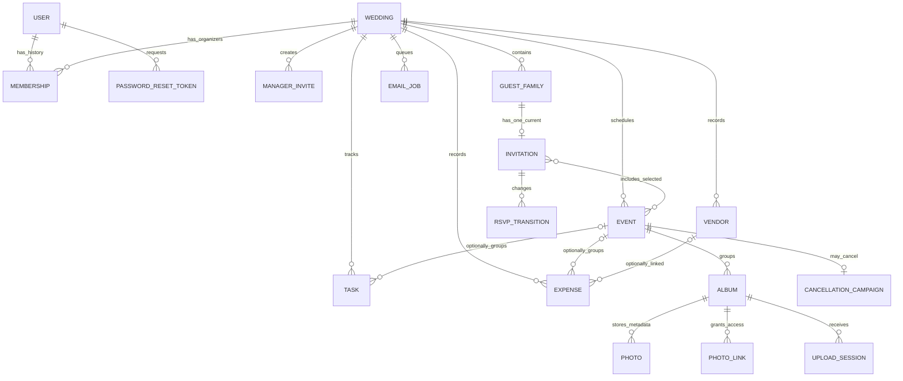
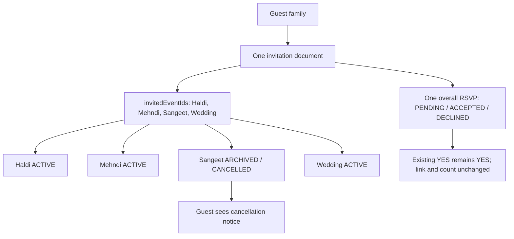
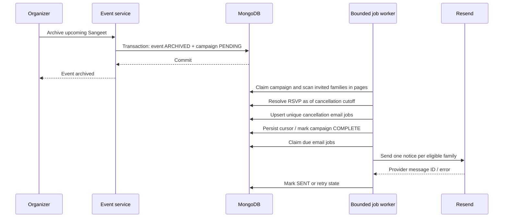

# Make My Marriage (MMM)
## Database Design & Data Integrity Specification

| Metadata | Value |
|---|---|
| Version | **1.0 — Database Design Baseline** |
| Prepared | **13 November 2026** |
| Status | **Implementation-ready proposal for technical review**; confirmed business rules are distinguished from recommended storage choices |
| Product baseline | *Make My Marriage — PRD v1.1* (12 November 2026) |
| Architecture baseline | *Make My Marriage — Final System Design v1.1* (12 November 2026) |
| Persistence | **MongoDB Atlas + Mongoose**, validated at API boundaries using **Zod** |
| Runtime | Full-stack **Next.js / TypeScript on Vercel**, modular monolith |
| Binary media | **Cloudflare R2**; MongoDB stores metadata and access control only |
| Email | **Resend**, with MongoDB durable outbox/jobs |
| Intended readers | Backend engineers, product owner, code reviewers, QA, and future maintainers |

> **Scope and precedence.** This document translates the two v1.1 baselines into collections, fields, relationships, constraints, indexes, query patterns, and atomic workflows. Where it makes an implementation choice not expressly approved by the product owner, that choice is labeled **recommended** rather than misrepresented as a new business requirement. If a schema example appears to conflict with a stated invariant, the invariant is authoritative and the implementation must be corrected.
>
> **Critical cross-document consistency:** (1) **one family invitation and one overall RSVP**, never per-event invitations/RSVPs; (2) canceling an upcoming event **does not reset** that invitation or response; (3) paid expenses support **either an active organizer payer or a manually entered external name**, never require every payer to have an account; (4) archive rather than hard-delete wedding events; (5) media stays in **Cloudflare R2**, not S3 or MongoDB/GridFS.

---

## Contents

1. [Goals and non-goals](#1-goals-and-non-goals)
2. [Modeling principles and data conventions](#2-modeling-principles-and-data-conventions)
3. [Conceptual data relationship diagram](#3-conceptual-data-relationship-diagram)
4. [Collection catalog and ownership](#4-collection-catalog-and-ownership)
5. [Detailed collection schemas](#5-detailed-collection-schemas)
6. [Payer model and validation](#6-payer-model-and-validation)
7. [Family invitation, RSVP and cancellations](#7-family-invitation-rsvp-and-cancellations)
8. [Indexes and enforceable uniqueness](#8-indexes-and-enforceable-uniqueness)
9. [Transactions, concurrency and idempotency](#9-transactions-concurrency-and-idempotency)
10. [Read patterns, aggregations and reporting](#10-read-patterns-aggregations-and-reporting)
11. [Tenancy, security and privacy](#11-tenancy-security-and-privacy)
12. [Data lifecycle, retention and cleanup](#12-data-lifecycle-retention-and-cleanup)
13. [Mongoose and Zod implementation examples](#13-mongoose-and-zod-implementation-examples)
14. [Failure scenarios and recovery](#14-failure-scenarios-and-recovery)
15. [Testing and database acceptance criteria](#15-testing-and-database-acceptance-criteria)
16. [Migration, deployment and operational guidance](#16-migration-deployment-and-operational-guidance)
17. [Design choices versus product decisions](#17-design-choices-versus-product-decisions)
18. [Traceability and references](#18-traceability-and-references)

---

# 1. Goals and non-goals

## 1.1 Goals

- Make all wedding-owned data **isolated by `weddingId`** with server-verified membership.
- Model **one active wedding membership per user**, multiple admins/managers per wedding, and safe organizer removal.
- Support multiple events, event-specific invited-family selection, and **one family-wide RSVP**.
- Preserve original invitations, accepted attendance counts, and historical records when a future event is cancelled.
- Model the expense ledger with **two payer kinds** (`ORGANIZER`, `EXTERNAL`), a preserved name snapshot, and strict `PAID`/`UNPAID` rules.
- Keep private photos in **R2** and store only object keys, states and permissions in Atlas.
- Support retry-safe manager joining, reset tokens, photo uploads and email/cancellation delivery.
- Keep schema and indexes understandable for one Next.js modular monolith and modest initial traffic.

## 1.2 Non-goals

No payments/financial transfers, budget planning, installments, vendor accounts, guest accounts, per-event RSVPs, multi-wedding accounts, Kafka, Redis, microservices, public audit-history UI, Google Calendar sync, or database materialization of live countdown labels. Vendor discovery results originate from Google Places and do not require a persistent discovery collection. The dashboard and calendar are **derived views**, not mandatory collections.

# 2. Modeling principles and data conventions

## 2.1 Identifiers and tenancy

- `_id`: MongoDB `ObjectId`, generated server-side. Store foreign-key-like references as `ObjectId` (not arbitrary strings).
- `weddingId`: required on **every wedding-owned collection**, even where it can be inferred via a parent reference. This enables direct tenant-scoped indexes and safer queries.
- All organizer-owned mutations derive `weddingId` from the **current active membership**, **not** from a client-submitted body parameter. APIs compare all referenced documents' `weddingId` values.
- Public `/w/:slug` reads use an explicit public projection. Token-gated guest requests derive scope from the **validated token's stored record**, never a URL-provided wedding ID.
- Mongoose `ref`/`populate()` is a convenience, **not** a cross-collection foreign-key constraint, security boundary, or cascade mechanism.

## 2.2 Dates, money, names, and state

| Concern | Convention |
|---|---|
| Dates/times | MongoDB `Date` values store UTC instants; events also store IANA `timezone`, e.g. `Asia/Kolkata`. |
| Date ranges | Validate `endAt > startAt`, if `endAt` is present. Use UTC instants for future-event cancellation checks. |
| Countdown | Compute `Today`, `1 day to go`, etc. on read/render in event timezone; **no persisted countdown field or daily update job**. |
| Currency | `currency: 'INR'` for v1; expense and vendor amounts are **positive integer paise** (`amountMinor`, `agreedCostMinor`), not floating-point rupees. |
| Money bounds | Reject values outside safe numeric/business limits; never rely on fractional JS floating-point addition for money. |
| Emails | Save original `email` for display plus lowercase/trimmed `emailNormalized` for equality/indexes. |
| Human names | Trim whitespace, cap length, escape on display, preserve entered spelling in immutable name snapshots. |
| Statuses | Keep **lifecycle** (`ACTIVE`, `ARCHIVED`) separate from **schedule phase** (`UPCOMING`, `ONGOING`, `COMPLETED`). |
| Timestamps | Use `createdAt`, `updatedAt` on persistent business collections; add domain-specific timestamps as needed. |
| Optional refs | Prefer `null` for absent, well-defined values in response DTOs; be consistent in stored documents. |
| History | Preserve meaningful payer, assignee and invitation history, even after a user is removed. |

## 2.3 Embed versus reference

**Embed** small bounded values that are usually fetched with their parent: venue address/GeoJSON, wedding website settings, contact information, payer union, task labels, RSVP state, small linked asset descriptors. **Reference** potentially unbounded/independently paginated sets: memberships, events, tasks, expenses, guest families, invitations, photos, email jobs, RSVP transitions. Never embed all photos or all guest families under a wedding document.

## 2.4 Required database discipline

1. Zod checks incoming DTOs; domain services enforce cross-record rules; Mongoose validates shapes; unique indexes enforce race-safe uniqueness.
2. Use explicit projections. Never return password hashes, reset hashes, join tokens, guest family contacts, or private R2 object keys from public endpoints.
3. Use `$set` of allowed fields, rather than replacing an entire object from stale client state. Field conflicts follow the agreed **last-write-wins** policy; compound invariants must still be checked.
4. Store randomized capability-token **hashes** (SHA-256 of a 256-bit random secret) rather than raw bearer tokens. Raw tokens appear only on link creation/dispatch and must be guarded in mail jobs and logs.
5. Treat TTL as **garbage collection only**; every token read validates expiry and revocation in application logic.

# 3. Conceptual data relationship diagram



**Interpretation:** The diagram is conceptual. MongoDB does not enforce these links like a relational database. Application services must validate referenced IDs, tenant ownership, status, and link permissions. **An invitation's `invitedEventIds[]` is a list of references; it is not an event-specific RSVP table.** `USER → MEMBERSHIP` may contain multiple *historical* rows across weddings, but **only one `ACTIVE` membership per user**.

# 4. Collection catalog and ownership

**Recommended v1 collection set (18)**, grouped by domain. The list is deliberately explicit so modules own their writes and other modules use service interfaces rather than modifying each other's records directly.

| Collection | Owning module | Tenant? | Purpose | Essential uniqueness |
|---|---|---|---|---|
| `users` | Auth | No | Organizer identity, password hash, token version | `emailNormalized` |
| `weddings` | Weddings | Root | Wedding, slug, venue, website, admin counter | `slug` |
| `memberships` | Weddings/Members | Yes | User-to-wedding role and lifecycle | One `ACTIVE` per user; one row per wedding/user |
| `managerInvites` | Members | Yes | One-time manager join links and email invites | `tokenHash` |
| `passwordResetTokens` | Auth | No | One-time 30-minute password reset grants | `tokenHash` |
| `events` | Events | Yes | Wedding function, schedule, venue, archive | — |
| `tasks` | Tasks | Yes | Assignee, due date, status, priority | — |
| `expenses` | Expenses | Yes | Simple paid/unpaid ledger, optional links, payer | — |
| `guestFamilies` | Guests | Yes | Family contact and invited party size | — |
| `invitations` | Invitations/RSVP | Yes | **One per family**, selected event IDs, one RSVP, one token | `(weddingId, guestFamilyId)`; `tokenHash` |
| `rsvpTransitions` | Invitations/RSVP | Yes | **Internal** append-only RSVP changes; cancellation cutoff evidence | `(invitationId, revision)` |
| `vendors` | Vendors | Yes | Organizer-managed vendor contacts and costs | — |
| `albums` | Galleries | Yes | Event album metadata | — |
| `photoLinks` | Galleries | Yes | Purpose-specific VIEW/UPLOAD tokens | `tokenHash` |
| `photos` | Galleries | Yes | R2 keys, processing state, image metadata | `(bucket, originalKey)` |
| `uploadSessions` | Galleries | Yes | Presigned PUT authorization and completion tracking | `temporaryKey` |
| `emailJobs` | Email | Contextual | Durable send jobs, retries, idempotency | `dedupeKey` |
| `cancellationCampaigns` | Events/Email | Yes | Durable future-event cancellation fan-out | `(weddingId, eventId)` |

**Why `rsvpTransitions`?** This *recommended internal data-integrity collection* allows cancellation emails to be selected based on RSVP state **at cancellation time**, even if guests update their RSVP before the email worker runs. It does not add a user-facing audit log or per-event RSVP. For a deliberately simpler MVP, see §7.5 for the trade-off.

**Why `cancellationCampaigns`?** It provides durable notification intent and progress across Vercel's short-lived functions. One future event is cancelled once, so a unique campaign per event prevents repeat fan-out. Archiving a past event does **not** create a campaign.

---
# 5. Detailed collection schemas

This section defines the **proposed canonical persistent shape**, not a promise that every UI field or collection must be introduced on day one. Common fields (`_id`, `createdAt`, `updatedAt`) are omitted from some tables for brevity. `ObjectId?` means an optional BSON ObjectId; `Date?` means an optional UTC instant. Unless explicitly noted, all wedding-owned records require `weddingId`.

## 5.1 `users` — account identity

| Field | Type | Rule |
|---|---|---|
| `_id` | ObjectId | Server-generated |
| `displayName` | string | Required; trim, bounded |
| `email` | string | Original display/case-preserving form |
| `emailNormalized` | string | Required; unique; lowercase/trim; normalized at write boundary |
| `passwordHash` | string | Secure password hash, not reversible |
| `tokenVersion` | int | Starts at 0; increment on password reset/forced sign-out |
| `status` | `ACTIVE \| DISABLED` | Auth account state |
| `createdAt`, `updatedAt` | Date | Mongoose timestamps |

**Do not store a permanent `weddingId` in `users` as a second source of truth.** Current wedding membership is resolved from `memberships`. Optional profile/avatar fields may be added later. Guests and external expense payers **do not** get `users` records.

## 5.2 `weddings` — tenant root and public wedding site

| Field | Type | Rule |
|---|---|---|
| `_id` | ObjectId | Wedding tenant key |
| `slug` | string | Unique, lowercase/URL-safe, immutable or changed via controlled workflow |
| `title` | string | Wedding title |
| `couple` | object | Names and optional details for public display |
| `dateRange` | `{startAt: Date, endAt?: Date}` | Top-level wedding schedule |
| `timezone` | string | IANA zone, e.g. `Asia/Kolkata` |
| `defaultVenue` | Venue embedded object | See §5.2.1 |
| `website` | object | Theme ID, welcome text, public cover R2 asset reference, optional YouTube URL |
| `activeAdminCount` | int | **Recommended** counter initialized to 1 for concurrency-safe last-admin rule |
| `settings` | object | Narrow documented flags/defaults; avoid arbitrary catchall configuration |
| `createdByUserId` | ObjectId | Initial administrator |
| `createdAt`, `updatedAt` | Date | Timestamps |

### 5.2.1 Shared `Venue` embedded value

```ts
type Venue = {
  name: string;
  formattedAddress: string;
  city?: string;
  state?: string;
  country?: string;           // e.g. "India"
  postalCode?: string;
  geo?: {
    type: 'Point';          // GeoJSON
    coordinates: [number, number]; // [longitude, latitude]
  };
};
```

A wedding can have a default venue, and every event can override it. **Recommended UI behavior:** prefill new-event venue from the wedding default, then persist the event's chosen venue as an explicit snapshot. This avoids an old event's address silently changing when the default is edited. The default-inheritance UX is still a minor product decision.

### 5.2.2 `website` embedded shape

Store `themeId`, optional `headline`, optional `welcomeText`, optional `coverAsset` (R2 key and public-safe preview metadata), and optional validated `youtubeVideoId`/approved YouTube URL. **Never embed guest-family data, invitation tokens, or private gallery URLs in this field.** The public site reads only non-archived events.

## 5.3 `memberships` — organizer identity within a wedding

| Field | Type | Rule |
|---|---|---|
| `_id` | ObjectId | Membership identity |
| `weddingId` | ObjectId | Required tenant |
| `userId` | ObjectId | Must exist in `users` |
| `role` | `ADMIN \| MANAGER` | Only two organizer roles |
| `status` | `ACTIVE \| REMOVED` | `REMOVED` retains history but grants no access |
| `joinedAt` | Date | When joined |
| `removedAt` | Date? | On removal |
| `removedByUserId` | ObjectId? | Optional history |
| `createdAt`, `updatedAt` | Date | Timestamps |

**One-wedding-at-a-time rule:** unique *partial* index on `userId` where `status='ACTIVE'`. Historical removed membership records may coexist for a user. Separately enforce one record per `(weddingId, userId)`; rejoining that same wedding updates the historical record rather than inserting a duplicate.

Only an active Admin can invite/remove/promote organizers; any active Admin/Manager can manage ordinary wedding resources. **The last active Admin cannot be removed or demoted.** For this cross-record invariant, use a transaction with an atomic `activeAdminCount > 1` guard on the wedding document (details §9.3).

## 5.4 `managerInvites` — single-use joining permissions

| Field | Type | Rule |
|---|---|---|
| `weddingId` | ObjectId | Destination wedding |
| `issuedByUserId` | ObjectId | Issuing Admin |
| `tokenHash` | string | Unique SHA-256 of random one-time secret |
| `invitedEmailNormalized` | string? | Required for targeted email invitation; optional for shareable joining link |
| `targetRole` | `MANAGER` | Recommended default; administrator promotion is a separate Admin action |
| `expiresAt` | Date | Must be checked on join |
| `consumedAt` | Date? | Write once |
| `consumedByUserId` | ObjectId? | Successful authenticated claimant |
| `revokedAt` | Date? | Admin can revoke unused invite |
| `createdAt` | Date | Issued time |

Join is not valid if expired, revoked, or consumed, and never inserts a second active wedding membership for a user. Email-targeted invitation requires normalized email match. A shareable joining link remains **one-time use**, not an unlimited enrollment code.

## 5.5 `passwordResetTokens` — one-time recovery

| Field | Type | Rule |
|---|---|---|
| `userId` | ObjectId | Registered account |
| `tokenHash` | string | Unique hash of secure random reset secret |
| `expiresAt` | Date | **30 minutes** after issue |
| `consumedAt` | Date? | Written once on use |
| `createdAt` | Date | Creation time |

Issuing a newer password-reset token invalidates older active tokens for that user through a transaction or server-checked version/issued-at rule; if using revocation flags, add `revokedAt`. Consuming a token updates the password hash and increments `users.tokenVersion` atomically. Only this *disposable* collection is eligible for a cleanup TTL, and token reads always check expiration independently.

## 5.6 `events` — wedding celebrations and lifecycle

| Field | Type | Rule |
|---|---|---|
| `weddingId` | ObjectId | Required |
| `title` | string | E.g. Haldi, Mehndi, Sangeet, Wedding |
| `description` | string? | Optional |
| `startAt`, `endAt` | Date | UTC instants, `endAt > startAt` |
| `timezone` | string | IANA zone for local display |
| `venue` | Venue | Event-specific venue/address/coordinates |
| `coverAsset` | object? | Public-safe image reference to R2 |
| `lifecycle` | `ACTIVE \| ARCHIVED` | **Do not hard-delete** for routine organizer deletion |
| `archivedAt` | Date? | Set once |
| `archivedByUserId` | ObjectId? | Organizer responsible |
| `archiveReason` | string? | Optional internal explanation |
| `cancellationId` | ObjectId? | Set if **future** event was cancelled; references campaign |
| `createdAt`, `updatedAt` | Date | Timestamps |

**Computed, not authoritative stored phase:** when active, `UPCOMING` if `now < startAt`; `ONGOING` if `startAt <= now < endAt`; otherwise `COMPLETED`. The organizer dashboard may label phases accordingly. Archive detection uses `startAt > now` (actual instant), **not** just the date or the text status. Future archival is a cancellation; ongoing/past archival is historical cleanup without cancellation emails.

Archiving keeps all linked tasks, expenses, vendor associations, invitations and albums. Public `/w/:slug` omits archived events; token-protected invited-family pages **may still show an archived future event as `Cancelled`**.

## 5.7 `tasks` — per-wedding task planner

| Field | Type | Rule |
|---|---|---|
| `weddingId` | ObjectId | Required |
| `eventId` | ObjectId? | Optional same-wedding event |
| `title`, `description` | string | Title required |
| `status` | `TODO \| IN_PROGRESS \| COMPLETED` | Exactly three states |
| `priority` | `LOW \| MEDIUM \| HIGH` | Recommended vocabulary |
| `dueAt` | Date? | UTC, optional |
| `assignedToUserId` | ObjectId? | Must be an active organizer **at assignment time** |
| `assigneeNameSnapshot` | string? | Recommended, preserves historical display |
| `createdByUserId` | ObjectId | Author |
| `deletedAt` | Date? | Optional reversible deletion implementation, not required by product |
| `createdAt`, `updatedAt` | Date | Timestamps |

An organizer removed later does not invalidate existing task history; assigning them anew is not permitted. An archived event should no longer be offered for new task association, but existing tasks retain their links.

## 5.8 `expenses` — paid/unpaid ledger

| Field | Type | Rule |
|---|---|---|
| `weddingId` | ObjectId | Required |
| `title`, `description` | string | Title required |
| `category` | string | Controlled set or validated free text (initial taxonomy recommended) |
| `amountMinor` | int (safe integer) | **Positive paise**; INR currency |
| `currency` | `'INR'` | V1 only |
| `eventId` | ObjectId? | Optional same-wedding event |
| `vendorId` | ObjectId? | Optional same-wedding vendor |
| `vendorNameSnapshot` | string? | Recommended when vendor linked; preserve label if vendor archived/deleted |
| `status` | `PAID \| UNPAID` | Default `UNPAID` |
| `payer` | embedded union or `null` | Defined exactly in §6 |
| `paidAt` | Date? | Null when unpaid; optional when paid |
| `createdByUserId` | ObjectId | Active organizer who created record |
| `notes` | string? | Optional |
| `deletedAt` | Date? | Optional soft deletion; excluding from sums if used |
| `createdAt`, `updatedAt` | Date | Timestamps |

**Confirmed:** an expense is one full amount, not a payment schedule, split, installment, transfer or budget allocation. The payer may be a *different person* from the organizer recording the expense, including a nonmember entered manually.

## 5.9 `guestFamilies` — contact directory

| Field | Type | Rule |
|---|---|---|
| `weddingId` | ObjectId | Required |
| `familyLabel` | string | E.g. Sharma Family |
| `primaryContactName` | string | Contact representative |
| `email`, `emailNormalized` | string? | Required **before emailing**, optional while drafting family record |
| `phone` | string? | Optional; no OTP |
| `invitedCount` | positive int | Size of party allowed on invitation |
| `notes` | string? | Organizer-only |
| `createdByUserId` | ObjectId | Organizer |
| `deletedAt` | Date? | Suggested rather than destructive delete after invitations sent |
| `createdAt`, `updatedAt` | Date | Timestamps |

Do **not** uniquely index family email: multiple family records may legitimately share an inbox. Invited-event selections belong to the **single invitation document**, not independent event invitations. A family may exist with no invitation yet.

## 5.10 `invitations` — exactly one family-wide RSVP

| Field | Type | Rule |
|---|---|---|
| `weddingId` | ObjectId | Required |
| `guestFamilyId` | ObjectId | Required; **one invitation row per wedding/family** |
| `invitedEventIds` | ObjectId[] | Selected wedding events; no duplicates; references retained when cancelled |
| `designId` | string | One predefined invitation template ID |
| `issuanceStatus` | `DRAFT \| ISSUED` | Draft until a valid invitation link is generated/issued |
| `tokenHash` | string? | Hash of one family-specific token; absent for unsent draft |
| `tokenVersion` | int | Increment when rotating token; RSVP preserved |
| `expiresAt` | Date? | Organizer-configurable for issued links |
| `revokedAt` | Date? | Explicit revocation |
| `sentAt` | Date? | Email send request/result metadata; keep provider state separately |
| `rsvpStatus` | `PENDING \| ACCEPTED \| DECLINED` | **One status for whole invitation** |
| `attendeeCount` | int | `ACCEPTED: 1..family.invitedCount`; otherwise 0 |
| `rsvpRevision` | int | Starts at 0; increments for actual response changes |
| `rsvpUpdatedAt` | Date? | Latest response change |
| `lastReminderAt` | Date? | Optional organizer-view metadata |
| `createdAt`, `updatedAt` | Date | Timestamps |

### Draft versus issued invitations (recommended lifecycle)

A family can be created before any invitation exists. When an organizer selects events, create/update the **one invitation in `DRAFT` state**, leaving `tokenHash` absent. Sending or generating the link assigns a token, `expiresAt`, and `issuanceStatus='ISSUED'`. **Do not duplicate `invitedEventIds` onto `guestFamilies`**; the draft invitation already stores selections, so there is one source of truth. Resend retries use the same invitation record. Link rotation changes only the token fields—not `rsvpStatus`, attendees, or selected events.

The email delivery state belongs to the durable `emailJobs` records. An invitation being `ISSUED` or `sentAt` being populated does not prove email *delivery*.

### RSVP invariants

- `PENDING` → `attendeeCount = 0`; `DECLINED` → `attendeeCount = 0`.
- `ACCEPTED` → `1 <= attendeeCount <= guestFamilies.invitedCount`.
- A guest can update the **same invitation** using an unexpired, unrevoked invitation token, only if at least one currently eligible invited event remains.
- If all invited events are cancelled, preserve the original `ACCEPTED`/`DECLINED` response but disable new acceptance; the guest can still read cancellation notices using the valid token.
- A cancelled event remains in `invitedEventIds` so the page can display the cancellation without altering other events.
- Family-size edits that would make an existing accepted attendee count invalid must be resolved deliberately (reject the size reduction or require a compatible count in the same operation); **never silently corrupt totals**.

## 5.11 `rsvpTransitions` — internal RSVP history (recommended)

| Field | Type | Rule |
|---|---|---|
| `weddingId` | ObjectId | Required |
| `invitationId` | ObjectId | Reference to the same invitation |
| `revision` | positive int | Matches incrementing invitation `rsvpRevision` |
| `status` | `ACCEPTED \| DECLINED` | Status after change; `PENDING` is implicit before first transition |
| `attendeeCount` | int | Count at this revision |
| `recordedAt` | Date | Server-issued mutation timestamp |
| `source` | `'GUEST_LINK'` | Response source; no guest user account |

Each actual change updates the invitation's current response and inserts one **append-only** transition in a short transaction. Use this only for internal correctness and notification cutoff rules; **it is not a user-visible audit/history feature and not a per-event RSVP**. Prevent unauthenticated access to this collection.

## 5.12 `vendors` — manually maintained vendor records

| Field | Type | Rule |
|---|---|---|
| `weddingId` | ObjectId | Required |
| `name` | string | Vendor name |
| `category` | string | Decorator, catering, photographer, etc. |
| `contact` | embedded object | Email, phone, optional address |
| `agreedCostMinor` | int? | Optional nonnegative INR paise |
| `eventIds` | ObjectId[] | Optional associated events, same wedding |
| `googlePlaceId` | string? | Optional discovery reference, if organizer saves it |
| `notes` | string? | Organizer-only |
| `archivedAt` | Date? | Recommended non-destructive removal |
| `createdAt`, `updatedAt` | Date | Timestamps |

**Do not** count `agreedCostMinor` as a ledger expense. Only actual `expenses` documents enter paid/unpaid totals. Deleting/archiving a vendor must not silently delete linked expenses; preserve `vendorNameSnapshot` where available.

## 5.13 `albums` — wedding photo albums

| Field | Type | Rule |
|---|---|---|
| `weddingId` | ObjectId | Required |
| `eventId` | ObjectId | Same-wedding event (one album grouped under an event) |
| `title`, `description` | string | Title required |
| `createdByUserId` | ObjectId | Organizer |
| `allowGuestDownloads` | bool | Optional gallery permission flag, default policy set in service |
| `archivedAt` | Date? | Suggested reversible archive |
| `createdAt`, `updatedAt` | Date | Timestamps |

No array of photos is embedded into albums. An event may have multiple albums; album metadata remains even if its event is archived (subject to access policy), rather than being cascade-deleted.

## 5.14 `photoLinks` — access grants for viewing/uploading

| Field | Type | Rule |
|---|---|---|
| `weddingId`, `albumId` | ObjectId | Scoped target |
| `purpose` | `VIEW \| UPLOAD` | **Distinct capability**, never interchangeable |
| `tokenHash` | string | Unique hash of random bearer token |
| `expiresAt` | Date | Organizer-configurable |
| `revokedAt` | Date? | Stop access immediately |
| `createdByUserId` | ObjectId | Organizer issuer |
| `createdAt` | Date | Issued time |

A valid VIEW link never grants upload rights, and a valid UPLOAD link never grants private-gallery browsing. Verify album/event scope and expiry on every token use. Expiry does **not** delete album or photo objects.

## 5.15 `photos` — R2 object metadata

| Field | Type | Rule |
|---|---|---|
| `weddingId`, `albumId` | ObjectId | Required, tenant scoped |
| `uploadedByType` | `ORGANIZER \| GUEST_LINK` | Guest uploads never imply a user account |
| `uploadedByUserId` | ObjectId? | Only for organizers |
| `uploadSessionId` | ObjectId? | Links guest upload completion |
| `bucket` | string | Server-configured R2 bucket |
| `originalKey` | string | Server-generated key; unique with bucket |
| `previewKey`, `thumbnailKey` | string? | Derivative R2 objects |
| `originalFileName` | string? | Sanitized/display-only; **never used as R2 key** |
| `mimeType` | string | Verified MIME, not merely client supplied |
| `sizeBytes` | int | **<= 20 * 1024 * 1024** (20 MiB implementation interpretation) |
| `width`, `height` | int? | Result of safe decode/inspection |
| `status` | `PENDING \| PROCESSING \| READY \| REJECTED \| DELETING` | Only `READY` displayed |
| `failureCode` | string? | Technical-safe reason for rejection |
| `deletedAt` | Date? | Removal workflow bookkeeping |
| `createdAt`, `updatedAt` | Date | Timestamps |

Supported input formats: **JPEG, PNG, WebP, HEIC/HEIF**. HEIC/HEIF needs a processing runtime with tested codec support. Store only validated file metadata; strip unnecessary EXIF including GPS from generated previews. Photos appear without *human moderation* after processing succeeds. **No fixed per-wedding photo-count quota**. R2 objects persist until organizer deletion, independently of guest-link expiration.

**20 MB note:** The product specifies a 20 MB limit; this design uses `20 * 1024 * 1024` bytes as the implementable binary limit (20 MiB). If product copy intends 20,000,000 decimal bytes exactly, choose one definition before coding and use it consistently in UI, validation, and tests.

## 5.16 `uploadSessions` — presigned upload state

| Field | Type | Rule |
|---|---|---|
| `weddingId`, `albumId` | ObjectId | Scoped upload target |
| `photoLinkId` | ObjectId? | Required for guest uploads; null for organizer upload |
| `temporaryKey` | string | Unique, random server-generated R2 key |
| `expectedMimeType`, `declaredSizeBytes` | string, int | Untrusted request hints |
| `status` | `ISSUED \| UPLOADED \| VERIFYING \| COMPLETED \| REJECTED \| EXPIRED` | Atomic monotonic transitions |
| `expiresAt` | Date | Short-lived presigned PUT validity |
| `completedPhotoId` | ObjectId? | Set on successful processing |
| `createdAt`, `updatedAt` | Date | Timestamps |

Before signing, validate purpose/album, rate limits, and declared size. After upload, **verify actual R2 bytes** and file contents; a presigned PUT alone does not guarantee the 20 MB limit. Repeated completion calls should return the existing processed photo rather than create duplicates. Orphaned temporary objects require explicit cleanup before session documents are purged.

## 5.17 `emailJobs` — durable delivery queue / outbox

| Field | Type | Rule |
|---|---|---|
| `weddingId` | ObjectId? | Null for account-only reset emails |
| `type` | enum | `PASSWORD_RESET`, `MANAGER_INVITE`, `FAMILY_INVITE`, `RSVP_REMINDER`, `EVENT_CANCELLED` |
| `dedupeKey` | string | Unique **business-operation** key |
| `recipientEmail` | string | Server-validated recipient, access-controlled |
| `payloadCiphertext` / `payloadRef` | string | Sensitive template data encrypted or securely referenced |
| `status` | `PENDING \| PROCESSING \| RETRY_PENDING \| SENT \| FAILED` | Worker state |
| `attempts`, `maxAttempts` | int | Bounded retries |
| `nextAttemptAt` | Date | Due time |
| `leaseUntil` | Date? | Recover abandoned worker claim |
| `leasedBy` | string? | Random worker claim ID |
| `providerMessageId` | string? | Resend accepted-message ID, not delivery proof |
| `lastErrorCode` | string? | Redacted failure reason |
| `sentAt` | Date? | Provider accepted request |
| `createdAt`, `updatedAt` | Date | Timestamps |

This is **not** an external queue/broker. Vercel worker functions claim MongoDB jobs atomically and process in bounded batches, with prompt triggering plus an independent recovery process. A secure internal route may invoke the worker; do not assume Vercel Hobby's daily cron is enough for time-sensitive reset emails. Keep durable dedupe records even if old detailed job payloads are eventually purged. **Provider acceptance is not proof of inbox delivery.**

## 5.18 `cancellationCampaigns` — future event cancellation intent

| Field | Type | Rule |
|---|---|---|
| `weddingId`, `eventId` | ObjectId | One cancellation campaign per future cancelled event |
| `cancelledAt` | Date | Cutoff for eligible accepted families |
| `cancelledByUserId` | ObjectId | Organizer |
| `status` | `PENDING \| PROCESSING \| COMPLETE \| FAILED` | Fan-out status |
| `lastInvitationId` | ObjectId? | Stable `_id` cursor for paginated fan-out |
| `processedCount` | int | Operational progress |
| `enqueuedCount` | int | Number of unique cancellation jobs added |
| `leaseUntil` | Date? | For bounded recovery |
| `createdAt`, `updatedAt` | Date | Timestamps |

Create a campaign **only if the event had not started yet** when it was archived. Repeated archive requests must not create another campaign. Paginate potential recipients by stable `_id` order; for each eligible family, create an `emailJobs` entry with `dedupeKey = event_cancelled:<campaignId>:<invitationId>` and a unique index. Preserve invitation and existing RSVP regardless of email delivery outcome.

---
# 6. Payer model and validation

## 6.1 Final business rule

**One expense, one recorded payer, if paid.** The payer can be:

1. **Self** — logged-in organizer (stored as `ORGANIZER`, not a third payer kind).
2. **Another active Admin/Manager** of this wedding (stored as `ORGANIZER`).
3. **Someone not registered** in MMM, such as a relative (stored as `EXTERNAL` with a manually typed name).

The user editing/recording an expense **must** have wedding membership. The external payer **does not** gain membership or any application permissions. This supersedes all previous language suggesting paid expenses may only name registered organizers.

## 6.2 Canonical discriminated union

```ts
type ExpensePayer =
  | {
      kind: 'ORGANIZER';
      organizerUserId: ObjectId;
      nameSnapshot: string;    // populated by server from user profile
    }
  | {
      kind: 'EXTERNAL';
      organizerUserId: null;
      nameSnapshot: string;    // trimmed manual input
    };

type ExpensePaymentState =
  | { status: 'UNPAID'; payer: null; paidAt: null }
  | { status: 'PAID'; payer: ExpensePayer; paidAt: Date | null };
```

Use **one embedded `payer` subdocument** to avoid inconsistent independent `payerType`, `payerUserId`, and `payerName` fields. For `ORGANIZER`, validate **active wedding membership only when first assigning or changing** that payer; a removed organizer already recorded as having paid must remain visible via the immutable `nameSnapshot`. For `EXTERNAL`, validate only the normalized, nonempty, length-limited name; do **not** perform membership lookup.

## 6.3 Valid, invalid, and transition examples

```js
// Valid: unpaid expense
{ status: 'UNPAID', payer: null, paidAt: null }

// Valid: Rahul, the currently logged-in organizer, paid
{ status: 'PAID', payer: {
    kind: 'ORGANIZER', organizerUserId: ObjectId('64b000000000000000000001'),
    nameSnapshot: 'Rahul'
  }, paidAt: ISODate('2026-12-14T12:00:00.000Z') }

// Valid: a relative with no MMM account paid
{ status: 'PAID', payer: {
    kind: 'EXTERNAL', organizerUserId: null, nameSnapshot: 'Rajesh Sharma'
  }, paidAt: null }

// Invalid: PAID but missing payer
{ status: 'PAID', payer: null }

// Invalid: EXTERNAL with organizer user ID
{ status: 'PAID', payer: {
    kind: 'EXTERNAL', organizerUserId: ObjectId('64b000000000000000000001'),
    nameSnapshot: 'Rajesh Sharma'
  } }
```

| Change | Required behavior |
|---|---|
| `UNPAID → PAID` | Require an organizer ref **or** external name; populate server snapshot |
| `PAID → UNPAID` | Clear `payer` and `paidAt` in the same update |
| Change payer from Rahul to Priya | Verify Priya is active and belongs to this wedding |
| Change payer from Rahul to external Rajesh | Do not require Rajesh account or membership |
| Rename unrelated note on an old expense paid by a removed organizer | Keep historical payer; **do not fail** solely due to now-removed membership |
| Organizer from another wedding submitted as payer | Reject regardless of manipulated frontend request |
| External name whitespace-only | Reject |

**Query discipline:** ledger sums filter `weddingId`, exclude deleted entries if soft-deletion is enabled, and sum `amountMinor` according to current `PAID` or `UNPAID` status. No partial/split payment math. Vendor cost metadata is not included in expense totals.

# 7. Family invitation, RSVP and cancellations

## 7.1 One invitation / one response model



- No per-event RSVP collection, no `rsvpStatus` within `events`, no invitation per event, and no new invitation on cancellation.
- A single `invitations.invitedEventIds[]` holds selected events. Referenced archived future events remain in that array to allow guest notices.
- A family with `ACCEPTED` and attendee count 4 stays `ACCEPTED`/4 after Sangeet is cancelled. All other invited events continue normally.
- The guest page resolves each selected event and classifies it as active, future-cancelled, or archived-past. Active celebrations are still included in the overall RSVP. The public wedding website separately hides all archived events.
- If all invited events have been cancelled, the URL remains usable while valid, and historical RSVP remains visible, but *new* acceptance is disabled because no active event remains.

## 7.2 RSVP mutation in one transaction

Recommended flow:

1. Validate invitation token hash, link validity, family ownership, and at least one eligible active event for a new answer.
2. Validate `ACCEPTED` attendee count is between 1 and `guestFamilies.invitedCount`; `DECLINED` sets 0.
3. Atomically increment `invitations.rsvpRevision` while updating current status/count, and insert matching `rsvpTransitions` row in the same MongoDB transaction. A repeated **identical** submission may return existing state without another transition.
4. If competing writes race, let one write succeed and retry the other after rereading current state; final state follows **last successfully committed write** (not a collaborative merge). Apply a retry bound.
5. Index `rsvpTransitions` by `(invitationId, revision)` for contiguous, unique revisions.

**Important implementation nuance:** Avoid client-provided `rsvpRevision` and never insert a history row without successfully updating the invitation. When using a transaction, include the invitation update in the same transaction, ensuring concurrent updates contend on one document. External side effects (email) must occur **after** transaction commit.

## 7.3 Future-event archive behavior

| Event when archived | Event document | Invitation read | Email |
|---|---|---|---|
| Upcoming (`startAt > now`) | Set `lifecycle=ARCHIVED`, `cancellationId` | Display `Cancelled` on affected family invitations; retain current RSVP | One `EVENT_CANCELLED` job per family **accepted at cutoff** |
| Ongoing | Archive historical record | Preserve references; no future-cancellation announcement | None |
| Completed | Archive historical record | Preserve references; no future-cancellation announcement | None |
| Repeated archive of same event | No new state transition | Same previously persisted outcome | **No duplicate** campaign/jobs |

**Recipients:** Under the agreed v1 policy, only families whose overall invitation was **Accepted** when the event was cancelled receive email. Pending and Declined families are not emailed; a Pending family can still RSVP for remaining active invited events. If several different future events are cancelled at different times, a family may receive **one separate email per cancelled event**, not repeated mail for the same event.

## 7.4 Cancellation campaign: durable outbox and fan-out



**Atomic archive write:** A short transaction must persist (a) event transition and (b) cancellation campaign intent. A crash after commit cannot erase the pending campaign; a retry cannot create duplicate campaigns because of a unique index on `(weddingId,eventId)`.

**Batch fan-out:** Process invitations in `_id` order, preserving a durable high-watermark `lastInvitationId` **after** creating that page's jobs. If a crash occurs before checkpoint commit, repeated upserts are harmless because `(campaignId, invitationId)` is represented by `emailJobs.dedupeKey` and is unique. The email worker uses separate claim leases and provider idempotency. Exactly-once delivery to an external provider is **not absolutely guaranteed** under every network failure; local dedupe makes it effectively once in normal operation.

## 7.5 RSVP as-of cancellation cutoff: avoiding a subtle race

**Problem:** A guest accepted on Monday, the organizer cancels on Tuesday, and the guest changes to Declined on Wednesday before the cancellation worker runs. Checking only `invitations.rsvpStatus` on Wednesday would **incorrectly skip** the cancellation notice. The reverse (accepting after cancellation) could create an undeserved notice.

**Recommended robust v1 design:** Keep `rsvpTransitions` immutable. The campaign stores `cancelledAt` at the archive mutation. During fan-out, find the **latest committed transition whose effective timestamp/order precedes the cancellation cutoff**; that is the eligible status. If it is `ACCEPTED`, enqueue once. An invitation with no transition was `PENDING`. Invitation edits must never erase these transitions.

**Precision requirement before implementing strict cutoff:** App-server wall-clock timestamps alone do not prove commit ordering for two overlapping transactions. The implementation must define the exact ordering semantics at a boundary (e.g. a DB-consistent snapshot or a short serialization/ordering protocol) and test RSVP/archive races. The data design includes transitions to avoid losing history, but **does not claim that `recordedAt <= cancelledAt` alone gives perfect transaction-order guarantees**. For small v1 weddings, an alternative is to materialize recipient IDs as a bounded, transactionally controlled snapshot at cancellation; this is simpler for small guest lists but needs pagination/locking for larger lists. Pick and test one strategy **before shipping notification fan-out**.

**Simpler MVP trade-off (not the default):** If `rsvpTransitions` is omitted, the implementation may define eligibility as RSVP state observed when the campaign worker reaches each invitation. That is cheaper but **does not faithfully implement “already accepted when cancelled” under races or delayed jobs**; document and accept that compromise explicitly rather than silently substituting it.

---

# 8. Indexes and enforceable uniqueness

Indexes below are the **recommended starting set**, not a mandate to maintain every speculative query index before launch. Exact field names must match the final Mongoose models. Run index creation through an explicit migration or deployment step; test uniqueness with concurrent requests. In MongoDB, **partial unique indexes enforce uniqueness only on documents matching the filter**. TTL deletion is asynchronous and **must never be an authorization decision**.

## 8.1 Primary indexes (MongoDB shell examples)

```javascript
// Authentication and tenant identity
db.users.createIndex({ emailNormalized: 1 }, { unique: true, name: 'uq_users_email' });
db.weddings.createIndex({ slug: 1 }, { unique: true, name: 'uq_weddings_slug' });

// Historical rows allowed, but one ACTIVE membership per user.
db.memberships.createIndex(
  { userId: 1 },
  { unique: true, name: 'uq_one_active_wedding_per_user',
    partialFilterExpression: { status: 'ACTIVE' } }
);
db.memberships.createIndex(
  { weddingId: 1, userId: 1 },
  { unique: true, name: 'uq_member_per_wedding' }
);
db.memberships.createIndex(
  { weddingId: 1, status: 1, role: 1 },
  { name: 'ix_members_by_wedding' }
);

// One-time and password-reset token lookups
db.managerInvites.createIndex(
  { tokenHash: 1 }, { unique: true, name: 'uq_manager_token' }
);
db.passwordResetTokens.createIndex(
  { tokenHash: 1 }, { unique: true, name: 'uq_reset_token' }
);
db.passwordResetTokens.createIndex(
  { expiresAt: 1 }, { expireAfterSeconds: 0, name: 'ttl_expired_resets' }
);

// Wedding schedules, tasks and expenses
db.events.createIndex(
  { weddingId: 1, lifecycle: 1, startAt: 1 }, { name: 'ix_events_schedule' }
);
db.tasks.createIndex(
  { weddingId: 1, status: 1, dueAt: 1 }, { name: 'ix_tasks_status_due' }
);
db.expenses.createIndex(
  { weddingId: 1, status: 1, createdAt: -1 }, { name: 'ix_expenses_ledger' }
);
db.expenses.createIndex(
  { weddingId: 1, eventId: 1 }, { name: 'ix_expenses_by_event' }
);

// Family guest directory and single family invitation
db.guestFamilies.createIndex(
  { weddingId: 1, emailNormalized: 1 }, { name: 'ix_family_email_lookup' }
); // NOT unique: multiple families may share an email

db.invitations.createIndex(
  { weddingId: 1, guestFamilyId: 1 },
  { unique: true, name: 'uq_one_invitation_per_family' }
);
db.invitations.createIndex(
  { tokenHash: 1 },
  { unique: true, name: 'uq_invitation_token',
    partialFilterExpression: { tokenHash: { $type: 'string' } } }
);
db.invitations.createIndex(
  { weddingId: 1, invitedEventIds: 1, _id: 1 },
  { name: 'ix_invitations_for_cancelled_event' }
); // multikey: selected events array

// Immutable RSVP transition history
db.rsvpTransitions.createIndex(
  { invitationId: 1, revision: 1 },
  { unique: true, name: 'uq_rsvp_revision' }
);
db.rsvpTransitions.createIndex(
  { invitationId: 1, recordedAt: -1 }, { name: 'ix_rsvp_asof_lookup' }
);

// Vendors, album media and purpose-scoped links
db.vendors.createIndex(
  { weddingId: 1, category: 1 }, { name: 'ix_vendor_category' }
);
db.albums.createIndex(
  { weddingId: 1, eventId: 1 }, { name: 'ix_albums_by_event' }
);
db.photoLinks.createIndex(
  { tokenHash: 1 }, { unique: true, name: 'uq_photo_link_token' }
);
db.photos.createIndex(
  { bucket: 1, originalKey: 1 },
  { unique: true, name: 'uq_photo_r2_object' }
);
db.photos.createIndex(
  { weddingId: 1, albumId: 1, status: 1, createdAt: -1 },
  { name: 'ix_album_ready_photos' }
);
db.uploadSessions.createIndex(
  { temporaryKey: 1 }, { unique: true, name: 'uq_upload_temp_key' }
);

// Durable outbox, retries and cancellation dedupe
db.emailJobs.createIndex(
  { dedupeKey: 1 }, { unique: true, name: 'uq_email_dedupe' }
);
db.emailJobs.createIndex(
  { status: 1, nextAttemptAt: 1, leaseUntil: 1 },
  { name: 'ix_due_email_jobs' }
);
db.cancellationCampaigns.createIndex(
  { weddingId: 1, eventId: 1 },
  { unique: true, name: 'uq_one_cancellation_per_event' }
);
db.cancellationCampaigns.createIndex(
  { status: 1, leaseUntil: 1 }, { name: 'ix_pending_campaigns' }
);
```

### Index creation/behavior nuances

- **MongoDB indexes are not foreign keys.** They cannot assert that `expenses.eventId` and the expense belong to the same wedding; service code must check both records.
- A **unique `tokenHash` index** works for required token documents. For optional `invitations.tokenHash`, use a **partial unique** index on actual strings so multiple drafts without a token are allowed.
- Do not add a TTL index on `invitations`, `guestFamilies`, `photoLinks`, `photos`, `albums`, `events`, or `cancellationCampaigns`: expired **link authority** must not delete the associated business data or historical campaign dedupe.
- A date-only TTL cleanup on `passwordResetTokens` is safe **only** because tokens are disposable and all token checks verify `expiresAt` first. TTL deletion is delayed and not guaranteed to happen at the exact expiry instant.
- No unique email index on guest families, because shared contacts are a valid case.
- On production deployments, control schema indexes via migrations; don't make every Vercel function request initiate index builds (`autoIndex: false` in production is a common configuration).

## 8.2 Additional indexes only when supported by query plans

| Query need | Possible additional index | Introduce when |
|---|---|---|
| Expense filter by vendor | `(weddingId, vendorId)` | UI uses vendor filter often |
| Expense filter by payer | `(weddingId, payer.kind, payer.organizerUserId)` | Organizer-payer reports become common |
| Task list by assignee | `(weddingId, assignedToUserId, dueAt)` | Assigned-to-me dashboard grows |
| Family directory search by label | Appropriate normalized label index or Atlas Search | Actual volume justifies it |
| Event venue proximity | `2dsphere` on `venue.geo` | MMM itself needs local event queries; **Google Places discovery does not require it** |
| Time-bounded invitation expiry scans | `(expiresAt)` | Cleanup/analytics requires scans, not link-validation lookup |
| Archived/deleted filters | Include lifecycle/archival fields in indexes | Explain plans show meaningful benefit |

For a modest initial product, begin with the core indexes in §8.1 and inspect `explain('executionStats')` / Atlas profiler for expensive query plans before expanding. Avoid wide compound indexes that add write cost without known benefit.

---
# 9. Transactions, concurrency and idempotency

MongoDB guarantees atomicity for a single-document write. Use short multi-document transactions **only** where a business invariant spans documents or an operation must commit alongside its durable outbox. Atlas supports transactions on its appropriate replica-set/sharded deployments; verify tier/version capabilities before relying on them. With Mongoose, prefer `connection.transaction()` or `session.withTransaction()` and **avoid concurrent `Promise.all()` operations inside one transaction/session**.

## 9.1 Transaction decision matrix

| Operation | Atomicity required | Proposed technique |
|---|---|---|
| Edit one task description | One document | Tenant-scoped `$set` |
| Mark expense Paid with payer | One expense document **plus eligibility read** | Validate selected payer and atomically replace payment state; use membership consistency guard for races |
| Create wedding and initial Admin | Wedding + membership | Transaction; `activeAdminCount = 1` |
| Join via single-use manager link | Join token + membership | Transaction; guarded consume + unique membership index |
| Promote/demote/remove Admin | Membership + admin counter | Transaction with guarded atomic counter change |
| Reset password | User + reset token | Transaction; hash update, token consumption, `tokenVersion++` |
| Submit RSVP | Invitation + immutable revision | Transaction; one current RSVP and one transition |
| Archive future event | Event + cancellation campaign | Transaction; unique cancellation intent |
| Archive completed event | Event only | Atomic update; no campaign |
| Send invitations/reminders | Email job creation | Persist durable job before dispatch; use stable dedupe key |
| Store photo binary and metadata | MongoDB + external R2 | **No distributed ACID**; state machine and reconciliation |
| Deliver email to Resend | MongoDB + external provider | **No distributed ACID**; claimed jobs, retries, idempotency |

## 9.2 Wedding creation and active membership

1. Authenticated user currently has **no active membership**.
2. Transaction inserts a new `weddings` record with `activeAdminCount = 1` and a new `memberships` row with `role='ADMIN', status='ACTIVE'`.
3. Unique active-membership index prevents a race in which the user tries to create/join two weddings concurrently; unique slug protects namespace.
4. If either insert fails, transaction rolls back. Do not leave a wedding with zero admins.

## 9.3 Preventing removal of the last Admin

**Naive `countDocuments({ role: 'ADMIN' }) > 1` followed by removal is unsafe** if two admins simultaneously remove each other. Recommended approach: keep a small authoritative `weddings.activeAdminCount`, update it conditionally, and write the membership change in the **same transaction**.

```ts
// Pseudocode, abbreviated for clarity.
await connection.transaction(async (session) => {
  const target = await Membership.findOne({
    _id: targetMembershipId, weddingId, status: 'ACTIVE'
  }).session(session);
  if (!target) throw new NotFoundError();

  if (target.role === 'ADMIN') {
    const guard = await Wedding.updateOne(
      { _id: weddingId, activeAdminCount: { $gt: 1 } },
      { $inc: { activeAdminCount: -1 } },
      { session }
    );
    if (guard.modifiedCount !== 1) throw new LastAdminError();
  }
  await Membership.updateOne(
    { _id: target._id, weddingId, status: 'ACTIVE' },
    { $set: { status: 'REMOVED', removedAt: new Date() } },
    { session }
  );
});
```

In production also check `modifiedCount === 1`, handle transaction retries, guard the current initiating Admin's authority, and update `activeAdminCount` for promotions/reinstatements. Periodically reconcile counter against active Admin memberships; a counter is only safe if **all writes** use the same rules. This is a **recommended implementation choice**, not an extra user-facing role.

## 9.4 One-time manager joining

- Authenticate claimant; resolve token by hash and check its purpose, expiry, revoke/consume state and optional targeted email.
- In a transaction atomically consume the invite **only if still usable**, then create/reinstate an active membership. Enforce the single-active-wedding unique index.
- If membership insert/reinstatement fails, token consumption rolls back. If two people click the same link, only one can commit successfully.
- Preserve `consumedByUserId` and `consumedAt` for security troubleshooting. Do not create guest or external-payer accounts.

## 9.5 Password reset and token rotation

- Accept reset token only if `hash` matches an unconsumed, unrevoked and unexpired record.
- In one transaction: mark token consumed, update securely hashed password, increment `users.tokenVersion`, invalidate other reset tokens (or rely on a controlled version check).
- Existing JWTs fail the server-side `tokenVersion` check after reset. Use generic forgot-password responses, rate limits and redacted logs.
- TTL may eventually delete old reset-token documents but **cannot** be used in place of explicit expiry checks.

## 9.6 Expense payer update consistency

- Only the authenticated current organizer can create/edit.
- For `payer.kind='ORGANIZER'`: resolve selected organizer in **the same wedding**, active at the time of assignment, fetch their display name, create snapshot; **do not** accept client-supplied snapshot.
- For `payer.kind='EXTERNAL'`: validate and trim submitted name; set `organizerUserId=null`. No member lookup.
- For `UNPAID`: atomically `$set` all three state fields (`status`, `payer=null`, `paidAt=null`).
- Apply membership checks when payer is **newly assigned or changed**, not on unrelated edits to an old expense. A historical removed organizer payer remains valid.
- Races between removing a member and selecting them as payer need a defined ordering. A transaction involving a guarded membership read/consistent version check is recommended when necessary; an existing transaction will not automatically lock an unrelated read document against removal. Avoid asserting a stronger guarantee than implemented.
- Paid/unpaid counts are calculated from stored expense state, not manual counter changes.

## 9.7 Event archive + cancellation intent

```ts
// Pseudocode showing the key durable boundary.
await connection.transaction(async (session) => {
  const event = await Event.findOne({ _id: eventId, weddingId }).session(session);
  if (!event) throw new NotFoundError();
  if (event.lifecycle === 'ARCHIVED') return; // idempotent

  const cancelledAt = new Date();
  const isFuture = event.startAt > cancelledAt;
  const campaignId = isFuture ? new Types.ObjectId() : null;

  await Event.updateOne(
    { _id: eventId, weddingId, lifecycle: 'ACTIVE' },
    { $set: { lifecycle: 'ARCHIVED', archivedAt: cancelledAt,
              archivedByUserId: actorId, cancellationId: campaignId } },
    { session }
  );

  if (isFuture) {
    await CancellationCampaign.create([{
      _id: campaignId, weddingId, eventId, cancelledAt,
      cancelledByUserId: actorId, status: 'PENDING',
      processedCount: 0, enqueuedCount: 0
    }], { session });
  }
});
```

**Production details:** Assert the event update matched one active row; handle concurrent archive write conflicts and unique campaign violations as idempotent success; keep recipient fan-out **outside** the short archive transaction. The service must not send an email before that transaction commits. If a public wedding website is cached, invalidate/revalidate the relevant page after commit.

## 9.8 Job claims and leases on Vercel

Claim a job with `findOneAndUpdate()` using due-status and lease predicates, setting a fresh `leasedBy`, incrementing attempt count and moving to `PROCESSING`. Use an index on `(status, nextAttemptAt, leaseUntil)`. Finish only if the same worker claim is still held. If lease expires, another invocation can retry. Do **not** keep a MongoDB transaction open across network calls to Resend.

```ts
// Illustrative claim; production query includes lease-expired reclaims.
const job = await EmailJob.findOneAndUpdate(
  { status: { $in: ['PENDING', 'RETRY_PENDING'] }, nextAttemptAt: { $lte: new Date() } },
  { $set: { status: 'PROCESSING', leasedBy: workerId, leaseUntil },
    $inc: { attempts: 1 } },
  { sort: { nextAttemptAt: 1 }, new: true }
);
```

**Recovery:** Reclaim stuck `PROCESSING` jobs with expired `leaseUntil`. The worker must avoid two send attempts from concurrently processing the same claim and must use a stable Resend idempotency key where supported. External delivery can be ambiguous after a timeout; retain durable dedupe and reconciliation.

## 9.9 Direct R2 upload completion is a state machine, not a DB transaction

1. `uploadSessions.ISSUED`: backend generated a short-lived PUT URL and temporary object key.
2. R2 PUT occurs **outside MongoDB**. Temporary object may exist without a DB photo record.
3. `complete`: verify via R2 HEAD/read; enforce actual byte count, MIME signature and decoding safety.
4. Claim upload session for processing once; create/update one `photos` record linked to session.
5. Store preview/thumb in R2; mark photo `READY` only after valid objects exist. If processing fails, mark `REJECTED` and clean up objects.
6. Repeated `complete` calls return the previous result or a stable `PROCESSING` response, never duplicate `photos`.
7. Scheduled reconciliation removes orphaned temporary objects and resumes stuck sessions.

An R2 upload is **not rolled back** by MongoDB transaction failure; application-level cleanup and state transitions are mandatory.

## 9.10 Stable idempotency key patterns

| Operation | Recommended dedupe identity |
|---|---|
| Event cancellation intent | Unique `(weddingId, eventId)` campaign |
| Cancellation email | `event_cancelled:<campaignId>:<invitationId>` |
| Invitation send attempt | Client-request ID / explicit organizer send action ID; retries of same action reuse it |
| Reminder send | Manual reminder action ID + invitation ID |
| Password reset issuance | Separate request operation ID; old tokens invalidated rather than duplicated |
| Upload complete | Unique `uploadSessionId`; only one successfully completed photo per session |
| Manager join | One-time `managerInvites.tokenHash` guarded consumption |

Do **not** globally dedupe all reminders by family forever: organizers may legitimately send a later reminder. The dedupe key must identify a *single logical user action*, not the entire relationship.

---

# 10. Read patterns, aggregations and reporting

## 10.1 Critical query paths

| Screen/workflow | Collection(s) | Typical predicate / index |
|---|---|---|
| Organizer access | `users`, `memberships` | `users._id` + `memberships.userId,status='ACTIVE'` |
| Public wedding site | `weddings`, `events` | `slug`, then `(weddingId,lifecycle='ACTIVE',startAt)` |
| Event list/countdown | `events` | Wedding + lifecycle + date; countdown calculated by application |
| Event task list | `tasks` | Wedding + optional event + status/due date |
| Expense ledger | `expenses` | Wedding + status/date/category/event/vendor; paginated |
| Family directory | `guestFamilies`, `invitations` | Wedding + search; join one invitation per family |
| RSVP invitation page | `invitations`, `events`, `guestFamilies` | Token hash, then projected selected events and family display data |
| Cancellation recipients | `invitations`, `rsvpTransitions` | Wedding + multikey invited event; status-at-cutoff resolution |
| Album listing | `albums` | Wedding + event |
| Private photo list | `photoLinks`, `photos` | Token hash → scope → `(weddingId,albumId,status='READY',createdAt)` |
| Durable email processing | `emailJobs` | Due statuses + nextAttemptAt/lease |

## 10.2 Expense summary aggregation (INR paise)

```javascript
// App must inject weddingId from authenticated membership.
db.expenses.aggregate([
  { $match: { weddingId: ObjectId('64b000000000000000000010'),
              deletedAt: null } }, // omit this condition if deletion is hard/unused
  { $group: {
      _id: null,
      totalMinor: { $sum: '$amountMinor' },
      paidMinor: { $sum: { $cond: [{ $eq: ['$status', 'PAID'] }, '$amountMinor', 0] } },
      unpaidMinor: { $sum: { $cond: [{ $eq: ['$status', 'UNPAID'] }, '$amountMinor', 0] } }
  } }
]);
```

The invariant is `totalMinor = paidMinor + unpaidMinor`. The `paidBy` name does not affect totals. Optional vendor agreed costs do not appear in this aggregation. When the result grows large, consider measured query optimizations before storing denormalized counters.

## 10.3 Guest RSVP summaries and event-wise attendance

One family invitation has one response. An **event-wise expected-attendance summary** is **derived** by selecting families whose single invitation includes that active event:

- `invitedFamilyCount`: count **ISSUED** invitations whose `invitedEventIds` contains this event (track unsent `DRAFT` family selections separately).
- `invitedHeadcount`: sum `guestFamilies.invitedCount` for those **ISSUED** invitations.
- `acceptedFamilyCount`: count among **ISSUED** invitations where `rsvpStatus='ACCEPTED'`.
- `expectedHeadcount`: sum `invitation.attendeeCount` for accepted **ISSUED** invitations.
- `pendingFamilyCount` / `declinedFamilyCount`: count by one overall RSVP among **ISSUED** invitations.

Do not mistake these event-wise *aggregates* for per-event responses. A family invited to Haldi and Wedding with `ACCEPTED/4` contributes four expected people to **each** of those two event reports (assuming each event is active), but is counted **once** in the overall family RSVP summary.

For active-event summaries, `$match: { issuanceStatus: 'ISSUED' }`, then `$unwind: '$invitedEventIds'`, `$match` the active event set, `$group` by event ID, and join family sizes only for selected families. Keep `weddingId` in all matches and join predicates. On event archive, the event stops appearing in active event summaries; its invitation references and historical RSVP still exist.

## 10.4 Calendar and dashboard are materialized nowhere initially

The monthly calendar makes **two scoped queries**: events intersecting the wedding-local month and tasks with due dates intersecting that month. Dashboard totals combine targeted aggregations over events, tasks, expenses and invitations; avoid creating duplicate `calendarEntries` or `dashboardStats` collections before measurements justify them.

## 10.5 Paginating large sets

- Use stable `(createdAt, _id)` or `(startAt, _id)` ordering with an appropriate compound index.
- Use keyset/cursor pagination for potentially long photo, family or event lists; avoid unbounded `skip()` at scale.
- Project only fields needed on each screen. Never return private link hashes or R2 secret configuration.
- Bound query page sizes and `$in` arrays. Resolve joined references with tenant-scoped queries instead of unbounded `populate()`.

# 11. Tenancy, security and privacy

## 11.1 Organizer access boundary

**The client may not choose the authoritative tenant.** Every protected REST handler verifies JWT signature, expiry and token version, then loads the **current active membership** and obtains `weddingId` and role. All subsequent queries must include it. Admin-only organizer operations check `role='ADMIN'` on the server. Never use a raw `findById(id)` for wedding-owned records without checking tenant ownership.

```ts
// Preferred resource access pattern
const expense = await Expense.findOne({
  _id: expenseId,
  weddingId: auth.activeWeddingId
}).lean();
if (!expense) throw new NotFoundError();
```

After a membership is removed, current session token alone is insufficient for protected access: every request must re-check active membership. `tokenVersion` is independent and handles password-reset/forced sign-out invalidation.

## 11.2 Capability token boundary

| Link type | Principal? | Allowed | Denied |
|---|---|---|---|
| Manager join | Authenticated applicant + valid single-use token | Add one wedding membership | Reuse join URL, join second active wedding |
| Family invitation | Bearer of current valid invitation token | Read that family's selected events; update one RSVP | Read other families or general guest list |
| Gallery VIEW | Bearer of current valid VIEW token | View authorized album and short-lived photo reads | Upload, delete, read other albums |
| Album UPLOAD | Bearer of current valid UPLOAD token | Initiate/complete bounded guest photo uploads | View private gallery or manage albums |
| Password reset | Bearer of valid one-time token | Reset that account's password | Authenticate as organizer directly |

Store hashed secrets, check expiry/`revokedAt`, use HTTPS, `Referrer-Policy` and `noindex` on secret-bearing pages, and redact raw tokens from request logs and analytics. Reissuing a guest invitation token modifies the **same invitation document** and leaves RSVP untouched. Sharing a guest-view link means anyone holding it may view the authorized album until expiry/revocation; show organizers this capability limitation.

## 11.3 Field-level privacy projections

**Public wedding website:** only public couple names, selected public cover/theme/text, published event titles, dates and venues, and optional approved YouTube embed. Never include guest email/phone, member role records, payment names not needed publicly, invite hashes, or gallery-view links.

**Family invitation:** only family-friendly greeting/selected events and *that family's* RSVP, counts and cancellation notices; never include whole wedding guest directory or organizer account contacts.

**Gallery viewer:** only `READY` private photo metadata necessary for display plus short-lived read URLs; never include R2 secret keys, worker states or other albums' photos.

**Admin/manager organizer UI:** all wedding modules visible to both roles except management of other organizers (Admin-only); no private finance partitions.

## 11.4 Sensitive data and encryption

- Passwords: strong one-way hashing (e.g. Argon2id as supported); no reversible passwords.
- Token hashes: SHA-256 on high-entropy random tokens. Hashing random tokens does not replace rate limits or expiry checks.
- Password reset email content: because email must contain the raw reset URL, any stored mail-job payload carrying it must be **encrypted or otherwise protected**; scrub promptly on success/expiration. Do not log it.
- Guest emails/phones and external payer names: personal data; limit logs, indexes, and public output; implement a future deletion/privacy policy before launching to the public.
- R2: original/preview private media paths never become permanent publicly enumerable URLs; authorize private images with scoped tokens and short-lived signed GETs or equivalent.
- Avoid saving unnecessary image EXIF/GPS information. Original objects may still contain EXIF until normalized/deleted; choose a consistent stripping policy for public/guest-facing derivatives.

---

# 12. Data lifecycle, retention and cleanup

| Data | On expiration, archive or removal | Retention strategy |
|---|---|---|
| Wedding event | Soft archive; preserve invitations, tasks, expenses, albums | **Keep** unless explicit wedding deletion policy established |
| Future archived event | Mark cancelled, enqueue accepted-family notices | Preserve event/campaign for historical integrity and dedupe |
| RSVP invitation | Token may expire/revoke; **do not delete RSVP or event IDs** | Keep with wedding history |
| RSVP transitions | Append-only internal integrity records | Keep while invitation/cancellation history needs them |
| Organizer membership | Set `REMOVED`; revoke access immediately | Retain roles/history and payer/assignee snapshots |
| Expense | Update Paid/Unpaid; optional soft delete by organizer | Preserve financial history per eventual account deletion policy |
| Vendor | Archive rather than cascade delete | Linked expenses retain vendor reference/snapshot |
| Photo VIEW/UPLOAD link | Expire or revoke access | **Do not delete photos** |
| Photo | Organizer requests deletion | Mark deleting, delete R2 original/derivatives, then finalize metadata deletion/tombstone |
| Upload session | Expire unused session and cleanup temporary R2 object | Delete session **only after cleanup**; temporary sessions may be purged safely later |
| Password reset token | Expire after 30 minutes, single use | Safe TTL cleanup after effective expiration |
| Manager join link | Expire/consume/revoke once | Retain minimal security evidence for a documented short retention period; no premature TTL deletion needed |
| Email job | Complete/fail/retry; scrub sensitive payload | Keep dedupe evidence at least while retry/duplicate window exists; define operational retention |
| Cancellation campaign | Complete only after all eligible job insertions | Preserve dedupe marker against repeat event cancellation |
| Wedding website | Public events update on mutation | Clear/revalidate caches after relevant changes |

**No silent cascading deletes.** Wedding/event/photo deletion must be explicit and reconcilable. A future full-account/wedding deletion workflow is not part of v1 requirements; legal/privacy retention durations, backups and user-access request processes remain to be defined before a public launch.

**TTL warning:** MongoDB TTL cleanup is asynchronous; it cannot guarantee immediate deletion at `expiresAt`. Code must deny an expired token *before* a TTL worker removes the record. Never put TTL on `photos` to implement sharing-link expiry.

# 13. Mongoose and Zod implementation examples

These snippets illustrate how to translate database invariants into application code; they are **not** a complete installable backend. In a real codebase, use centralized types, Mongoose model registration compatible with Next.js hot reload, reusable database connection caching, and domain-specific error classes. **Mongoose validation by itself cannot validate another wedding document's membership or eligibility**; services must own those checks.

## 13.1 Shared tenancy and venue schema

```ts
import mongoose, { Schema, Types } from 'mongoose';

const venueSchema = new Schema({
  name: { type: String, required: true, trim: true },
  formattedAddress: { type: String, required: true, trim: true },
  city: String, state: String, country: String, postalCode: String,
  geo: {
    type: { type: String, enum: ['Point'] },
    coordinates: { type: [Number], default: undefined }
  }
}, { _id: false });

// Service/Zod must also require a valid two-coordinate Point when geo is present
// and validate -180<=longitude<=180, -90<=latitude<=90.

const requiredWeddingId = {
  type: Schema.Types.ObjectId,
  ref: 'Wedding',
  required: true,
  index: true
};
```

Don't blindly reuse an entire schema object when different collections need different index combinations; each module should explicitly declare its own indexes.

## 13.2 Expense schema with server-side payer state enforcement

```ts
import { Schema, model, models } from 'mongoose';

const payerSchema = new Schema({
  kind: { type: String, enum: ['ORGANIZER', 'EXTERNAL'], required: true },
  organizerUserId: { type: Schema.Types.ObjectId, ref: 'User', default: null },
  nameSnapshot: { type: String, required: true, trim: true, maxlength: 120 }
}, { _id: false });

const expenseSchema = new Schema({
  weddingId: { type: Schema.Types.ObjectId, ref: 'Wedding', required: true },
  title: { type: String, required: true, trim: true, maxlength: 160 },
  amountMinor: {
    type: Number, required: true,
    validate: {
      validator: (n: number) => Number.isSafeInteger(n) && n > 0,
      message: 'Amount must be a positive integer number of paise'
    }
  },
  currency: { type: String, enum: ['INR'], default: 'INR' },
  eventId: { type: Schema.Types.ObjectId, ref: 'Event', default: null },
  vendorId: { type: Schema.Types.ObjectId, ref: 'Vendor', default: null },
  status: { type: String, enum: ['PAID', 'UNPAID'], default: 'UNPAID' },
  payer: { type: payerSchema, default: null },
  paidAt: { type: Date, default: null }
}, { timestamps: true });

expenseSchema.pre('validate', function () {
  if (this.status === 'UNPAID') {
    if (this.payer != null || this.paidAt != null) {
      this.invalidate('payer', 'Unpaid expenses cannot have a payer or paid date');
    }
    return;
  }
  const p = this.payer;
  if (!p || !p.nameSnapshot?.trim()) {
    this.invalidate('payer', 'Paid expenses require a payer');
  } else if (p.kind === 'ORGANIZER' && !p.organizerUserId) {
    this.invalidate('payer.organizerUserId', 'Organizer ID is required');
  } else if (p.kind === 'EXTERNAL' && p.organizerUserId != null) {
    this.invalidate('payer.organizerUserId', 'External payer cannot have an organizer ID');
  }
});

expenseSchema.index({ weddingId: 1, status: 1, createdAt: -1 });
export const Expense = models.Expense ?? model('Expense', expenseSchema);
```

**Limitations:** `pre('validate')` on `save()` does **not** automatically enforce the full union on every query-based `updateOne`/`findOneAndUpdate`. `runValidators: true` is helpful but not a substitute for the full service-layer state transition validator. Cross-wedding event/vendor ownership and active organizer payer eligibility must be checked explicitly. The `nameSnapshot` value for an organizer **must be resolved by the server**, not from the request.

## 13.3 Zod write DTO for the two payer kinds

```ts
import { z } from 'zod';

const objectIdString = z.string().regex(/^[a-f\d]{24}$/i, 'Invalid ObjectId');

const organizerPayerInput = z.object({
  kind: z.literal('ORGANIZER'),
  organizerUserId: objectIdString
}).strict();

const externalPayerInput = z.object({
  kind: z.literal('EXTERNAL'),
  name: z.string().trim().min(1).max(120)
}).strict();

const incomingPayer = z.discriminatedUnion('kind', [
  organizerPayerInput,
  externalPayerInput
]);

export const paymentStateInput = z.discriminatedUnion('status', [
  z.object({
    status: z.literal('UNPAID'),
    payer: z.null()
  }).strict(),
  z.object({
    status: z.literal('PAID'),
    payer: incomingPayer,
    paidAt: z.coerce.date().nullable().optional()
  }).strict()
]);

// Service maps:
// ORGANIZER => {kind, organizerUserId: ObjectId, nameSnapshot: serverUserName}
// EXTERNAL  => {kind, organizerUserId: null, nameSnapshot: trimmedInputName}
// UNPAID    => {status:'UNPAID', payer:null, paidAt:null}
```

**Why this matters:** The `EXTERNAL` branch must **never** require membership, while the `ORGANIZER` branch must check active membership in the current wedding. `I paid` is a UI convenience that submits the current user's ID through the `ORGANIZER` branch.

## 13.4 Membership and invitation constraints

```ts
// Membership indexes
aMembershipSchema.index(
  { userId: 1 },
  { unique: true, partialFilterExpression: { status: 'ACTIVE' } }
);
aMembershipSchema.index({ weddingId: 1, userId: 1 }, { unique: true });

// Invitation indexes — draft invitation may have no tokenHash
anInvitationSchema.index({ weddingId: 1, guestFamilyId: 1 }, { unique: true });
anInvitationSchema.index(
  { tokenHash: 1 },
  { unique: true, partialFilterExpression: { tokenHash: { $type: 'string' } } }
);

// Note: identifiers aMembershipSchema and anInvitationSchema represent
// actual schema variables declared in their respective module files.
```

These indexes protect against duplicate enrollment and duplicate invitation rows even under concurrent API calls. Application validation still enforces same-wedding event references, non-empty selections before sending, single overall RSVP, and token purpose/expiry.

# 14. Failure scenarios and recovery

| Failure or race | Database behavior and recovery |
|---|---|
| Two invitations created for one family simultaneously | Unique `(weddingId,guestFamilyId)` rejects duplicate; refetch canonical row |
| Two people use same one-time manager link | Guarded consume + membership transaction allows only one claim |
| Two admins try to remove each other | Conditional wedding admin-counter update in transactions prevents zero admins |
| Removed organizer still has valid JWT | Protected request loads active membership and rejects access |
| External person entered as paid-by name | Validate/accept string without user lookup, store `EXTERNAL` snapshot |
| Organizer from another wedding selected as payer | Reject at service layer, regardless of client form |
| Paid-by organizer later removed | Expense and stored name snapshot remain valid; no retroactive rewrite |
| RSVP submitted twice | One invitation row; identical retry can be no-op; revision unique prevents duplicated history |
| Guest RSVP changes while cancellation worker runs | Resolve prior accepted state using cutoff/snapshot strategy; not just current RSVP |
| Future event archived twice | One event transition, one campaign, unique email dedupe keys |
| Past event archived | No cancellation campaign/email |
| Email job dispatch fails immediately | Durable `PENDING` record remains, worker recovery retries |
| Worker crashes after claim | `leaseUntil` expiry enables another worker to claim |
| Provider accepted email but response was lost | Stable idempotency key and local status/checks reduce duplicates; exact external once-only not guaranteed |
| Resend is temporarily unavailable | Retry/backoff with bounded attempts; surface failure appropriately |
| R2 upload succeeds but complete API fails | Upload session and temp object survive; guest retries completion; orphan cleaner handles eventual abandonment |
| Guest PUTs oversized file using a signed URL | Post-upload R2 byte-size check rejects/deletes object; no `READY` photo |
| HEIC conversion fails | `REJECTED` with retry/clear UX, not visible as completed photo |
| Gallery view link expires | Token check denies new reads; photos remain in R2 |
| Event archived but wedding page cached | Revalidate/invalidate public page after commit; DB remains source of truth |
| MongoDB transaction retry occurs | Callback contains only DB writes; no irreversible external send inside transaction |
| Cross-tenant ObjectId guessed | Every wedding-owned query includes verified tenant scope; return unavailable/not-found |
| TTL cleaner is delayed | Expired token rejected by explicit application time check |

# 15. Testing and database acceptance criteria

## 15.1 Mandatory automated test matrix

### Identity / membership

- [ ] Normalize organizer emails consistently; duplicate normalized email fails unique index.
- [ ] One user cannot have two `ACTIVE` memberships, even across concurrent join/create requests.
- [ ] Removed membership can remain historically without granting access; rejoin is controlled.
- [ ] At least one Admin exists after any permitted organizer removal/demotion sequence.
- [ ] Concurrent removals of two Admins cannot leave zero active Admins.
- [ ] Manager cannot issue manager invitations or change organizer roles.
- [ ] Single-use joining token cannot be consumed twice; expired/revoked token never joins.
- [ ] Password reset token is single-use, expires at 30 minutes, and invalidates old JWTs.

### Events / invitations / RSVP

- [ ] An event can be archived without losing linked tasks, expenses, invitations or photos.
- [ ] Future event archive produces exactly one cancellation campaign; a past/ongoing archive produces none.
- [ ] Family has exactly **one invitation row**, even if invited to four events and emails are resent.
- [ ] Family invitation contains only selected event IDs; no per-event RSVP is created.
- [ ] Accepted family RSVP remains Accepted after one invited event is cancelled.
- [ ] Cancelled event displays a notice on family invitation; still-active event details remain.
- [ ] Pending family may respond for remaining active invited events.
- [ ] All selected events cancelled → guest still sees notice, **new** acceptance disabled, historical response preserved.
- [ ] RSVP accepted attendee count is `1..invitedCount`, declined/pending attendee count is 0.
- [ ] Reducing invited family size below accepted attendee count is rejected/explicitly reconciled.
- [ ] A duplicate/rapid RSVP request does not create a second invitation or corrupt RSVP state.
- [ ] RSVP before cancellation cutoff is eligible for notice; RSVP after cutoff is not.
- [ ] Concurrent RSVP/archive boundary has a deterministic, tested resolution.
- [ ] Family previously Accepted but later Declined still gets notice **if Accepted at cancellation time**.
- [ ] Cancel campaign restart/retry does not create duplicate `emailJobs` for same campaign + invitation.
- [ ] Public `/w/:slug` omits archived events while family invitation retains relevant cancellation notice.

### Expense ledger

- [ ] Create unpaid expense with `payer=null`, `paidAt=null`.
- [ ] Create paid expense with `I paid` organizer reference and trusted server name.
- [ ] Create paid expense with another active organizer from same wedding.
- [ ] Create paid expense with manual non-member name `Rajesh Sharma` and no user reference.
- [ ] Reject blank external name, conflicting payer kinds, cross-wedding organizer and missing Paid payer.
- [ ] Organizer removal does not erase existing historical payer snapshot.
- [ ] Edit unrelated field of Paid record with removed organizer payer succeeds.
- [ ] `PAID → UNPAID` clears payer/date; `UNPAID → PAID` requires valid payer.
- [ ] Values are integer paise; negative/zero/unsafe values rejected.
- [ ] Paid + Unpaid totals equal total; vendor agreed cost is not double counted.

### Photos / email / privacy

- [ ] Album UPLOAD and VIEW tokens cannot be interchanged.
- [ ] Invalid/revoked/expired token is rejected **even before** TTL cleanup.
- [ ] A guest cannot read another album using an upload token or guessed photo ID.
- [ ] R2 objects larger than configured maximum cannot become READY.
- [ ] MIME spoofing and unsupported image contents become REJECTED.
- [ ] Repeated upload completion produces at most one photo record.
- [ ] Photo appears only after automated validation and processing.
- [ ] Expiring photo link does not delete actual photo objects.
- [ ] Orphan cleanup handles interrupted R2 uploads and image processing.
- [ ] Email claim lease prevents parallel processing of one job under normal conditions; stale claims recover.
- [ ] No public/guest API returns token hashes, password hashes, reset links or R2 secrets.
- [ ] All organizer CRUD denies resources owned by other weddings.

## 15.2 Index and transaction integration tests

- Run integration tests against a **MongoDB deployment supporting transactions**, not only mocked repositories.
- Validate unique indexes are **actually built** before starting concurrency tests; Mongoose `unique:true` is an index request, not a synchronous validator.
- Test duplicate-key (`E11000`) paths and idempotent refetch behavior.
- Exercise database retryable write conflicts, worker lease expiry, and crash-after-commit recovery.
- Check a few real `explain('executionStats')` plans for wedding event lists, family invitation lookups, and private album pagination.
- Validate test fixtures with two independent weddings to expose cross-tenant mistakes.

---

# 16. Migration, deployment and operational guidance

## 16.1 Initial provisioning

1. Create production/staging MongoDB Atlas projects/clusters using least-privilege application credentials and network/TLS configuration appropriate to Vercel.
2. Configure one database per environment (`mmm_dev`, `mmm_staging`, `mmm_prod` are illustrative names; separate Atlas projects may be preferable for stronger isolation).
3. Create collections/models and indexes via controlled migrations. Keep `autoIndex` disabled for ordinary production function invocations.
4. Seed only stable taxonomy/configuration required by the app; event types are user-created, so do **not** hardcode mandatory Haldi/Sangeet records.
5. Configure secrets in Vercel environment variables: MongoDB URI, JWT secret, token-hashing/crypto configuration, R2 credentials, Resend API key, and internal worker secret. No secrets in Git or client bundles.
6. Set up Atlas monitoring, backup/restore verification, index usage checks, worker backlog/error alerts, and R2 storage/cost alerts.
7. Provision durable worker triggering/recovery suitable for time-sensitive email; Vercel Hobby daily cron alone is not a reliable 30-minute reset-email retry system.

## 16.2 Schema evolution policy

- Use explicit versioned migration scripts (`db/migrations/...`) for index changes, required-field additions, bulk backfills and collection renames.
- Prefer **expand → backfill → switch reads/writes → contract** when changing live document shapes. Never introduce a required field on old documents without a migration/default plan.
- Deploy indexes ahead of code that depends on uniqueness; handle duplicate preexisting data before building a unique index.
- Never rename `payer` to an organizer-only `paidBy` model in later iterations: the `EXTERNAL` variant is a **confirmed product requirement**.
- Preserve single-family RSVP semantics if future UI changes event display. A new RSVP model would require explicit product approval and data migration.
- Reconcile `activeAdminCount` and all scoped references after migrations. Maintain export/backup procedures for controlled rollback.

## 16.3 Data backup and restore

Back up **both** MongoDB business metadata and R2 objects. Restoring only the database can leave broken object pointers; restoring only R2 cannot recover album permissions. Define tested point-in-time or scheduled backup coverage, recovery time/objectives, and explicit retention settings before public release. Avoid assuming R2 object storage automatically provides the specific versioned application backup strategy you need.

# 17. Design choices versus product decisions

| Subject | Confirmed business/product rule | Implementation recommendation or still open |
|---|---|---|
| Wedding account | One wedding per user at a time | Historical `REMOVED` memberships; active partial unique index |
| Organizers | Admin/Manager; multiple admins, never zero | Transactionally maintained `activeAdminCount` |
| Family invitations | One per family, selected events, one RSVP | `invitations` includes `DRAFT` state before send; token versioning |
| RSVP and cancellation | Preserve RSVP; send accepted families one notice for cancelled upcoming event | Append-only internal `rsvpTransitions`, deterministic as-of-cutoff protocol |
| Events | Soft archive; future archive cancels; past archive no emails | `lifecycle` field and `cancellationCampaigns` |
| Payer | Paid expense has organizer or manual external name | Embedded discriminated union with trusted organizer `nameSnapshot` |
| Currency | INR expense amounts | Integer paise with safe business bounds |
| Photos | R2, 20 MB per file, no count cap, no manual approval | 20 MiB versus decimal 20 MB wording; processing and cleanup states |
| Guest links | Organizer-configurable expiry; no deletion of photos on expiry | SHA-256 hashes, distinct `photoLinks` records |
| Emails | Resend + MongoDB durable async jobs | Worker trigger/lease/recovery topology on Vercel pending deployment gate |
| Date/countdown | Relative event badges and wedding timezone | Derived on read from UTC startAt + IANA timezone |
| Venue | Address + geo coordinates, per-event venue override | New events prefilled from wedding default then persist snapshot |
| Deletions | Events archived, photos remain until organizer delete | Expense/task/vendor soft removal choices, full wedding deletion policy |
| Performance | Simple initial monolith, no Redis/Kafka | Start with core indexes; add measured indexes/cache later |

The open implementation details above must not be represented as user-approved features. They should be resolved during module implementation and documented in small architecture decision records.

# 18. Traceability and references

## 18.1 Baseline-to-collection mapping

| Requirement/domain | Collections | Main invariant |
|---|---|---|
| Authentication + password reset | `users`, `passwordResetTokens` | Secure signed JWT, token version, one-time reset |
| Wedding + organizer management | `weddings`, `memberships`, `managerInvites` | One active wedding per user, last Admin protection |
| Dashboard + calendar | Derived queries | No duplicate source-of-truth collection |
| Events | `events`, `cancellationCampaigns` | Soft archive; future-event cancellation rules |
| Tasks | `tasks` | TODO / IN_PROGRESS / COMPLETED |
| Expenses | `expenses` | PAID/UNPAID; organizer **or manual external** payer |
| Family guests | `guestFamilies` | Family-based invitation and count |
| Digital invites + RSVP | `invitations`, `rsvpTransitions` | **One family invitation, one overall response** |
| RSVP reminder + cancellation email | `emailJobs`, `cancellationCampaigns` | Retry-safe mail, event-scoped dedupe |
| Vendor records | `vendors` | Agreement metadata not part of paid ledger sums |
| Vendor discovery | No local storage required | Google Places proxy; optional saving to vendors |
| Public wedding website | `weddings`, `events` | Public projection, no private guest data |
| Photo gallery | `albums`, `photoLinks`, `photos`, `uploadSessions` | R2 private objects, limited guest tokens, validation before READY |

## 18.2 Authoritative technical references

- MongoDB — [Partial Indexes](https://www.mongodb.com/docs/manual/core/index-partial/): unique partial index semantics and query coverage.
- MongoDB — [Unique Indexes](https://www.mongodb.com/docs/manual/core/index-unique/): duplicate prevention and uniqueness behavior.
- MongoDB — [TTL Indexes](https://www.mongodb.com/docs/manual/core/index-ttl/): asynchronous expiry cleanup; never use TTL as an access-control clock.
- Mongoose — [Transactions](https://mongoosejs.com/docs/transactions.html): session and transaction helpers; multi-document atomicity considerations.
- MongoDB — [Schema Validation](https://www.mongodb.com/docs/manual/core/schema-validation/): persistent document validation beyond application DTOs.
- MongoDB — [Explain Results](https://www.mongodb.com/docs/manual/reference/explain-results/): measure real query/index execution plans.
- Internal: **MMM Product Requirements Document v1.1** and **MMM Final System Design v1.1** are the authoritative scope/architecture baselines.

## 18.3 Final database architecture statement

> **MMM will use MongoDB Atlas as the authoritative data store for users, a single active wedding membership per user, wedding planning data, one family invitation with one RSVP, organizer-or-external expense payer attribution, album/photo metadata, purpose-limited guest links, and durable email/cancellation job state. Cloudflare R2 remains the binary image store. Database uniqueness, tenant scoping, short transactions, and explicit lifecycle rules preserve integrity while maintaining the simplicity of the Next.js modular monolith.**

---

**End of document — MMM Database Design v1.0 (13 November 2026)**
