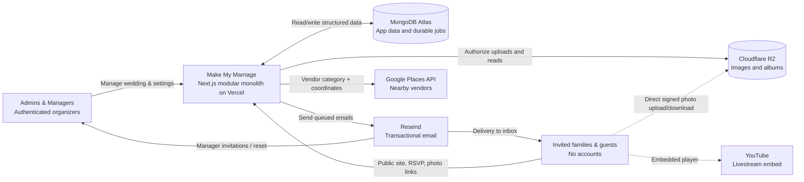
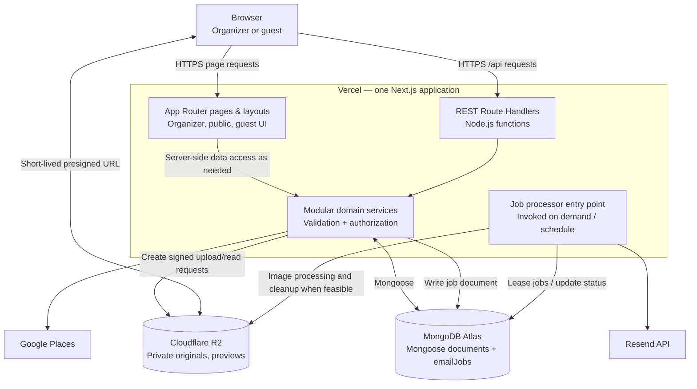
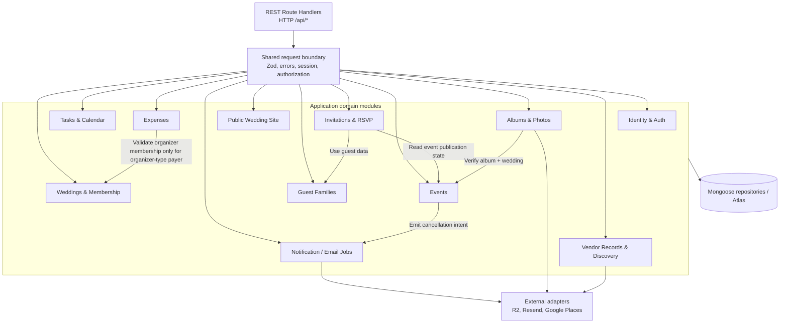
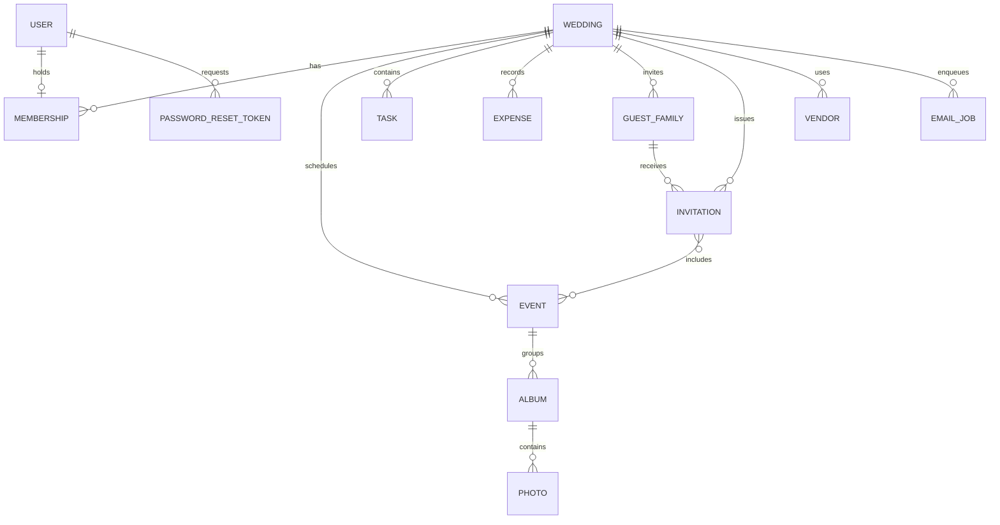
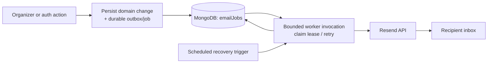
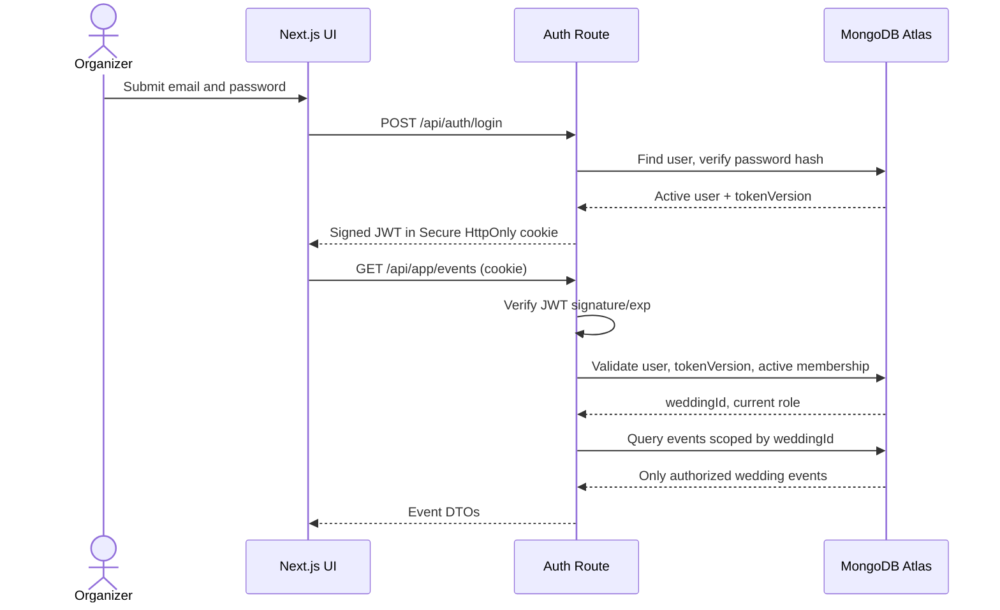
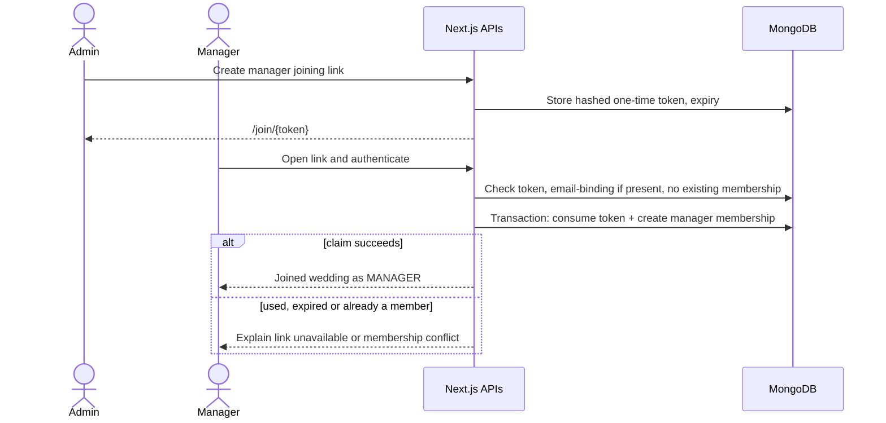
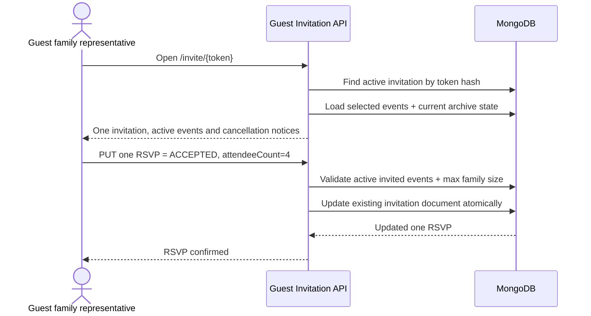
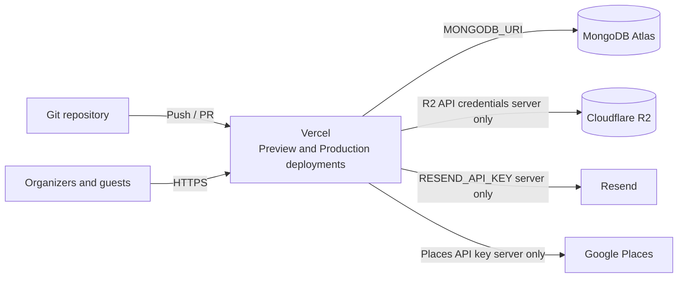

# Make My Marriage (MMM)
## System Design & Architecture Document

| Field | Value |
|---|---|
| Version | **1.1 — Final Architecture Baseline** |
| Date | **12 November 2026** |
| Status | **Final system design baseline** — approved product decisions incorporated; implementation/operations choices explicitly marked |
| Companion document | *Make My Marriage — PRD v1.1* (12 November 2026), aligned with later architecture decisions |
| Intended readers | Product owner, full-stack/backend engineers, reviewers, QA, future contributors |
| Scope | Logical system architecture, modular boundaries, data model, API design, security, flows, deployment approach, operations, trade-offs |

> **Decision labels.** **Confirmed** means explicitly selected in project discussions. **Design recommendation** means the implementation approach proposed in this document, subject to review. **Deferred** means not yet fixed. This distinction matters: technical recommendations are not silently turned into product requirements.

> **Consistency note (12 November 2026).** This version supersedes the earlier system-design v1.0 and the original PRD v1.0 restriction requiring every paid expense to reference a registered organizer. A paid expense may now name a **current organizer** or a **manually entered external payer**. The aligned PRD v1.1 carries the same rule.

> **Guiding principle.** Build a **clean, maintainable, production-capable modular monolith**. Solve real security and reliability problems without adopting microservices, Kafka, Redis, Kubernetes, or real-time infrastructure before they are needed.

---

## Table of contents

1. [Executive summary](#1-executive-summary)
2. [Scope, constraints, decisions](#2-scope-constraints-and-architecture-decisions)
3. [Quality attributes and design principles](#3-quality-attributes-and-design-principles)
4. [C4 Level 1 — System context](#4-c4-level-1--system-context)
5. [C4 Level 2 — Runtime containers](#5-c4-level-2--runtime-containers)
6. [C4 Level 3 — Modular monolith](#6-c4-level-3--modular-monolith)
7. [Next.js routes and repository structure](#7-nextjs-routes-and-repository-structure)
8. [API architecture and contracts](#8-api-architecture-and-contracts)
9. [MongoDB data architecture](#9-mongodb-data-architecture)
10. [Authentication and organizer authorization](#10-authentication-and-organizer-authorization)
11. [Guest tokens, invitation and RSVP model](#11-guest-tokens-invitation-and-rsvp-model)
12. [Event cancellation and archival](#12-event-cancellation-and-archival)
13. [Cloudflare R2 and photo pipeline](#13-cloudflare-r2-and-photo-pipeline)
14. [Email delivery and durable jobs](#14-email-delivery-and-durable-jobs)
15. [Wedding website, geography and countdowns](#15-wedding-website-geography-and-countdowns)
16. [Critical sequence diagrams](#16-critical-sequence-diagrams)
17. [Security and privacy architecture](#17-security-and-privacy-architecture)
18. [Vercel deployment and environment model](#18-vercel-deployment-and-environment-model)
19. [Performance, scale, and reliability](#19-performance-scale-and-reliability)
20. [Observability, testing, and release plan](#20-observability-testing-and-release-plan)
21. [Architectural decision records](#21-architectural-decision-records)
22. [Open questions, risks and prerequisites](#22-open-questions-risks-and-prerequisites)
23. [References](#23-references)

---

# 1. Executive summary

**Make My Marriage (MMM)** is a free, India-first wedding-management web application for couples, families, and invited organizers. Users manage one wedding per account. A wedding may have multiple **Admins** and **Managers**. Guests never register: each family receives **one invitation** that lists selected events and has **one Yes/No RSVP** for the invitation as a whole. The platform also provides tasks, a paid/unpaid expense ledger (with selectable organizer payers **or manually named external payers**), vendors, a public wedding website, event albums, QR-based photo uploads, and email communication.

**Confirmed technology selection**:

- **Application:** Next.js App Router with TypeScript, full-stack on **Vercel** for the first deployment.
- **Architecture:** One **modular monolith**; REST **Route Handlers** are the primary API surface. No separate Express server.
- **Database:** Managed **MongoDB Atlas** cluster, accessed with **Mongoose**; Zod at input boundaries.
- **Organizer authentication:** Email/password and **one longer-lived signed JWT**, stored in a secure HttpOnly cookie; **MongoDB membership and role checks** on protected requests.
- **Object storage:** **Cloudflare R2**, not Amazon S3; 20 MB maximum per photo; no fixed photo-count limit initially.
- **Images:** JPEG, PNG, WebP, HEIC/HEIF accepted; verified and transformed as needed; no manual photo approvals.
- **Emails:** **Resend**, with durable MongoDB-backed email jobs and deployment-independent processing logic.
- **Expenses:** A `PAID` entry has exactly one payer: either an active wedding organizer chosen from a list (including the current user), or an external person whose name is entered manually. A payer need not have an MMM account.
- **Vendor discovery:** Google Places API, minimal search by location/category.
- **Guest access:** Public `/w/:slug`; purpose-specific, expiring invitation, upload, and gallery tokens.
- **Hosting and scale:** Vercel selected initially; no traffic target or specific Atlas tier has been chosen.

**Most important cross-module rule:** Archiving an **upcoming** event is treated as cancelling that event. A family invitation and its existing RSVP remain unchanged. Cancelled events are displayed with a polite notice, active events remain available, and a **single event-cancellation email** is queued for each family whose invitation was **Accepted** at cancellation time. Archiving an ongoing/past event does not produce cancellation emails.

## 1.1 Scope and non-goals

This design covers all 14 PRD domains: authentication; weddings/organizers; dashboard; events; tasks; expenses; guest families; invitations; RSVP/reminders; vendor records; vendor discovery; wedding website/YouTube embed; photos/albums; calendar.

It **does not** introduce payment processing, guest accounts, vendor accounts, budgeting or partial payments, multi-wedding accounts, per-event RSVP, in-app notifications, real-time collaboration, advanced analytics, an activity-history UI, external calendar sync, complex workflow approvals, or a separate livestream service.

---

# 2. Scope, constraints and architecture decisions

## 2.1 Confirmed decisions

| Concern | Decision | Why it matters |
|---|---|---|
| Domain ownership | One wedding per registered account; many organizers per wedding | Membership is single-tenant per user; application is multi-tenant across weddings |
| Roles | `ADMIN`, `MANAGER` only; multiple admins | Only organizer management is admin-only |
| Guests | No account required | Separate token-gated guest endpoints |
| Invitations | One per family; event-specific selection; one overall RSVP | Do **not** create per-event RSVP records |
| Expense | Single amount; `PAID`/`UNPAID`; a single **organizer payer OR manually named external payer** when paid | No payment schedule, gateway, partial payments, or external payer accounts |
| Event deletion | Archive/soft-delete; preserve linked data | Cancelling future event triggers notification logic |
| Concurrency | Last saved update wins | Use targeted updates; do not claim conflict detection |
| Site visibility | Wedding website public; all non-archived events shown | `/w/:slug` is not personalized per guest |
| Guest link expiry | Organizer-configurable dates | Link expiry does **not** delete data or photos |
| Photo moderation | None | Publish immediately **after automated verification**, not before |
| Photo storage | Cloudflare R2 | Store binaries separately from MongoDB |
| Email provider | Resend | Centralized mail adapter and templates |
| Emails | Durable async processing | Worker execution mechanism is not a business domain |
| Deployment | Vercel first iteration | Runtime is ephemeral; do not assume persistent process |
| Countdown | “2 days to go”, “Tomorrow/1 day to go”, “Today” | Derived at display time; no DB countdown field |

## 2.2 Decisions recommended, not yet user-confirmed

- The longer-lived JWT expires after **approximately seven days** (configurable; final duration deferred).
- Secure HttpOnly cookies plus same-site protections, explicit CSRF strategy, server-side account `tokenVersion` checks for forced invalidation.
- A **single-use manager link** expires and can be revoked; only the successful authenticated claimant consumes it.
- A primary wedding venue is prefilled into new events, with per-event override (the inheritance UX is still open).
- Public-facing cover assets may have optimized public URLs; private album photos never use unrestricted public R2 URLs.
- A bounded worker drains MongoDB email jobs using immediate post-commit invocation **plus** independent recovery scheduling; a production-reliable execution trigger must be chosen before launch.
- A photo's derivative processing may run asynchronously, with a `PROCESSING` state. “Immediately visible” means no human approval: visible as soon as automated validation succeeds.

## 2.3 Deferred

Exact hosting plan, runtime region, MongoDB tier, final domain, default guest-link expiry offsets, R2 bucket layout, image-processing worker placement, target load, email quotas, and backup retention.

---

# 3. Quality attributes and design principles

| Quality attribute | Design approach | Practical validation |
|---|---|---|
| Simplicity | One repository/application, strict module boundaries, no microservices | A new feature fits an existing domain module |
| Data isolation | All wedding-specific data scoped by verified membership and `weddingId` | Cross-wedding API tests always deny access |
| Security | Session + role checks, purpose-limited guest tokens, private objects | Direct API calls cannot bypass UI permissions |
| Reliability | Durable email jobs, bounded retries, idempotent cancellation fan-out | Retries and process termination don't lose work |
| Usability | Mobile-first guest pages; one RSVP per family | RSVP and photo upload work without signup |
| Maintainability | Thin route handlers, service/repository layers, typed DTOs | Domain logic tested without HTTP or UI |
| Performance | Indexed queries, projection, pagination, image thumbnails | No unbounded reads on growing collections |
| Cost control | R2 rate limits, operational caps, telemetry | Monitor storage, reads, writes, mail usage |
| Evolvability | Adapters for email, object storage, worker triggers | Provider swap does not rewrite domain code |

**Non-functional targets** should be assessed under realistic load rather than claimed as guaranteed. Adopt PRD guidance for fast common pages, responsive mobile interactions, clear errors, safe recovery, and accessible forms.

---

# 4. C4 Level 1 — System context

The following Mermaid is a **C4-style system context diagram** (not the official C4 DSL); it is editable and renders in GitHub and Mermaid-compatible Markdown viewers.



**Trust boundaries:** (1) unauthenticated internet clients, (2) the MMM server boundary, (3) MongoDB and other provider APIs. Browser clients never receive MongoDB credentials, Resend API keys, or long-lived R2 credentials.

---

# 5. C4 Level 2 — Runtime containers

Here, “containers” means **logical runtime/deployment components**, not necessarily Docker containers.



### Deployment interpretation

- Next.js pages and route handlers are **deployed together**. Hosting may internally scale many function instances; this does not make the application microservices.
- A **logical job processor** is part of the repository. Vercel starts a bounded invocation for it; no always-on process is assumed.
- MongoDB Atlas and Cloudflare R2 are managed external systems.
- Browser-to-R2 transfers use short-lived signed URLs, so 20 MB photos need not pass through Vercel request bodies.
- Long image transformations must fit the actual Vercel plan/runtime or use a separately triggered processing runtime later; this is an **implementation risk**, not a reason to add microservices now.

---

# 6. C4 Level 3 — Modular monolith

## 6.1 Component boundaries



This diagram shows **logical interactions**, not direct imports permitted everywhere. Services expose explicit APIs. Other modules must not reach into another module's repository or Mongoose model except via defined interfaces.

## 6.2 Module ownership

| Module | Owns | Coordinates with |
|---|---|---|
| `auth` | Accounts, password hashes, JWT, reset tokens | `weddings` for member authorization |
| `weddings` | Wedding profile, settings, membership, admin invites | `auth`, `events` |
| `events` | Event creation, dates/venues, archival/cancellation state | `invitations`, `notifications` |
| `tasks` | Task CRUD, assignments, statuses; calendar projection | `events`, `weddings` |
| `expenses` | Ledger entries, payer union (organizer reference or external name), summary aggregates | `weddings` (organizer payer lookup only), `vendors`, `events` |
| `guests` | Family contacts, family size, invite eligibility | `invitations` |
| `invitations` | Family invite, selected events, RSVP, token validity | `events`, `guests`, `notifications` |
| `vendors` | Vendor records, Google Places adapter | `events`, `expenses` |
| `website` | Public slug, theme settings, published event listing | `weddings`, `events` |
| `media` | Albums, photo metadata, upload sessions, gallery links | `events`, R2 adapter |
| `notifications` | Email templates, durable jobs, delivery states | Resend adapter, domain notifications |
| `dashboard` | Read-only aggregation from domain queries | Most modules; **does not own duplicated records** |

**Dependency policy:** Domain services may depend on interfaces of other services; persistence adapters and external SDK clients sit behind service interfaces. Keep route handlers thin. Avoid circular imports; use application-level orchestration for workflows spanning modules (e.g. event cancellation).

## 6.3 Example layering

```text
GET /api/app/expenses
  -> requireOrganizer(request)      // JWT, tokenVersion, membership
  -> parseQuery(zodSchema)
  -> expenseService.list({ weddingId: context.weddingId, filters })
  -> expenseRepository.findByWedding(...)  // Mongoose
  -> paginated DTO response
```

Never accept `weddingId` in a client request as proof of ownership. Read wedding context from server-validated membership.

---

# 7. Next.js routes and repository structure

## 7.1 Website and page URLs

| Path | Access | Purpose |
|---|---|---|
| `/` | Public | Product landing page |
| `/login`, `/register` | Public | Email/password authentication |
| `/forgot-password`, `/reset-password?token=...` | Public; reset token required for mutation | Password recovery |
| `/join/[token]` | Link visible publicly; login required to accept | One-time manager joining |
| `/app/*` | Organizer session + active membership | All management pages |
| `/w/[slug]` | Public | Wedding website; all non-archived events |
| `/invite/[token]` | Purpose-limited guest token | One family invitation and RSVP |
| `/gallery/[token]` | Purpose-limited guest token | Private gallery browsing |
| `/upload/[token]` | Purpose-limited guest token | Event album photo uploads |

A public wedding slug is an **identifier**, not a security secret. Random tokens are **capability credentials**. Changing a slug should not leak private records or invalidate internal IDs.

## 7.2 Suggested repository structure

```text
make-my-marriage/
  src/
    app/
      (marketing)/page.tsx
      (auth)/login/page.tsx
      (auth)/register/page.tsx
      (auth)/forgot-password/page.tsx
      (auth)/reset-password/page.tsx
      (public)/w/[slug]/page.tsx
      (guest)/invite/[token]/page.tsx
      (guest)/gallery/[token]/page.tsx
      (guest)/upload/[token]/page.tsx
      (guest)/join/[token]/page.tsx
      (organizer)/app/layout.tsx
      (organizer)/app/dashboard/page.tsx
      (organizer)/app/events/page.tsx
      (organizer)/app/tasks/page.tsx
      (organizer)/app/expenses/page.tsx
      (organizer)/app/guests/page.tsx
      (organizer)/app/invitations/page.tsx
      (organizer)/app/vendors/page.tsx
      (organizer)/app/gallery/page.tsx
      (organizer)/app/calendar/page.tsx
      (organizer)/app/settings/page.tsx
      api/
        auth/...
        app/...
        guest/...
        public/...
        internal/jobs/drain/route.ts
    modules/
      auth/{auth.service.ts,auth.repository.ts,auth.schema.ts,auth.types.ts}
      weddings/{wedding.service.ts,membership.service.ts,...}
      events/{event.service.ts,event.repository.ts,...}
      tasks/...
      expenses/...
      guests/...
      invitations/...
      vendors/...
      website/...
      media/...
      notifications/{email-job.service.ts,email-worker.ts,...}
      dashboard/...
    infrastructure/
      mongodb/{connection.ts,models/...}
      r2/{client.ts,object-storage.adapter.ts}
      resend/{client.ts,email.adapter.ts}
      places/{client.ts,places.adapter.ts}
    lib/
      auth/{cookies.ts,jwt.ts,require-organizer.ts}
      validation/
      errors/
      dates/
      rate-limit/
    components/
    emails/
  tests/
  public/
  .env.example
  package.json
```

**Note:** These names are conventions, not exact mandatory filenames. Route groups in parentheses do **not** appear in the URL. A page layout does not authorize direct REST calls: each handler must authorize separately.

## 7.3 Rendering and caching

- Organizer pages may render server-side and fetch scoped data through a server service, or use REST from interactive client components. The **backend contract remains REST-first**; a server component need not make a wasteful HTTP call to the same application just to read data.
- Protected and guest-token pages must avoid shared public caching; ensure no cache stores personalized RSVP, private photos, or organizer data for other users.
- Public `/w/[slug]` pages may use caching/revalidation, but archived events and updated schedules should not remain stale for unacceptable periods.
- Countdown labels are computed from event timestamps at render/update time; refresh across day boundaries if the page remains open.

---

# 8. API architecture and contracts

## 8.1 HTTP conventions

- URL prefix: `/api`; group organizer operations under `/api/app` and guest operations under `/api/guest`.
- JSON request/response for ordinary CRUD; binary files **never** sent through general JSON APIs.
- Zod validates bodies, query parameters, and path parameters. Mongoose schemas enforce persistent constraints, not client trust.
- Standard error shape with machine-readable `code`, human-readable `message`, `requestId`, and optional validation `details`.
- Common responses: `200`/`201` success, `204` delete/archive acknowledgment, `400` validation, `401` unauthenticated, `403` forbidden, `404` unavailable/nonexistent (avoid resource enumeration), `409` conflict/used token, `410` expired/revoked link when appropriate, `429` rate limited.
- Paginate collections with cursors or page/limit; cap page size. Apply projection and sort indexes.
- Mutations receive CSRF protection where cookie authentication applies.
- Prefer explicit, idempotent semantics for retried operations (e.g. PUT RSVP, POST cancellation with idempotency key).

**Example successful response:**

```json
{
  "data": { "id": "expense_id", "title": "Photography", "amountMinor": 5000000, "status": "PAID", "payer": { "kind": "EXTERNAL", "organizerUserId": null, "nameSnapshot": "Rajesh Sharma" } },
  "meta": { "requestId": "req_abc" }
}
```

**Example error:**

```json
{
  "error": { "code": "INVITATION_EXPIRED", "message": "This invitation link is no longer active." },
  "meta": { "requestId": "req_def" }
}
```

## 8.2 Suggested route inventory

This table is a **contract proposal**, not a fully approved OpenAPI specification.

| Domain | Method and route | Access | Outcome |
|---|---|---|---|
| Auth | `POST /api/auth/register`, `/login`, `/logout` | Public / authenticated | Account/session lifecycle |
| Auth | `POST /api/auth/forgot-password`, `/reset-password` | Public + reset token | One-time password recovery |
| Me | `GET /api/app/me` | Organizer | Current account, wedding, role |
| Weddings | `POST /api/app/wedding`, `GET/PATCH /api/app/wedding` | Organizer (create without membership) | Create/update wedding |
| Members | `GET /api/app/members` | Organizer | List admins/managers |
| Members | `POST /api/app/member-invitations` | Admin | Email invite or one-time join link |
| Members | `POST /api/join/:token/accept` | Authenticated invitee | Atomically join wedding |
| Members | `PATCH /api/app/members/:id/role`, `DELETE /api/app/members/:id` | Admin | Promote/remove with last-admin invariant |
| Events | `GET/POST /api/app/events`, `PATCH /api/app/events/:id` | Organizer | Event CRUD |
| Events | `POST /api/app/events/:id/archive` | Organizer | Archive, future-cancellation workflow |
| Tasks | `GET/POST /api/app/tasks`, `PATCH/DELETE /api/app/tasks/:id` | Organizer | Task planner |
| Expenses | `GET/POST /api/app/expenses`, `PATCH/DELETE /api/app/expenses/:id` | Organizer | Paid/Unpaid ledger; organizer or manual external payer |
| Guests | `GET/POST /api/app/guest-families`, `PATCH/DELETE /api/app/guest-families/:id` | Organizer | Family data |
| Invitations | `POST /api/app/invitations`, `POST /api/app/invitations/:id/send` | Organizer | One family invite and email job |
| Invitations | `POST /api/app/invitations/remind-pending` | Organizer | Queue reminders |
| Guest RSVP | `GET /api/guest/invitations/:token`, `PUT /api/guest/invitations/:token/rsvp` | Guest token | View/update one overall RSVP |
| Vendors | `GET/POST /api/app/vendors`, `PATCH/DELETE /api/app/vendors/:id` | Organizer | Local vendor records |
| Discovery | `GET /api/app/vendor-discovery?lat=&lng=&category=` | Organizer | Restricted Google Places proxy |
| Public | `GET /api/public/weddings/:slug` | Public | Public website payload |
| Albums | `GET/POST /api/app/albums` | Organizer | Album management |
| Guest media | `POST /api/guest/uploads/:token/init`, `/complete` | Guest upload token | R2 upload session and verification |
| Gallery | `GET /api/guest/galleries/:token`, `GET /api/guest/photos/:token/:photoId/access` | Guest view token | Private metadata and signed GET |
| Jobs | `POST /api/internal/jobs/drain` | Internal secret only | Run bounded durable jobs |

*Implementation note:* For `/api/app/wedding` creation, an authenticated user with **no current wedding membership** may create a wedding. All subsequent `/api/app/*` routes require membership, except that explicitly scoped create flow.

---

# 9. MongoDB data architecture

## 9.1 Tenancy and primary entities

A user belongs to at most **one wedding**; a wedding contains many organizers. Use a `memberships` collection or embed membership in `users`; the former is recommended for explicit lifecycle and unique-index enforcement.



ER diagram is conceptual. The initial implementation should normally maintain **one current invitation per guest family** per wedding rather than repeatedly issuing new invitation records; resends reuse the invitation token if still valid. Regeneration/revocation creates a new token version without duplicating RSVP.

## 9.2 Candidate collections and key fields

| Collection | Representative fields and indexes |
|---|---|
| `users` | `_id`, `emailNormalized` (unique), `passwordHash`, `tokenVersion`, name, profile, state |
| `weddings` | `_id`, `slug` (unique), couple names, date range, `defaultVenue`, `timezone`, website/theme, settings |
| `memberships` | `userId` (unique to enforce one wedding/account), `weddingId`, role, `status`; index `(weddingId,status)` |
| `managerInvites` | `weddingId`, `tokenHash` (unique), `invitedEmail?`, `expiresAt`, `consumedAt`, `revokedAt`, issuer |
| `events` | `weddingId`, name, start/end UTC, timezone, venue, public status, `archivedAt`, cancellation marker; index `(weddingId,startAt)` |
| `tasks` | `weddingId`, eventId?, assigneeUserId?, dueAt?, priority, `TODO/IN_PROGRESS/COMPLETED`; indexes by wedding/status/date |
| `expenses` | `weddingId`, eventId?, vendorId?, `amountMinor`, currency `INR`, `PAID/UNPAID`, `payer: {kind, organizerUserId?, nameSnapshot}?`, `paidAt?`; indexes `(weddingId,status)` and optional payer filters |
| `guestFamilies` | `weddingId`, name, primaryContact, normalizedEmail, invitedCount, notes |
| `invitations` | `weddingId`, `guestFamilyId`, `invitedEventIds[]`, `tokenHash`, `expiresAt`, `revokedAt`, `rsvpStatus`, `attendeeCount`, `rsvpUpdatedAt` |
| `vendors` | `weddingId`, category, name, contact, agreedCostMinor?, eventIds[], notes, optional places reference |
| `albums` | `weddingId`, eventId, title, createdBy; view and upload link settings/references |
| `photoLinks` | `weddingId`, `albumId`, `purpose:VIEW/UPLOAD`, `tokenHash`, expiry, revokedAt |
| `photos` | `weddingId`, albumId, object keys, mime/type, size, image metadata, `PENDING/PROCESSING/READY/REJECTED`, uploadedByType |
| `uploadSessions` | `weddingId`, albumId, token/link reference, expected MIME/size, temporary object key, expiry, status |
| `emailJobs` | `type`, `dedupeKey` (unique), `weddingId?`, recipient, protected payload ref, status, attempts, leaseUntil, nextAttemptAt, providerId |
| `passwordResetTokens` | `userId`, `tokenHash`, `expiresAt`, `consumedAt`; short TTL cleanup optional |
| `cancellationCampaigns` | `weddingId`, `eventId`, cancellation occurrence key, effectiveAt, fan-out progress, status |

**Important:** collection names and fields are design recommendations, **not** a finalized low-level schema. A cancellation campaign may be embedded within the event if fan-out volume is small, but a separate document is clearer for durable processing.

## 9.3 Example wedding and event venue

```json
{
  "_id": "wedding_abc",
  "slug": "rahul-priya",
  "timezone": "Asia/Kolkata",
  "defaultVenue": {
    "name": "Example Wedding Hall",
    "formattedAddress": "Jaipur, Rajasthan, India",
    "city": "Jaipur",
    "state": "Rajasthan",
    "country": "India",
    "postalCode": "302001",
    "geo": { "type": "Point", "coordinates": [75.7873, 26.9124] }
  }
}
```

GeoJSON order is **longitude, latitude**. Coordinates above are an illustrative Jaipur-area point, not a geocoded claim about a particular venue. Individual events may override the wedding default. Persist timestamps in UTC and the relevant IANA timezone for display and calendar-day comparisons.

## 9.4 Expense and payer model — finalized domain rules

**Business rule (updated):** A paid expense can be attributed to the logged-in organizer, another **currently active** Admin/Manager of the same wedding, **or anyone outside MMM whose name an organizer enters manually** (for example, a parent or relative). The person recorded as the payer does **not** need to be an MMM user. Only logged-in organizers may *create/edit* expense entries; that is distinct from the payer's identity.

### 9.4.1 Invariants

1. `amountMinor` is a positive integer stored in paise, in INR; use integer arithmetic, not floating-point rupees.
2. `UNPAID` → `payer = null` and `paidAt = null`; does not require any payer selection.
3. `PAID` → **exactly one payer** with `payer.kind = ORGANIZER | EXTERNAL`; it must not contain conflicting organizer and external identities.
4. `ORGANIZER` → `organizerUserId` is required and must identify an **active Admin/Manager of this same wedding when assigned or changed**. `nameSnapshot` is populated by the server from the user profile. “I paid” is only a UI shortcut to select the signed-in organizer; it is **not a separate stored kind**.
5. `EXTERNAL` → `organizerUserId = null`; `nameSnapshot` is required, supplied through a trimmed, length-limited free-text field (e.g. `Rajesh Sharma`). It does not create a user account, grant access, or require membership verification. Reject empty/whitespace-only names and unsafe control characters; escape names when rendered.
6. **Historical continuity:** If a recorded organizer payer is later removed, **retain** the organizer reference and original `nameSnapshot`. Do **not** retroactively invalidate an existing paid record or prevent edits to its unrelated fields. Validate active membership only when **assigning or changing** an organizer payer; a previously removed payer may not be newly selected.
7. `PAID → UNPAID` clears current payer and paid date; `UNPAID → PAID` requires a valid payer; changing payer from either kind revalidates the new selection.
8. No payer verification against a bank account, no actual payment transfer, no shared/partial payments, no instalments or payment schedules. Totals: `totalPaid = sum(amountMinor where status=PAID)`; `totalUnpaid = sum(amountMinor where status=UNPAID)`.

### 9.4.2 Recommended stored representation

One embedded discriminated union, **not** separate columns that can disagree:

```ts
type ExpensePayer =
  | { kind: 'ORGANIZER'; organizerUserId: string; nameSnapshot: string }
  | { kind: 'EXTERNAL'; organizerUserId: null; nameSnapshot: string };

type ExpensePaymentState =
  | { status: 'UNPAID'; payer: null; paidAt: null }
  | { status: 'PAID'; payer: ExpensePayer; paidAt: string | null };
```

*Illustrative persistence shape: Mongoose ObjectId and Date types replace strings as appropriate.* `nameSnapshot` is populated by the server for organizer payers; for external payers it is the manually entered name after normalization.

**Example — organizer payer (including “I paid”):**

```json
{
  "title": "Photography", "amountMinor": 5000000, "currency": "INR",
  "status": "PAID",
  "payer": { "kind": "ORGANIZER", "organizerUserId": "user_rahul", "nameSnapshot": "Rahul" }
}
```

**Example — manually entered non-member:**

```json
{
  "title": "Decoration", "amountMinor": 2500000, "currency": "INR",
  "status": "PAID",
  "payer": { "kind": "EXTERNAL", "organizerUserId": null, "nameSnapshot": "Rajesh Sharma" }
}
```

**Example — unpaid:** `{ "status": "UNPAID", "payer": null, "paidAt": null }`.

### 9.4.3 API and UI contracts

- The expense form presents **I paid**, **Choose organizer**, **Enter another person's name**. The first two submit an `ORGANIZER` payer; the third submits an `EXTERNAL` payer.
- Example write DTO for organizer: `{"status":"PAID","payer":{"kind":"ORGANIZER","organizerUserId":"user_rahul"}}`.
- Example write DTO for external: `{"status":"PAID","payer":{"kind":"EXTERNAL","name":"Rajesh Sharma"}}`.
- Example unpaid DTO: `{"status":"UNPAID","payer":null}`.
- The server never trusts a client-provided `nameSnapshot` for an organizer. It loads current eligible wedding membership and resolves the user's display name.
- The membership service is called **only for organizer-type payer assignment**, not for an external name. Rename any conceptual “Validate Eligible Payer” step to **“Validate Payer Details”**, covering a discriminated type, appropriate checks, and state invariants.
- Ledger filters and exports should display the snapshot name for both kinds. An `EXTERNAL` name is a ledger label, not a principal that can access anything.
- Use field-specific atomic updates and validate the complete payment-state invariant at the service boundary; last-write-wins remains the chosen conflict policy.

## 9.5 Key constraints and indexes

- Unique normalized user email.
- Unique `memberships.userId` for one-wedding-per-user; unique `(weddingId,userId)` as defense in depth.
- Unique wedding slug.
- Unique (current) family invitation association using an appropriate partial unique index; a token's hash must be unique.
- Unique `emailJobs.dedupeKey`, e.g., `event_cancelled:<cancellationId>:<familyId>`.
- Event and task indexes for common lists `(weddingId, startAt)` and `(weddingId, status, dueAt)`.
- Guest-family lookup `(weddingId, normalizedEmail)` is an optional non-unique search index (different families may share an address).
- Avoid indexing every field prematurely; inspect actual queries.
- Expiration **must be checked in application logic**; TTL cleanup is optional for *disposable token/session documents only*, not the main invitation or RSVP record.

## 9.6 Transaction policy

Prefer single-document atomic updates. Use MongoDB transactions for **short, correctness-critical multi-document state changes**, such as consuming a one-time manager invite together with creating a membership, or coordinating an archive marker with a durable cancellation outbox/campaign.

Do **not** put hundreds of individual email sends or unlimited fan-out records inside one database transaction. The event archive should commit once and a resumable worker should fan out notifications.

---

# 10. Authentication and organizer authorization

## 10.1 Login flow

1. Client submits email/password to `/api/auth/login`.
2. Server rate-limits, normalizes email, validates input, and verifies password using **Argon2id** (or an equivalently vetted password-hashing algorithm).
3. Server issues a signed JWT with `sub`, `iat`, `exp`, `tokenVersion` (and standard issuer/audience claims); no permanent role/wedding trust is taken from JWT claims.
4. Store JWT in a `Secure`, `HttpOnly` cookie with deliberate `SameSite` and path choices. Do not store it in localStorage.
5. Each protected operation verifies JWT **and current user/account status and membership** in MongoDB; fetch current role. Admin-only endpoints require `ADMIN` in current active membership.
6. Logout clears the browser cookie. **Single-JWT logout does not invalidate a stolen copy server-side** unless a server-side version/deny-list mechanism is invoked. That limitation must be understood.

**Design recommendation:** use `tokenVersion` to invalidate previously issued JWTs after password reset, credential compromise, or forced account-wide sign-out. For an admin removing a manager, changing membership status is sufficient to block wedding data APIs immediately, though account-level auth remains valid until token/version invalidation.

## 10.2 Password reset

- Endpoints: `POST /api/auth/forgot-password` and `POST /api/auth/reset-password`.
- Generate a high-entropy random token; persist **only the token hash**, with expiration (recommended **30 minutes**).
- Send reset link through a **priority Resend email job**. Keep raw reset URLs out of logs; protect the job payload because the email needs the original token.
- Return the same generic acknowledgment for existing/nonexisting email addresses.
- Verify one-time token, validate new password, atomically consume token/change hash, and increment `tokenVersion`.
- Invalidate previous reset links and require user to log in again.
- Limit requests by IP and account/email key. Do not rely on TTL cleanup to enforce expiration.

**Delivery caveat:** if no sufficiently prompt durable worker trigger exists on the initial Vercel plan, password recovery may be delayed even though jobs are persisted. Treat reliable timely dispatch as a **release blocker**; see §14 and §22.

## 10.3 Manager invitations and multiple admins

- Admin can create an email invitation or **one-time-use joining URL**.
- Token is random, hashed at rest, purpose-bound, expiring, and revocable.
- A prospective manager opens `/join/[token]`, signs in/registers, and then explicitly accepts.
- Atomic acceptance confirms: valid/unconsumed token, intended email if email-bound, user has no membership, wedding active, and token consumption succeeds exactly once.
- Each user can join only one wedding. Repeated acceptance responds with a helpful used/expired message; parallel attempts cannot both succeed.
- Admins may promote a manager to admin; **the last active admin cannot be removed or demoted**. Precise permissions for managing *other admins* remain an implementation-policy open item.

---

# 11. Guest tokens, invitation and RSVP model

## 11.1 One family invitation, multiple selected events, one RSVP

This is a **non-negotiable confirmed domain rule**.

```json
{
  "guestFamilyId": "family_123",
  "invitedEventIds": ["haldi", "mehndi", "sangeet", "wedding"],
  "rsvpStatus": "ACCEPTED",
  "attendeeCount": 4,
  "expiresAt": "2027-01-10T18:30:00.000Z"
}
```

- The single invitation lists only events that family was selected for, including a visible cancellation notice for archived **future** invited events.
- The public `/w/[slug]` website separately lists **all non-archived** events for everyone.
- One `PENDING` / `ACCEPTED` / `DECLINED` RSVP belongs to the **invitation**, not any event.
- `ACCEPTED` includes attendee count from 1 up to invited family size; `DECLINED` implies zero expected attendees; `PENDING` is unanswered.
- Repeat submissions **update the same RSVP record**; they do not create new invitations.
- Cancelling one event never resets the invitation token, RSVP, attendee count, or still-active event references.
- If **all** invited events have been cancelled, the invitation remains viewable with cancellation messages and historical RSVP; **new acceptance is disabled** because no event remains to attend.

## 11.2 Capability token design

| Token purpose | Page | Permitted operations | Disallowed |
|---|---|---|---|
| Family invitation | `/invite/[token]` | Read that family's selected events; update that invitation's RSVP | Manage events; view other families |
| Album upload | `/upload/[token]` | Request bounded upload authorization for designated album | Browse private gallery unless separately granted |
| Gallery view | `/gallery/[token]` | Browse authorized album(s); obtain short-lived image reads | Upload/delete photos or change album settings |
| Manager join | `/join/[token]` | Initiate one-time membership acceptance after login | Organizer operations without membership |
| Password reset | `/reset-password?token=` | One-time password change | Any other authenticated action |

Use purpose-specific random secrets (e.g. 256-bit), store keyed hashes, compare safely, validate expiry/revocation server-side. Treat share links as bearer credentials. Avoid placing tokens in analytics events, logs, referrer URLs, or third-party resources; set suitable Referrer-Policy and `noindex` on token pages.

**Organizer-configurable link expiration:** invitation, upload, and gallery access have separate expiration settings; R2 presigned object URLs are independently short-lived and not a substitute for these checks.

---

# 12. Event cancellation and archival

## 12.1 Domain meaning

**Confirmed product behavior:** The organizer archives (soft-deletes) an event. If the event **has not started yet** at that moment, this is treated as a **future-event cancellation** for invited guests. If it is ongoing or already past, archive it for historical organization and **do not send a cancellation email**.

Use `startAt > now()` (UTC instants) to classify future events. For display and “Today” labels, use the event's configured timezone. Avoid comparing only calendar dates when classifying whether the event has already started.

**Event lifecycle fields, proposed:** `status` for schedule (`UPCOMING/ONGOING/COMPLETED`, which may be derived), `archivedAt`, `archivedBy`, `archivedReason?`, and `cancellationId?` when a future event was cancelled. Keep archived records and all references; no hard cascade delete.

## 12.2 Invitation behavior after cancellation

Example: Sharma family is invited to Haldi, Mehndi, Sangeet, Wedding, and has already responded **Yes**. Sangeet is later cancelled:

- **Keep the same invitation URL and existing Yes RSVP unchanged.** No new invitation and no per-event RSVP.
- Show **Sangeet — Cancelled** with a polite explanation on that invitation page.
- Other invited events remain visible and active. Guests need take no further action for their existing accepted RSVP.
- Queue **one polite cancellation email** to the already-accepted family representative about **that cancelled event**, not a new RSVP request.
- Families whose invitation is Pending or Declined are **not** emailed under the chosen v1 rule. A Pending family may still respond Yes/No for the remaining active events.
- If all invited events are cancelled, keep historical RSVP accessible but disable any *new* acceptance.
- Already-completed or currently-running event archival does **not** trigger guest cancellation emails.

**Clarification:** If two distinct future events are cancelled on different occasions, each can produce its **own** single notice per eligible family. “One email” means **one per cancelled event per eligible family**, not a lifetime cap across all cancellations.

## 12.3 Atomicity and idempotency

A recommended robust implementation:

1. Organizer initiates `POST /api/app/events/:id/archive`.
2. Authorize wedding/member; read `startAt`, archive state, and `now`.
3. In a short MongoDB transaction or equivalent atomic outbox design, mark event archived **once** and persist a **cancellation campaign/outbox marker** for future events. If already archived, return idempotent success without a second campaign.
4. A worker processes the campaign in pages, selecting invitations that contain the cancelled event and were **Accepted** at cancellation time; create one `emailJob` per eligible family with a stable, unique dedupe key.
5. Resend adapter sends from durable jobs; worker retries errors and records status.
6. Invitation reads reflect event status immediately regardless of email-delivery progress.

**Race-condition note:** Determining “accepted *at cancellation time*” exactly across concurrent RSVP updates requires a clear snapshot strategy (e.g. capture RSVP transition time/version or eligibility in a durable cancellation fan-out snapshot). Do not silently use a much-later current RSVP state if strict timing semantics matter. A minimal v1 can make a deterministic cutoff based on `cancelledAt` and store accepted-state metadata; test concurrent RSVP/cancellation requests. This is a **small implementation design decision**, not a change to the user's RSVP model.

## 12.4 Recommended guest copy

> **Event update:** We're sorry to share that the Sangeet ceremony scheduled for 15 December will no longer take place. All other celebrations on your invitation remain unchanged. If you have already RSVPed, your response remains confirmed and no action is required. Thank you for your understanding.

The actual page should tailor the last sentence for Pending/Declined families, and should never promise “all other events unchanged” if more than one has been cancelled. Protect venue and contact details from unintended exposure beyond the invitation's configured permissions.

---

# 13. Cloudflare R2 and photo pipeline

## 13.1 Object storage design

**Confirmed:** Cloudflare R2 stores originals and generated previews; MongoDB stores metadata, permissions, album relationships, and upload state. Private galleries stay private. Photos remain until an organizer deletes them, irrespective of guest-link expiry.

Suggested object-key convention:

```text
weddings/{weddingId}/albums/{albumId}/original/{photoId}
weddings/{weddingId}/albums/{albumId}/preview/{photoId}.webp
weddings/{weddingId}/albums/{albumId}/thumb/{photoId}.webp
weddings/{weddingId}/public/cover/{assetId}.webp
```

Never build a client-trusted object path directly from user input. Use server-issued random object IDs and scoped prefixes. Separate private and public policies/buckets or enforce equivalent object-level access through a trusted delivery layer.

## 13.2 Upload flow and validation

1. Guest opens `/upload/[token]`; server validates purpose, expiry, album/event relationship, and rate limits.
2. Client selects file. Perform a **UX-only** preliminary 20 MB check and file-type hint check.
3. Client calls `POST /api/guest/uploads/:token/init` with metadata. Server validates request, creates `uploadSession`, assigns a unique **temporary key**, and returns short-lived R2 **presigned PUT** URL (signed `Content-Type` where appropriate).
4. Browser uploads **directly to R2**. The R2 bucket has a strict origin/method/header CORS policy. No R2 master credentials reach the browser.
5. Client calls `/complete`. Server performs R2 `HeadObject`/read-validation, checks **actual stored bytes ≤20 MB**, type signatures and decode safety. Reject/delete objects that violate policy.
6. Decode/normalize image, strip potentially sensitive EXIF (particularly GPS metadata), create preview and thumbnail. HEIC/HEIF needs a codec/runtime that actually supports the desired conversion.
7. Store photo metadata and mark `READY`; show photo **without moderator approval**. Until verification finishes, display “processing” only.
8. Abandoned upload sessions and orphaned temporary objects are periodically cleaned up.

**R2-specific issue:** R2 presigned URLs support `PUT`, `GET`, `HEAD`, `DELETE`, but not HTML-form presigned `POST` policies. A strict client-side 20 MB check **cannot prevent a malicious client from uploading more** with an authorized PUT URL; validate/delete on completion, keep URLs short-lived, rate-limit token issuance, and monitor temporary storage. If hard pre-upload enforcement is later mandatory, evaluate an intermediary that can enforce stream sizes, but do not silently claim presigned PUT alone enforces the limit.

## 13.3 Photo read flow

- A browser requests gallery metadata using a **valid gallery-view token**; the backend filters by authorized album and `READY` status.
- To view an image, the API issues a **short-lived presigned GET** for its private preview object or uses a permission-aware image delivery layer.
- Read access must not be inferred from an R2 key alone. Do not expose private albums through a public R2 bucket/CDN endpoint.
- Public wedding cover assets may use cacheable public URLs; a private view path must not accidentally inherit that policy.
- Optional Cloudflare caching/CDN is a later optimization, **not an assumption that every private object is safely public**.

## 13.4 Processing trade-off for Vercel

HEIC conversion plus large image processing can be CPU/memory intensive. A bounded, on-demand Vercel Function may be sufficient for typical v1 images, but **verify Sharp/libvips HEIF capability, bundle size, memory, and execution duration against the actual plan** before promising uniform conversion.

Recommended fallback: persist `PROCESSING` and run conversion with a separately invokable processing job; it is still part of the modular monolith design. Never call a photo fully published before the conversion/verification succeeds. A failure should allow retry or yield `REJECTED` with a clear user message.

---

# 14. Email delivery and durable jobs

## 14.1 Workflow

**Provider:** Resend. Email types: password reset, manager invitation, family invitation, manual reminder, future-event cancellation.



## 14.2 Job document and state machine

Recommended fields:

```json
{
  "_id": "job_123",
  "type": "EVENT_CANCELLED",
  "dedupeKey": "event_cancelled:cancellation_1:family_3",
  "weddingId": "wedding_1",
  "recipientEmail": "family@example.com",
  "payloadReference": "encrypted_or_server_only_reference",
  "status": "PENDING",
  "attempts": 0,
  "maxAttempts": 5,
  "nextAttemptAt": "2026-12-10T10:00:00.000Z",
  "leaseUntil": null,
  "providerMessageId": null
}
```

Transitions: `PENDING → PROCESSING → SENT`, or `PROCESSING → RETRY_PENDING → PROCESSING`, eventually `FAILED`. A stale `PROCESSING` lease is eligible for recovery. A sent job never re-enters send state during normal retry handling.

- Claim jobs atomically with a condition on status, due time, and lease expiry.
- Use **unique business-level `dedupeKey`** (not merely an HTTP idempotency token) to avoid duplicate job creation.
- Use a **Resend idempotency key** on send. Resend currently documents a **24-hour** retention window for a given idempotency key. Retries beyond that window still require local dedupe protections and may not prevent all duplicate deliveries.
- Classify transient vs permanent errors (timeout/429 vs invalid address); honor provider rate limits.
- Password reset job payloads contain sensitive link data. Encrypt payloads where feasible, limit access, avoid logs, and scrub after completion/expiry.
- Maintain aggregate statuses visible to organizers without exposing provider secrets.

## 14.3 Vercel-specific execution caveat

**Confirmed:** Deploy Next.js on Vercel initially. **Not confirmed:** exact plan and reliable email-worker invocation mechanism.

- Vercel Functions are **ephemeral** and cannot be assumed to host a continuously running process. `after()`/post-response work may provide prompt **best-effort** processing but is subject to function lifetime and execution failure; it is **not a durable queue trigger** by itself.
- Design the **worker processor** as a reusable function such as `processDueJobs({maxJobs,maxDurationMs})`. A protected internal API can invoke it on demand; a scheduled process can run recovery.
- The current Vercel Cron documentation lists **Hobby as at most once daily**, while Pro/Enterprise can schedule more often. Daily recovery alone is **not** adequate for a password reset link that expires in 30 minutes or a time-sensitive cancellation notice.
- **Before public launch**, ensure a promptly retryable, durable triggering path (e.g. suitable paid scheduling/queue service, persistent external worker, or an approved managed background execution product). This is a **deployment reliability gate**, not an invitation to introduce Kafka or microservices.
- Internal worker routes must authenticate a secret/provider identity; never leave job processing publicly callable.

## 14.4 Transactional outbox rule

When a domain mutation **must** produce an email (e.g. future-event cancellation), persist the cancellation intent with the domain change or as a durable outbox record within a transaction. The worker creates/sends jobs from that intent. Never archive successfully and then rely solely on an in-memory promise to remember the notifications.

---

# 15. Wedding website, geography and countdowns

## 15.1 Public site

`/w/[slug]` is **public and common to everyone**. It shows the couple, public wedding details, selected theme (2–3 predefined themes), cover image, maps links, YouTube embed if configured, and **all non-archived wedding events**. It does **not** filter events based on a specific family's invitation.

Organizer actions update website settings in the wedding record. Ensure invalid/disabled YouTube links fail gracefully; don't host the stream. Public pages must not include guest contact information, internal expense amounts, raw invitation tokens, or private image object keys.

## 15.2 Venue fields and vendor search

- Retain a human-readable address and geo coordinates: venue name, formatted address, city, state, country, postal code, GeoJSON longitude/latitude, and IANA timezone.
- Event venue can differ from wedding default.
- Google Places is called from server-only code with selected fields, bounded search radius/limits, and a budget cap. Store only permitted vendor information per provider terms and let organizers create their own records.
- Display Google Maps links in website and events; a full map UI is not required.

## 15.3 Relative countdown labels

| Condition | UI label |
|---|---|
| Upcoming, >1 local calendar day | `N days to go` |
| Tomorrow | `1 day to go` or `Tomorrow` |
| Same event-local date | `Today` |
| Event currently happening | `Happening today` |
| Event finished | `Completed` |
| Event archived | Hidden in public/standard event listings |

Compute from `startAt`, `endAt`, and the appropriate timezone in a shared date utility; do not save changing countdown strings to MongoDB. On a page left open overnight, refresh the label around the local midnight boundary. Do not render stale countdowns from long-lived public caches.

---

# 16. Critical sequence diagrams

## 16.1 Login and organizer authorization



## 16.2 One-time manager joining



## 16.3 Family RSVP; no per-event response



## 16.4 Future event cancellation and email

```mermaid
sequenceDiagram
    actor O as Organizer
    participant API as Event Archive API
    participant DB as MongoDB
    participant W as Job Processor
    participant R as Resend
    actor G as Accepted family
    O->>API: Archive future Sangeet
    API->>DB: Atomically mark archived + persist cancellation intent
    DB-->>API: Committed
    API-->>O: Event archived
    G->>API: Open existing invitation link
    API->>DB: Load invitation + referenced events
    API-->>G: Existing RSVP unchanged; Sangeet marked Cancelled
    W->>DB: Claim campaign and find eligible accepted families
    W->>DB: Upsert unique event/family email jobs
    W->>DB: Claim pending email job
    W->>R: Send event cancellation (idempotency key)
    R-->>W: Provider message ID
    W->>DB: Mark SENT
    R-->>G: Polite cancellation email
```

The email sequence is **eventually consistent**; an archive must not wait for Resend to deliver emails. The invitation page changes as soon as the event archive is persisted.

## 16.5 Guest image upload to R2

```mermaid
sequenceDiagram
    actor G as Guest
    participant UI as Upload page
    participant API as Next.js media API
    participant DB as MongoDB
    participant R2 as Cloudflare R2
    G->>UI: Scan QR, select supported image
    UI->>API: POST /init with upload token, MIME, expected size
    API->>DB: Validate album link, expiry, abuse limits; create upload session
    API-->>UI: Short-lived presigned PUT URL + object key opaque ID
    UI->>R2: PUT image directly (not via Vercel body)
    R2-->>UI: Upload response
    UI->>API: POST /complete
    API->>R2: Head/read object; verify actual bytes and type
    API->>DB: Mark processing; persist photo metadata
    API->>R2: Create preview/thumbnail or schedule processing
    API->>DB: Mark READY after successful validation
    API-->>UI: Upload complete; photo visible without manual review
```

## 16.6 Forgot password

```mermaid
sequenceDiagram
    actor U as Organizer
    participant API as Auth API
    participant DB as MongoDB
    participant W as Email worker
    participant R as Resend
    U->>API: POST /forgot-password {email}
    API->>DB: If user exists, replace previous token with new token hash
    API->>DB: Persist priority password-reset email job
    API-->>U: Generic confirmation (same for unknown emails)
    W->>DB: Claim due priority job
    W->>R: Send reset URL
    R-->>U: Email with one-time link
    U->>API: POST /reset-password {token,newPassword}
    API->>DB: Atomically validate/consume token; update passwordHash and tokenVersion
    API-->>U: Reset successful; log in again
```

---

## 16.7 Expense payment attribution (organizer or external payer)

```mermaid
sequenceDiagram
    actor O as Organizer
    participant UI as Expense Form
    participant API as Expense REST Handler
    participant ES as Expense Service
    participant MS as Membership Service
    participant DB as MongoDB
    O->>UI: Mark expense Paid; choose payer mode
    UI->>API: PATCH expense with status=PAID and payer DTO
    API->>ES: Authenticated wedding context + validated DTO
    alt payer.kind = ORGANIZER
        ES->>MS: Verify selected user is active in same wedding
        MS-->>ES: Eligible organizer identity + current name
        ES->>ES: Construct ORGANIZER payer with name snapshot
    else payer.kind = EXTERNAL
        ES->>ES: Validate and normalize manual name
        ES->>ES: Construct EXTERNAL payer, no user reference
    end
    ES->>DB: Update expense payment state atomically
    DB-->>ES: Saved expense
    ES-->>API: Normalized expense DTO
    API-->>UI: 200 Paid; payer display name
```

For `UNPAID`, no payer is needed. For historical payments made by a subsequently removed organizer, non-payer updates retain the original attribution.

# 17. Security and privacy architecture

## 17.1 Threat boundaries and mitigations

| Threat | Mandatory control |
|---|---|
| Cross-wedding data leakage | Membership verification and `weddingId` filtering **on every protected operation** |
| Manager elevation | Admin role fetched from MongoDB, not accepted from JWT or client body |
| JWT theft/replay | Secure cookie, HTTPS, expiry, tokenVersion; CSRF protection |
| Login brute force | IP/account throttling; generic auth errors; secure password hashing |
| Password reset enumeration | Uniform response; request rate limits; hashed one-time expiring tokens |
| One-time link race | Atomic token claim + membership creation; unique user membership constraint |
| Guest token guessing | High-entropy tokens, hashes at rest, expiry/revocation, rate limits |
| RSVP tampering | Server validates family size, linked invitation and event statuses |
| Photo abuse/oversize | Server-side R2 object verification, per-token request limits, cleanup, content validation |
| Malware/image parser abuse | Verify actual file signature, safe decoder constraints, strip metadata, patch libraries |
| Private photo leakage | Private bucket/object policy, short-lived signed reads, separate upload and view tokens |
| External API key leakage | Secrets stored only in Vercel environment variables |
| Email duplication/spam | Unique job keys, bounded retries, provider idempotency, abuse protection |
| Stored HTML/XSS | Sanitization or plain text for notes/descriptions; CSP where practical |
| Public metadata privacy | Guest contact info and expenses never appear in public responses |

## 17.2 Permission enforcement

- Admin and Manager have the same rights on all operational wedding modules.
- An **external payer name is not an application identity or role**. Only current authenticated organizers may create/edit expenses; recording an outsider as a payer grants that person no access.
- **Only Admin** may invite/remove managers, promote a manager, or perform other approved organizer membership operations.
- Do not confuse public page visibility with data access permissions. A guest token authorizes only its exact purpose.
- URL/slug IDs, event IDs and photo IDs are untrusted selectors; authorize all referenced records before returning data.
- When removed, an organizer immediately fails membership checks even if their JWT has not expired.

## 17.3 Privacy behavior

- Limit public pages to explicitly public wedding details; no family emails/phones or private albums.
- Account-free guest uploads still collect user content; present a plain privacy notice, deletion contact, and content-use terms appropriate for public deployment.
- Strip EXIF location metadata from public-facing derivatives unless explicitly needed.
- Avoid including raw tokens and full photo URLs in analytics, request logs, or error reports.
- Data deletion, retention, backup policies and legal notices must be completed before a real public launch.

---

# 18. Vercel deployment and environment model

## 18.1 Initial release topology



- Separate **development, preview, and production** environment variables and storage resources as feasible. Never use production credentials in untrusted preview builds.
- Choose a Vercel function region near the MongoDB Atlas cluster/primary application audience to reduce roundtrip latency. The exact region is **deferred**.
- Reuse a module-scoped cached Mongoose connection **per warm function instance**; instances may multiply, so monitor Atlas connection counts and pool sizes. Do not assume a global singleton across all Vercel instances.
- Keep image data in R2 and signed direct uploads; don't use Vercel local filesystem for persistent photos.
- Build-time secret leakage, preview-domain guest URLs, and email redirect/callback origins require environment-aware configuration.

## 18.2 Candidate environment variables

```dotenv
# Server-only. Example names; no actual secrets.
MONGODB_URI=...
JWT_SECRET_OR_PRIVATE_KEY=...
JWT_ISSUER=make-my-marriage
JWT_AUDIENCE=mmm-organizers
APP_BASE_URL=https://<your-production-domain>
RESEND_API_KEY=...
RESEND_FROM_EMAIL=...
R2_ACCOUNT_ID=...
R2_ACCESS_KEY_ID=...
R2_SECRET_ACCESS_KEY=...
R2_BUCKET_PRIVATE=...
R2_BUCKET_PUBLIC=... # optional, or separate namespace/policy
GOOGLE_PLACES_API_KEY=...
INTERNAL_JOB_TRIGGER_SECRET=...
PASSWORD_RESET_TOKEN_TTL_MINUTES=30
MAX_PHOTO_BYTES=20971520
```

Do not prefix server secrets with `NEXT_PUBLIC_`.

## 18.3 Provider constraints requiring attention

1. **Vercel Hobby is for personal, non-commercial use.** MMM is free for users, but a publicly operated product may still be commercial depending on purpose and terms. Evaluate the appropriate Vercel plan before a public release.
2. **Vercel cron frequency matters.** Current Hobby cron scheduling is at most daily. It is not enough as the only way to deliver short-lived password-reset links or urgent event cancellation messages.
3. **Function duration/memory and native image libraries** require validation for HEIC and thumbnail processing.
4. **R2 is not unmetered.** No fixed photo-count cap is a product choice, not an absence of provider billing. Monitor storage and operations.
5. **Atlas IP/access restrictions** must allow selected hosting connectivity without broadly exposing DB credentials. Prefer least-privilege users and safe connection policies.

---

# 19. Performance, scale, and reliability

## 19.1 Expected read/write characteristics

- **Read-heavy:** Public wedding sites, gallery image access, organizer dashboard/guest summaries.
- **Moderate writes:** Task and expense updates, family invitations, RSVP responses.
- **Burst traffic:** Event-day QR image uploads and occasional bulk invitation/reminder sends.
- **No real-time subscription requirement:** Refresh/fetch after mutation; no WebSocket synchronization.

## 19.2 Initial optimizations

- Pagination and projection for events, tasks, vendors, guests, invitations, albums, photos.
- Compound indexes on wedding-scoped lookups; avoid unbounded `populate()` chains and N+1 API queries.
- Build dashboard summaries as bounded aggregates; cache only if measurements justify it.
- Serve thumbnails for gallery grids; do not load all original 20 MB photos on list pages.
- Batch email job processing and cap concurrency to avoid overrunning Resend quotas.
- Rate-limit guest token validation and presigned PUT issuance; prevent endless abandoned R2 objects.
- Allow HTTP and database client reuse on warm Vercel instances, but not incorrect process-global user state.

## 19.3 Consistency decisions

| Operation | Consistency model |
|---|---|
| Single task/expense edit | Atomic document update; last-write-wins accepted |
| Membership removal | Authorization uses current DB membership; denial on next request |
| One-time manager token | Atomic compare-and-consume with membership creation |
| RSVP update | Single invitation document atomic update |
| Event archive | Immediate in DB; guest page reflects it on next fetch |
| Cancellation email | Eventually delivered from durable jobs; no duplicate fan-out |
| Photo upload | Pending → verified/processed → ready; no manual moderation |
| Gallery read link expiry | Enforced on each authorization request; existing short-lived R2 GET URL may remain valid until its own expiry |

## 19.4 Failure modes and recovery

| Failure | Behavior |
|---|---|
| MongoDB unavailable | No false success; graceful error, retry transient reads/operations appropriately |
| Resend unavailable | Job remains retriable; UI reports queued, not delivered |
| Worker stopped/terminated | Lease expires; recovery trigger reclaims due jobs |
| Event archived, emails not yet sent | Invitation shows cancelled state immediately; campaign remains pending |
| R2 PUT succeeds, completion request fails | Upload remains uncommitted; retry completion or cleanup temp object |
| Image decoder fails | Do not publish; mark rejected and return safe explanation |
| Google Places fails | Manual vendor records continue to work |
| Guest link expires | Friendly expiry page; historical RSVP/photo metadata stays in DB |
| Organizer removed | Next wedding-scoped request denied; past organizer-payer references and name snapshots preserved; an external payer remains plain text |
| Concurrent edit of same field | Later write takes precedence (known trade-off) |

---

# 20. Observability, testing, and release plan

## 20.1 Observability

Track operational behavior without a user-visible audit feed:

- Structured logs with request IDs, route, module, latency, error code, **never secrets or raw tokens**.
- Counters: login failures, invite sends, pending/failed email jobs, cancellation campaigns awaiting dispatch, photo rejects, R2 verification/processing errors, provider 429s.
- Storage usage and object count; upload concurrency/rate; cost alerts across R2, Vercel, Atlas, Resend, Places.
- Alerts for worker backlog aging beyond acceptable limits, repeated email failures, rising 5xx, and abnormal R2 operations.
- Provider-specific delivery webhooks can be integrated later to improve sent/delivered/bounced status; “accepted by Resend” is not equivalent to “arrived in inbox.”

## 20.2 Test strategy

| Test layer | Priority cases |
|---|---|
| Unit | Permission checks, discriminated payer validation, currency math, countdown local dates, link expiries, event classification |
| Module/service | Both expense payer kinds, preserved historical removed organizer, state transitions, RSVP single-response rules, event archive campaign, archive idempotency |
| Database integration | Expense payer union persistence, unique memberships, one-time join token race, duplicate job dedupe, indexes, archival retention |
| API integration | Cross-wedding organizer payer rejection; external manual payer accepted; direct unauthorized expense editing denied; validation/error shape |
| External adapters | Resend retry/idempotency; R2 signed PUT/HEAD/GET; Places error handling |
| E2E browser | Register → wedding → manager → event → guests → RSVP → cancel → email status; QR photo upload |
| Fault injection | Resend timeout, worker crash after provider accepted, duplicate callback, orphaned R2 upload |
| Security | Cookie/CSRF, token enumeration, upload abuse, expired/revoked access, cross-tenant object IDs |

**Required expense payer test matrix:**

1. Admin marks expense paid by self → `ORGANIZER` reference and server-sourced name snapshot.
2. Manager marks expense paid by another active Admin/Manager in **same** wedding → accepted.
3. Admin marks expense paid by non-member via manual name → accepted as `EXTERNAL`, **without creating an account**.
4. Selecting an organizer from another wedding or removed organizer for a *new payer assignment* → rejected.
5. External payer with blank/whitespace-only name, or both payer variants supplied → rejected.
6. `UNPAID` with a non-null payer → rejected or normalized to null according to published DTO policy (recommend reject inconsistent input).
7. `PAID → UNPAID → PAID` → payer cleared, then freshly validated.
8. Original organizer payer removed **after** payment → existing expense and display name remain; unrelated expense edits succeed without revalidating removed payer.
9. Only a current wedding organizer can perform expense writes; selecting an external payer does not confer application access.
10. Total paid/unpaid sums remain accurate for both payer kinds and across edits.

**Required event cancellation test matrix:**

1. Future event archived; invitation already `ACCEPTED` → RSVP remains Yes; exactly one event/family email job.
2. Future event archived; `PENDING` or `DECLINED` → no cancellation email.
3. Family invited to four events, one archived → other three active; no invitation replacement.
4. All invited events archived → previous RSVP stored; new Yes blocked.
5. Past/ongoing event archived → no cancellation email.
6. Archive request retried or executed concurrently → one effective archive/campaign per occurrence.
7. Email worker fails, restarts, or retries → job is recoverable and locally deduplicated.
8. Concurrent RSVP mutation while cancellation occurs → deterministic eligibility rule tested.

## 20.3 Suggested implementation phases

**Phase P0 — Foundation:** Repo and CI, MongoDB/Mongoose connection, common errors/validation, auth/password reset, wedding and membership, event CRUD, tasks, expenses, dashboard basics. Add unit/integration tests early.

**Phase P1 — Guest coordination:** Family guests, event-wise selection with one RSVP, Resend jobs/reminders, public wedding website, calendar/countdowns, one-time manager joining, future-event cancellation workflows. Confirm worker reliability before live use.

**Phase P2 — Media and discovery:** Vendor records/Places, event albums, QR upload, R2 processing, private gallery links, website themes/YouTube embed. Load-test upload spikes and cost exposure.

**Pre-launch:** Production secret separation, backup restore drill, quota alerts, secure links/cookies, transactional email domain verified, reliable background processing, privacy/terms, image parser testing, commercial hosting-plan review.

---

# 21. Architectural decision records

| ADR | Decision | Status | Trade-off / rejected alternative |
|---|---|---|---|
| ADR-001 | One full-stack Next.js modular monolith | **Confirmed** | Reject separate Express server/microservices for v1 |
| ADR-002 | REST Route Handlers as primary backend interface | **Confirmed** | Accept some HTTP ceremony; use direct server services for appropriate SSR reads |
| ADR-003 | MongoDB Atlas with Mongoose | **Confirmed** | Relational references still need strong consistency/indices |
| ADR-004 | Longer-lived JWT plus DB membership checks | **Confirmed** | Simplifies token flow; higher theft window, DB authorization required |
| ADR-005 | Hashed one-time email password reset | **Confirmed** | Avoid OTP/SMS/extra provider; email-delivery reliability essential |
| ADR-006 | Admin + Manager only, multiple admins | **Confirmed** | No fine-grained policy; protect last admin |
| ADR-007 | One invitation and one RSVP per family | **Confirmed** | Cannot capture event-specific attendance |
| ADR-008 | Archive events; future archive triggers cancellation notices | **Confirmed** | Must coordinate fan-out and keep RSVP unchanged |
| ADR-009 | Cloudflare R2, private albums, direct signed uploads | **Confirmed** | Additional validation/cleanup needed for 20 MB PUT constraint |
| ADR-010 | Accept JPEG/PNG/WebP/HEIC/HEIF | **Confirmed** | Codec/runtime testing required |
| ADR-011 | No photo-count cap; retain until organizer deletion | **Confirmed** | Real operating cost and abuse exposure |
| ADR-012 | Resend + durable async email jobs | **Confirmed** | Worker dispatch/recovery must work on Vercel |
| ADR-013 | Vercel as first hosting platform | **Confirmed** | Ephemeral functions and plan limits |
| ADR-014 | Last saved write wins | **Confirmed** | Concurrent same-field edits can overwrite |
| ADR-015 | Public wedding website shows all non-archived events | **Confirmed** | No guest-specific filtering |
| ADR-016 | Organizer-configurable guest link expiries | **Confirmed** | Must validate purpose, expiry, revocation on every access |
| ADR-017 | Zod, standard error DTOs, service/repository layering | **Design recommendation** | Improves testability with modest structure |
| ADR-018 | Job outbox, lease + retry + dedupe, bounded worker | **Design recommendation** | No guarantee from `after()` or daily cron alone |
| ADR-019 | `PAID` payer is **organizer OR manually named external person**; one payer per expense | **Confirmed** | Supersedes v1.0 organizer-only rule; preserve historical identity, no non-member account |

---

# 22. Open questions, risks and prerequisites

These **do not reopen settled product features**. They are implementation and operations decisions that must be resolved before coding their affected areas or shipping to real users.

| Priority | Topic | Decision / verification needed |
|---|---|---|
| **Launch blocker** | Email job delivery on Vercel | Choose a **prompt and durable** trigger/recovery setup; Hobby once-daily cron alone cannot support 30-minute reset token delivery |
| **Launch blocker** | Production Vercel plan | Confirm public MMM use complies with plan terms (Hobby non-commercial restriction) |
| **Launch blocker** | Image processing runtime | Verify HEIC decoding/Sharp support, memory, execution time; select fallback worker if needed |
| **Launch blocker** | Photo cost and abuse | Set rate limits, R2 billing alerts, abandoned-object cleanup, secret protection; unlimited count does not imply zero cost |
| **Launch blocker** | Security + data operations | Backup/restore, privacy disclosures, data deletion, token and CSRF testing |
| Important | Exact JWT validity and signing key rotation | Choose policy and confirm tokenVersion invalidation mechanics |
| Important | Cancellation vs RSVP race | Persist accepted-at-cancellation eligibility deterministically |
| Important | Admin-to-admin management | Who may remove/demote other admins? Last-admin rule mandatory |
| Resolved | Expense payer | Organizer selection (including self) **or manually entered external name**; no eligible-membership requirement for an external name |
| Important | Event venue inheritance | Prefill wedding default vs require explicit venue on every event |
| Important | Gallery/RSVP expiry defaults | Organizer can configure, but useful defaults and validation still needed |
| Important | Archival restoration | Decide whether/when archived events can be restored; avoid silently reissuing invites or cancellation notices |
| Later | CDN and image derivatives | Whether public covers use separate R2 bucket/route, whether private previews need cache-protected delivery |
| Later | API contract specification | Publish OpenAPI/DTO schema and pagination conventions |
| Later | Hosting region and database tier | Select based on real traffic and vendor availability |
| Later | Provider webhooks | Resend delivered/bounced; R2 event-based processing if adopted |

## 22.1 Recommended definition of “architecture complete”

The architecture is ready for implementation planning when the team approves this document's logical boundaries and can answer the **launch-blocker** items above. Detailed endpoint DTOs, exact Mongoose schemas and UI component designs are **LLD tasks**, not prerequisites for accepting the high-level architecture.

---

# 23. References

Official documentation consulted for platform-specific constraints. Pricing, plan capabilities, and APIs can change: recheck when configuring production.

1. **Next.js Route Handlers** — https://nextjs.org/docs/app/getting-started/route-handlers
2. **Vercel Functions limits** — https://vercel.com/docs/functions/limitations
3. **Vercel Cron usage and pricing** — https://vercel.com/docs/schedules/cron-jobs/usage-and-pricing (Hobby daily limit; Pro/Enterprise more frequent)
4. **Vercel Hobby terms / non-commercial use** — https://vercel.com/docs/plans/hobby and https://vercel.com/legal/terms
5. **Cloudflare R2 presigned URLs** — https://developers.cloudflare.com/r2/api/s3/presigned-urls/ (PUT supported; POST unsupported)
6. **Cloudflare R2 CORS** — https://developers.cloudflare.com/r2/buckets/cors/
7. **Cloudflare R2 with AWS SDK for JavaScript v3** — https://developers.cloudflare.com/r2/examples/aws/aws-sdk-js-v3/
8. **Cloudflare R2 pricing** — https://developers.cloudflare.com/r2/pricing/
9. **Resend idempotency keys** — https://resend.com/docs/dashboard/emails/idempotency-keys (24-hour deduplication window)
10. **MongoDB findOneAndUpdate and transactions** — https://www.mongodb.com/docs/manual/reference/method/db.collection.findoneandupdate/
11. **Vercel after/waitUntil execution** — https://vercel.com/docs/functions/functions-api-reference/vercel-functions-package

---

## Final architecture statement

**MMM v1 will be implemented as a single TypeScript/Next.js modular monolith running initially on Vercel.** REST Route Handlers expose the application; domain services enforce wedding isolation, membership roles, and invitation rules; MongoDB Atlas/Mongoose persist wedding data and durable jobs; Cloudflare R2 holds images; Resend sends email; and Google Places provides constrained nearby-vendor discovery.

The system preserves the project's simplicity: **one wedding per user, two organizer roles, one invitation per family, one RSVP per invitation, simple Paid/Unpaid expense ledger (organizer or manual external payer), no guest login, public wedding site, and private token-shared photos.** Cancelling a future event archives only the event, leaves existing family RSVP unchanged, and sends one deduplicated polite cancellation notice to previously accepted families. Deployment-specific reliability/security gates are identified explicitly rather than hidden behind an architecture drawing.


*Document revision: v1.1, 12 November 2026. Latest confirmed change: organizer or manual external expense payer; supersedes system-design v1.0.*
